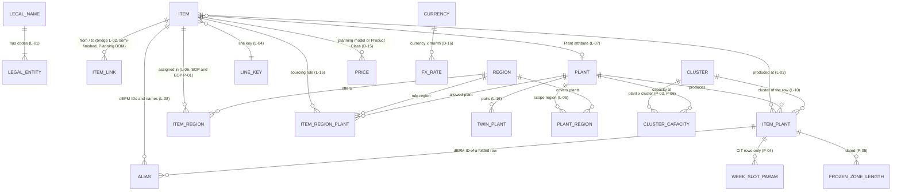
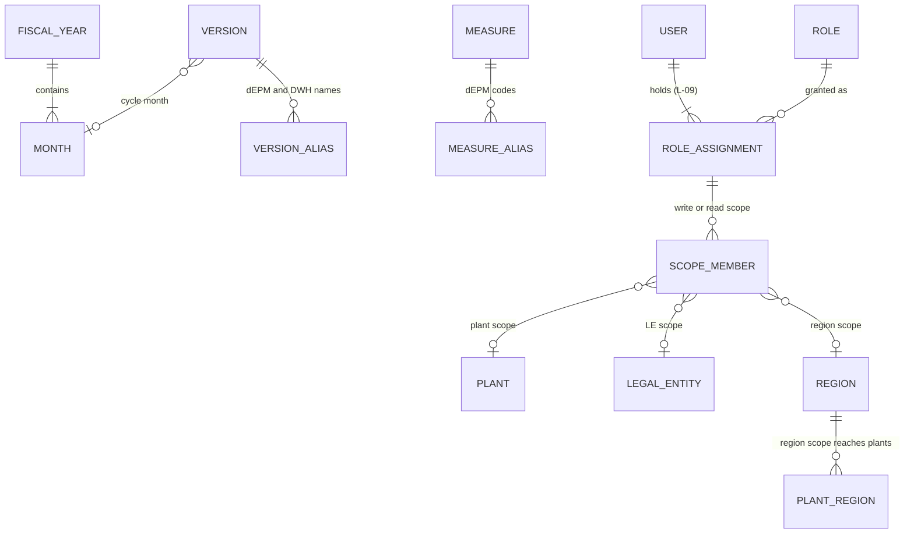
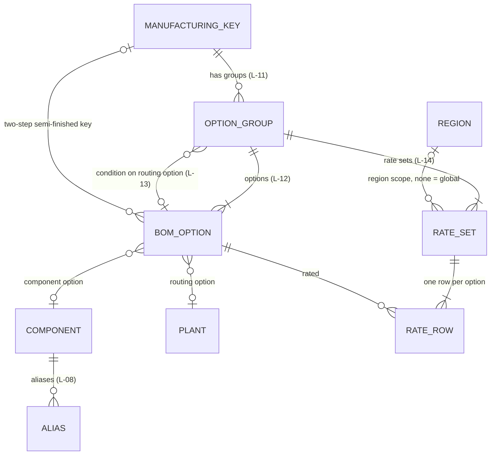
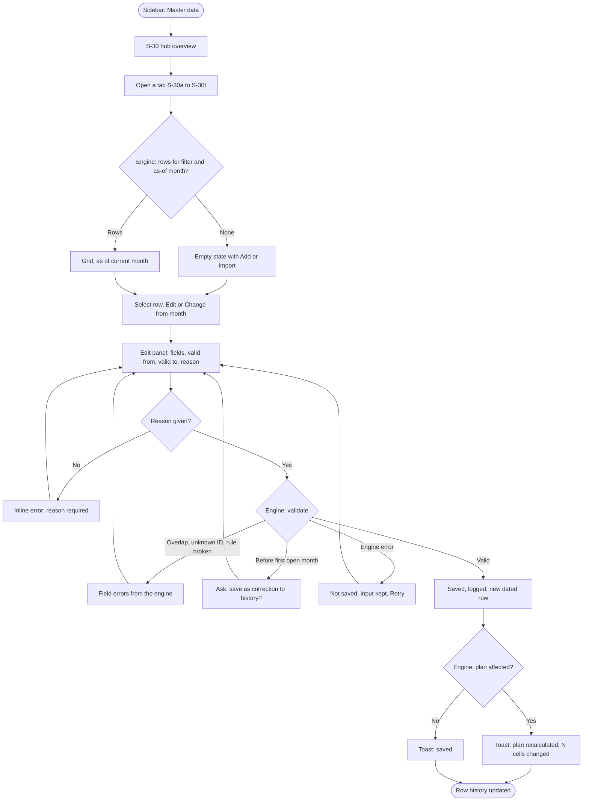
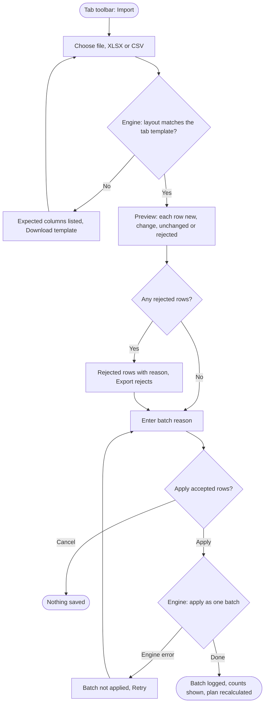
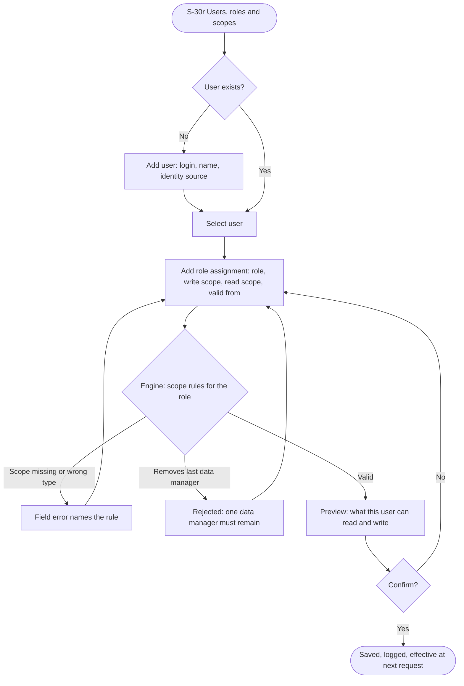
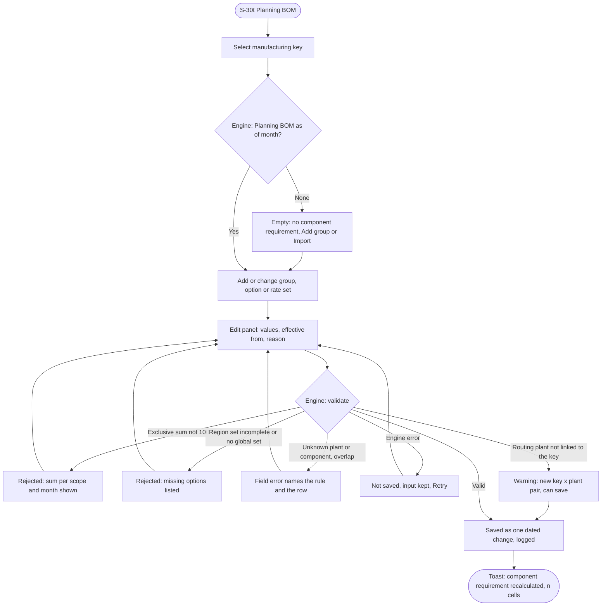
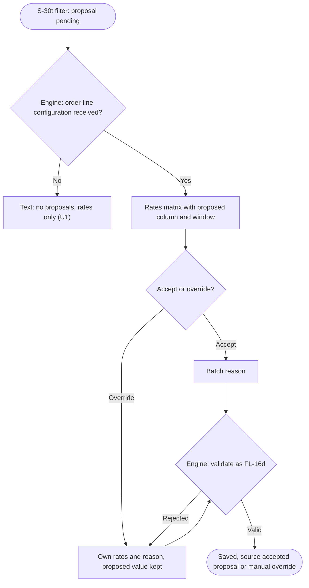
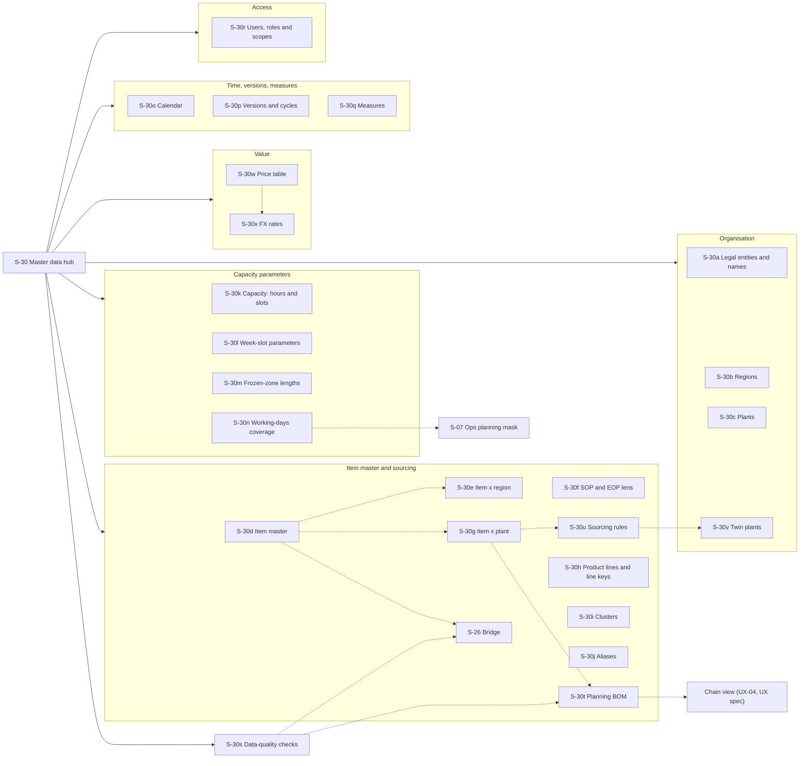

# Master-data specification — IBP M1 (DF-11)

- Slug: `ibp-m1`
- Run: `.concept-forge/20261005-0839-ibp-m1`
- Date: 2026-10-13 (first issue 2026-10-07)
- Scope source: `docs/concept/CONCEPT-ibp-m1.md`, revision 9.9.3 (approved scope). Driving requirement: **DF-11**. Rules taken from DF-02, DF-03, DF-04, DF-10, DF-12, DF-13, DF-14, CP-01, CP-02, CP-06, CP-07, CP-08, CP-09, NW-01, NW-03, NW-04, NW-06, NW-07, NW-08, UX-03, UX-04 and the T3 / T11 / T12 / T13 tables. Where this spec and the concept differ, the concept wins.
- Evidence: `.concept-forge/20261005-0839-ibp-m1/digests/master-data.md` (cited as "digest §n"). Every count in this document comes from the digest or the concept. Anything not in the evidence is marked **[AD]** (assumed design decision, open to change).
- Companion: `docs/spec/SPEC-ibp-m1-ux.md`. This document details screen **S-30 Master data**. S-30 is a tabbed hub with one tab per dimension or structure (S-30a … S-30x). The bridge stays on its own screen, **S-26**. The UX spec is not edited here; its S-30 wireframe, FL-16 and the Data manager row must be realigned to this document (MD-Q-15, decided: queued work). The UX spec references **S-30t Planning BOM** and owns the read view of the chain (UX-04).
- Revision 2026-10-08 (concept 9.8.2): the **Planning BOM** (NW-07) is added — dimension D-13 Component, links L-11 … L-14, rules EDR-11 … EDR-13, cubes C-13 and C-14, input I-03, flows FL-16d and FL-16e, tab S-30t, checks DQ-27 … DQ-35, questions MD-Q-18 … MD-Q-21.
- Revision 2026-10-13 (concept 9.9.3): **item master** (DF-12, T12) — D-04 becomes the one ITEM table with the four dated structures ITEM × PLANT, ITEM × REGION, ITEM × REGION × PLANT (sourcing rule, NW-08, T13) and ITEM LINKS; D-05 and D-13 become pointers; plant-suffixed MKs folded, plant-suffixed and `-BR` planning models merged, `-BA` planning models kept (Northfield). New master data: twin plants (D-14), price table (D-15, CP-09), FX rates (D-16, DF-14), full calendar (D-10, DF-13), cluster = Assembly Cluster = Manufacturing Category with hour and production-slot capacity at plant × cluster (D-07, P-03, P-06). New role: global supply planner; Operations co-edits capacity parameters and Planning BOM rates; Product Division read scope. Tail & Passenger Lifts (`Taillift`) are out of scope. MD-Q-1 … MD-Q-21 are decided (section 13). New tabs S-30u … S-30x; tabs S-30d, e, f, g, i, k, l, m, o, r changed (list at the end).

## Summary

M1 keeps master data in the tool. It is seeded once from the DWH dimension exports and then maintained by the S&OP data manager (DF-04, T3). Today no dimension carries a validity period, an owner or a change history (digest §5). The model links products, keys, plants and regions only through free-text attributes inside the dimension rows, never through relationships (digest §2.1). M1 changes both:

1. **Element ID is identity; the caption is a label.** Every join, link, import and scope uses the element ID. Captions and other names are dated aliases (DF-04).
2. **Effective dating everywhere it matters.** Attributes that change the plan carry a validity in months. A change opens a new dated row and never overwrites history (rule set EDR, below).
3. **Links are explicit, dated objects.** These include the PM ↔ MK bridge, ITEM × PLANT rows, regional sourcing rules, twin plants, plant → region, LE → Legal Name, ITEM × REGION (Region Model Assignment) and the **Planning BOM** (MK → option group → option → component or plant, with dated rates per MK × region). Each has a data-quality rule.
4. **One maintenance pattern for every dimension.** S-30 is a hub of tabs. Each tab has a grid, a filter bar, an edit panel with a required reason, inline validation, file import with preview, export, and a per-row history.
5. **The engine decides.** Validation, ID resolution, as-of reading, recalculation and access scope are server-side. The screen shows the result (UX-03, T2.10).

Counts: **16 dimensions and structures** (D-01 … D-16; D-05 and D-13 are pointers into D-04), **16 links** (L-01 … L-16), **7 parameter sets** (P-01 … P-07), **3 referenced inputs** (I-01 … I-03), **24 maintenance tabs** (S-30a … S-30x) plus the hub overview and the existing S-26, **38 data-quality checks**, **21 decided questions and 2 open pointers** (OQ-35, OQ-36).

## Contents

1. Roles and jobs
2. Effective-dating rules
3. Dimension catalogue
4. Links between dimensions (4.4: Planning BOM)
5. Cubes
6. User flows
7. Sitemap of the S-30 hub
8. Screen inventory (S-30 tabs)
9. Maintenance layouts (wireframes)
10. Data-quality checks
11. Contradictions in the evidence and how M1 handles them
12. UI principles specific to master data
13. Open questions

---

## 1. Roles and jobs

Roles follow concept T11. Access is authenticated and enforced on the server (UX-03).

| Role | Jobs on master data | Rights on S-30 |
|---|---|---|
| Data manager | Seed master data once and accept the seed report. Then maintain every dimension, link and parameter: the **item master** (ITEM, ITEM × REGION, ITEM LINKS; with the global supply planner ITEM × PLANT rows, default plant shares, sourcing rules and twin plants), the full calendar, **FX rates** monthly, the **price table**, users, roles, scopes and the plant → region assignment. Import the lists delivered by Operations (frozen-zone lengths, hour capacity) and by IT (users, U7). Maintain the **Planning BOM** (components, routing and component groups, options, conditions, rates; one global file) by import or by hand, and accept or override rate proposals once order-line configuration arrives (U1) **[AD]**. Work the data-quality list. | Edit all tabs |
| Global supply planner | Edit, with the data manager, the ITEM × PLANT rows of every MK (create, end-date, default plant shares), the **regional sourcing rules** (S-30u) and the **twin plants** (S-30v); edit frozen-zone lengths, capacity parameters and Confirmed production on every plant (T11). Writes no sales figure. Reads everything else. | Edit S-30g, S-30k, S-30l, S-30m, S-30u, S-30v; read the other tabs except S-30r |
| Ops planner | Operations on its own plants: **co-edits with the data manager** hour capacity and production-slot capacity at plant × cluster, Average Assembly Hours, week-slot parameters and the **Planning BOM rates** of MKs produced at its plants (MD-Q-8, UX-Q-24). Reads keys, plants, line keys, frozen-zone lengths and working-days coverage that drive the Ops planning mask (S-07) and the capacity checks (S-23). Delivers lists (zone lengths, hour capacity) to the data manager. | Edit S-30g (hours), S-30k, S-30l and the rates in S-30t for its plants; read the other tabs except S-30r |
| Sales planner | Read legal entities, regions, planning models, Region Model Assignment and SOP / EOP that shape the Sales masks (S-04, S-05, S-06). | Read all tabs except S-30r |
| Approver | Read the Region Model Assignment and SOP / EOP changes for the Portfolio Review (S-28, UX-Q-5). | Read all tabs except S-30r |
| Pilot operator | Read the seed report and the alias lists that drive fixture landing (DF-10 key resolution). | Read all tabs except S-30r |
| Manager, Regional Head, Corporate function (view only) | Read master data for orientation. Master data carry no plan values, so the plant / LE / region read scope does not filter them **[AD]**; a **Product Division** restriction (UX-03, MD-Q-6) does not hide master-data rows either. | Read all tabs except S-30r |

In M1, the data manager edits all master data **[AD]**, with two decided exceptions that follow T11: the **global supply planner** edits ITEM × PLANT rows, default plant shares, sourcing rules, twin plants, capacity parameters and frozen-zone lengths on every plant, and **Operations** (the ops planner on its plants) co-edits hour and production-slot capacity, Average Assembly Hours, week-slot parameters and Planning BOM rates (MD-Q-8, MD-Q-10, UX-Q-24). A user may hold several roles and switches the active one without signing out; any read scope may add a Product Division restriction. Planning BOM content comes from product management / Operations (U9) and lands through the data manager's single global import file (MD-Q-21).

---

## 2. Effective-dating rules (new design)

No dEPM dimension export has a valid-from, valid-to, owner or last-changed column (digest §5, checked across all columns of the five exports). The only dated master data on disk is the project's seed (`item_identifier`, `item_link`, `production_eligibility`, `edge`). The rules below are therefore new design **[AD]**, except where a concept requirement fixes them (DF-04 dated aliases, NW-01 dated edges with an as-of guard, NW-07 dated rates with an effective-from month).

| Rule | Statement |
|---|---|
| EDR-1 Granularity | Validity is kept in **months**. `valid_from` is the first month a row applies (YYYY-MM). `valid_to` is the last month it applies, inclusive. A blank `valid_to` means open-ended. Users and role assignments are the exception: they are dated by **day** and take effect at once. |
| EDR-2 No overlap | Two rows for the same key and the same dated attribute never overlap. Gaps are allowed. A gap in a **required** dated attribute is a data-quality finding for the months it covers (S-30s). |
| EDR-3 Change = new row | "Change from month m" ends the current row at m−1 and opens a new row at m. History is never overwritten. |
| EDR-4 Correction | A typo can be fixed in place on an existing row. The edit is marked "correction", needs a reason and keeps the old value in the log. |
| EDR-5 Past months | A `valid_from` before the first open month of the current cycle is accepted only as a correction with a reason. Closed months of closed cycles keep their snapshot (PR-03) and are never recalculated. The engine applies the change to open months only. |
| EDR-6 No delete | Rows are end-dated, never deleted. Element IDs are never reused or renamed. A member that is no longer used gets a `valid_to`. |
| EDR-7 Undated attributes | Descriptive attributes (captions, hierarchy labels, country, currency) hold their current value only. Every change is still logged with user, time, old value, new value and reason. |
| EDR-8 As-of reading | The engine reads the row valid in the **plan month of the cell** (for example, the frozen-zone length valid in month m governs month m). Screens open "as of" the current month, with a selector for another month or "all history". |
| EDR-9 Aliases | At any date, an alias value resolves to exactly one element ID of its type (DF-04). |
| EDR-10 Seeded rows | Rows created by the one-time seed have an open start (no `valid_from`), source "seed: <export>" and one logged seed batch. |
| EDR-11 Rate sets | Planning BOM groups, options and conditions follow EDR-1 … EDR-6 by month. Rates are kept as **rate sets**: one set = the rates of **all** options of one group, for one MK and one scope (global or one region), from one effective month (NW-07). A set applies until the next set of the same MK × group × scope starts (EDR-3: the earlier set ends at m−1). A set is saved, imported and rejected **as a whole**, never option by option. |
| EDR-12 Ambiguous overlap | The following are rejected on save and on import, and the message names the conflicting row: two rate sets of the same MK × group × scope with the same effective month; two routing groups of one MK valid in the same month; two options of one group on the same target (component or plant) in the same month; two conditions for one group in the same month. In an import, the conflicting rows and the whole rate set they belong to are rejected. |
| EDR-13 Structure change carries rates | Adding or end-dating an option of a group from month m needs new rate sets from m for every scope that group has (global and each region), saved in the same change. The edit panel opens those sets pre-filled with the current rates and the new option at 0 % **[AD]**. |

---

## 3. Dimension catalogue

Column legend for the attribute tables:

- **Type:** text, integer, decimal, boolean, month (YYYY-MM), enum, link (→ dimension).
- **Req:** required.
- **Mode:** *edit* = the data manager maintains it; *seed* = loaded once, then read-only; *derived* = computed by the engine; *system* = created by the tool.
- **Dated:** Y means it follows EDR-1 … EDR-6; N means it follows EDR-7.

### D-01 — Legal entity (Sales Division / company code)

- **Key:** element ID = `Company Code (E)` (for example `7800 (E)`), the value the fact column `DSALES_Division` carries (digest §1.4).
- **Source today:**
  - dEPM `DSALES_DIVISION`: 60 members, 58 "(E)" leaves.
  - Corporate view `dbo.vwt_att_company`, on a different server from `dmsnop`: 142 rows.
  - Seed / vault: 62.
  - Concept DC1 says "133 LNs".
- **Owner today:** `DSALES_DIVISION_WRITE` ("Control Entities"). **M1:** data manager.
- **Hierarchy:** Total > Acmelift Group (56) | JV (2) > entity code > `<code> (E)` (dEPM path, depth 6). The `Company` view adds a `Acmelift Group` grouping: Acmelift Group 124, EAU 11, JV 6, REL 1.

| Attribute | Type | Req | Mode | Dated | Validation | Example (evidence) |
|---|---|---|---|---|---|---|
| Element ID (`Company Code (E)`) | text | Y | seed | N | unique; never changed | `7800 (E)` |
| Company Code | text | Y | seed | N | unique (142 / 142); alphanumeric allowed (10 codes are non-numeric) | `1401CHB`, `GPO_Group` |
| Legal Name | link → D-02 | Y | edit | Y | exactly one Legal Name per code per month (L-01) | Acmelift Europe GmbH |
| Caption (`Company`) | text | Y | derived | N | `<code> - <Legal Name>` | `<code> - Acmelift Europe GmbH` |
| Country Code | enum (ISO 3166 alpha-2) | Y | edit | N | two letters; 35 distinct today | AT, US, CN |
| Dealer flag | enum Dealer / Third party | Y | edit | Y | one value | Dealer (16 in `Company`; see DQ-20) |
| Group membership | enum Acmelift Group / EAU / JV / REL | Y | seed | N | from `Company.Acmelift Group` | Acmelift Group |
| Currency | text | N | seed | N | 25 distinct today | — |
| Financial Region, Region Sales, Region Operations, Region HR | text | N | seed | N | descriptive only. **Never** used as the planning region (CP-06, DQ-16) | MARINE, EMEA |
| Plant (free text) | text | N | seed | N | descriptive only. It is not a link to D-08: 118 free-text values do not match plant IDs (digest §1.4) | `Stonebridge` |
| Active for planning | boolean | Y | edit | Y | seeded true where the LE carries plan facts **[AD]** (MD-Q-11) | true |
| Sort order (`OrderPosition`) | integer | N | seed | N | null on 9.8 % today | — |

Not carried **[AD]**: `Relevant for App Studio` (true on 59 of 60), the `*_sort` helper columns, `SAP Local / 2 / 3 Currency` (mostly `0`), and `Dealer Flag based on Legal Entity` (folded into Dealer flag).

### D-02 — Legal Name (LN)

- **Key:** tool-generated surrogate ID **[AD]**. Legal Name is not an element ID in dEPM. Caption = the Legal Name text.
- **Why first-class:** DF-02 makes LN a planning axis because one LN carries several codes. 6 Legal Names carry 16 of the 142 codes (digest §1.4). FMS and compare roll up by LN (SC-04, E8).
- **Cardinality:** 132 distinct in `dim_Company.csv`; the concept says 133 (DQ-10).

| Attribute | Type | Req | Mode | Dated | Validation | Example |
|---|---|---|---|---|---|---|
| LN ID | text | Y | system | N | unique | — |
| Legal Name | text | Y | edit | N | unique after trimming and case-folding; no control characters | Acmelift Asia Pacific Pte. Ltd. |
| Codes | list of D-01 | — | derived | — | count of codes valid in the as-of month | 2 |
| Country | enum | N | derived | — | from the codes; shows "mixed" if the codes differ | SG |

### D-03 — Region (DSALES_Region)

- **Key:** element ID (`ID`), 92 rows, the same view in both Power BI models (digest §1.5).
- **Source:** dEPM `DSALES_Region`. **Owner today:** `DSALES_REGION_WRITE` ("Control Regions"). **M1:** data manager.
- **Hierarchy:** Total (L-0) > All Sales Regions / Dummy / SPV (L-1) > region (L-2: LATAM 30, EMEA 26, APAC 16, CIS 13, NAM 4, Global 1, `SPV (E)` 1) > sub-region (L-3, 23 names, for example CENTRAL AMERICA) > country (L-4, 76 names). The flat `Region` attribute has 7 values.
- **Rule:** region is an independent axis. It is never derived from the LE or the plant (DF-02, CP-06). A fact row with region `-` keeps `-`.

| Attribute | Type | Req | Mode | Dated | Validation | Example |
|---|---|---|---|---|---|---|
| Element ID | text | Y | seed | N | unique; system members `-`, `Dummy`, `SPV`, `Global` kept and locked | — |
| Caption | text | Y | edit | N | non-empty | CHINA |
| Parent | link → D-03 | Y (except Total) | edit | Y | no cycles; parent level = own level − 1 | NORTH ASIA (L-3) |
| Level | enum L-0 … L-4 | Y | derived | — | from the path | L-4 |
| Region (scope level) | enum | Y for L-2 and below | derived | — | the L-2 ancestor; this value is used by region scopes (L-09) **[AD]** | APAC |
| Planning region | boolean | Y | edit | Y | marks the members the masks offer as region coordinates **[AD]** (MD-Q-2). Planning BOM region rate sets (L-14) are offered on the same members | true |
| Sort order | integer | N | seed | N | — | — |

Not carried: `Region Flag` (all False in three dimensions, digest §2.3).

### D-04 — Item master (ITEM and its structures; DF-12, T12)

- **One ITEM table.** One row per item, whatever its classification: **planning model** (`DSALES_Product`), **finished good / MK** (`DMANUFACT_Key`), **semi-finished**, **component**, **phantom** (an SAP phantom assembly: in the BOM, not stocked, its components passing through to the parent). A planning model and an MK are never one row: they are two items joined by a bridge link (N:1 YCRANE, 1:N, one-sided IDs, semi-finished keys, components).
- **Key:** origin + element ID (DF-04). Origin = the dEPM dimension (`DSALES_Product`, `DMANUFACT_Key`), "folded" (an MK item folded from plant-suffixed keys), "merged" (a planning-model item merged from plant-suffixed or `-BR` planning models whose base ID does not exist) or "tool" (components, phantoms). A planning model and an MK with the same ID string (374 1:1 identical) stay two items.
- **Cardinality (before fold and merge):**
  - Planning models: 1,888 rows in the DWH view (286 "(E)", 1,602 others); 1,660 in the dEPM export; 1,661 in the seed.
  - MKs: 1,365 rows in the DWH view (119 "(E)", 1,246 leaves); 1,345 in the dEPM export; 1,346 plus 3 semi-finished in the seed.
  - How many IDs fold or merge, and how many items result, is counted in Phase 5 (DQ-36). Counts stay as measured; none is invented.
- **Source:** the SAP S/4 material master feeds Product Division, Product Class, Assembly Cluster and Sales Reporting Unit into dEPM; dEPM adds `Linked Manufact Key` and `Targeted Plant`. **Owner today:** `DSALES_PRODUCT_WRITE` ("Control Models") and OLAP role `DMANUFACT_KEY`. **M1:** data manager; ITEM × PLANT and the sourcing rule with the global supply planner.
- **Scope:** Tail & Passenger Lifts (product line `Taillift`; 80 of 996 models in the parameters cube, U11) and any passenger-lift model are excluded from the seed and from every check [concept 9.9.3]. Their history stays in the DWH.
- **Hierarchies:** sales (Product Division > Product Category > Product Class > Planning Model, "Global Product Hierarchy") for planning models; manufacturing (Product Line > Manufacturing Category > Manufacturing Key Name, plus the technical ragged path L-0 … L-6: Group > LAND (1,236) | SEA (129) at depth 6-8) for MKs and semi-finished items; Ops "Product Line", one level. M1 keeps all as named hierarchies over the same attributes **[AD]**.
- **Caption drift:** planning-model ID differs from the caption in 640 of 1,888 rows, 434 rows share a caption; MK ID differs from the name in 463 rows, 157 rows share 70 names. Joins use the ID only.
- **Seed:** once from the DWH dimension exports, the DWH primary (MD-Q-5, decided). The 28 MK IDs with a `-BA` pattern are seeded as items of classification **semi-finished** (never created by hand); Phase 5 checks the 3 Basic Assemblies (B11) against them and lists the 28 for the data manager to confirm before Phase 6 links them *(inference: selected by regex)*.

**(1) ITEM — attributes**

| Attribute | Type | Req | Mode | Dated | Validation | Example (evidence) |
|---|---|---|---|---|---|---|
| Element ID | text | Y | seed / edit (new members) | N | unique per origin (1,888 / 1,888 and 1,365 / 1,365 before fold and merge); immutable; a component or phantom ID must not equal any other item or plant ID | `PHT22 SLD`, `CIT-11-01-000` |
| Origin | enum DSALES_Product / DMANUFACT_Key / folded / merged / tool | Y | system | N | set at creation | folded |
| Caption | text | Y | edit | N | non-empty (null on 1 MK row today, DQ-04); a duplicate caption is allowed with a warning | Aerial Work Platforms |
| Classification | enum planning model / finished good (MK) / semi-finished / component / phantom | Y | seed / edit | N | decides which structures apply (see "Which classification uses which structure"); the 28 `-BA` MK IDs seed as semi-finished | semi-finished |
| Member type | enum leaf / consolidation | Y | derived | — | "(E)" suffix = consolidation (line keys and cluster keys are "(E)" MKs) | leaf |
| Parent | link → D-04 | Y (except Total) | edit | Y | no cycles | `Wind (E)` |
| Product Line | text (→ D-06) | N for planning models, Y for MKs | edit | N | must match a D-06 product line when set; 19 values on MKs; null on 16 planning models today | Crane |
| Line key | link → D-06 | Y for MKs | derived (L-04) | — | `Product Line + " (E)"`, else the L-2 ancestor (DF-04) | `Crane (E)` |
| Product Division / Category / Class | enum (14 / 48 / 106) | N | seed (SAP) | N | null on 41 / 70 / 231 leaves today; shown "(unassigned)" in roll-ups | Loader Cranes |
| Assembly Cluster (planning model) | text (78) | N | seed | N | descriptive; read by the sales cluster filter (UX-05); the same concept as D-07 | Hooklifts & Skip Loaders Westvale |
| Manufacturing Category (MK) | text (81) | N | seed | N | `-` on 12 rows shown "(none)"; per plant it becomes the cluster of the ITEM × PLANT row (structure 2) | Platforms Italy |
| WSC Group / Planning Family; Reporting product line (PLM) | text (49 / 22) | N | seed | N | descriptive; PLM value trimmed (DQ-08) | Tractor unit |
| Plant (supplying plant attribute) | link → D-08 | N | edit | Y | resolves to a plant ID or alias at the as-of month; `Dummy Plant` allowed and flagged. **Read only as the single-plant check and the seed fallback of the default plant shares (CP-07)**; a routing group (L-11) or a sourcing rule (L-15) takes precedence | Westvale |
| Targeted Plant | link → D-08 | N | seed | N | descriptive; differs from supply in 38 of 490 pairs (P11) | — |
| Linked item (planning model ↔ MK) | link | — | derived from L-02 | — | read-only here; maintained on S-26 **[AD]** | `TEC (E)` |
| Market suffix | enum none / NAM / LATAM | — | derived | — | from "(NAM)" / "(LATAM)" in the caption (42 rows) | NAM |
| Sales model, Sales model description | text | N | seed | N | `-` on 15 / 24 MK rows | — |
| Key family | enum (leaf, line key, cluster, CIT, `-BA`, plant-suffixed, semi-finished) | Y for MKs | derived | — | from the ID pattern and the hierarchy; `-BR` and plant-suffixed keys now appear only as aliases | CIT |
| Product Line Flag, Manufacturing Cluster Flag | boolean | — | derived / seed | N | cluster flag true on the 3 Basic Assemblies | true |
| Component type | enum part / assembly / feature | Y for components | edit | N | "feature" = a non-physical choice such as a **colour** (MD-Q-19, decided); a routing option is a component only when declared | part |
| Unit | enum each | Y for components | system | N | the requirement counts units of the component per unit of the MK **[AD]** | each |
| Proposed state | enum proposed / accepted | — | system | — | new-item proposal state of PR-04 (Portfolio Review) | accepted |
| Sort order | integer | N | seed | N | kept (MD-Q-13); German labels not carried | — |
| Valid from / Valid to | month | N / N | edit | Y | an option may use a component only inside its validity; end-dating an item used by a valid link is rejected until the link is end-dated | 2027-01 / — |

Not carried **[AD]**: `SalesModelDescription` on planning models (99.9 % null), `Valid WSC Product Group` (one value), `Is product line` (replaced by D-06), `Manufacturing Family` (1,364 of 1,365 null), `LangDE`; the one-value `item.region` and `item.is_active` columns (replaced by structure 3).

**(2) ITEM × PLANT — dated; the plants at which an MK or a semi-finished item is produced**

The row's existence replaces L-03 and `production_eligibility`; there is no region scope and no priority. Seeded once from the distinct MK × plant pairs of the ops Confirmed history (MD-Q-10, decided), plus the suffix plants of folded keys.

| Attribute | Type | Req | Mode | Dated | Validation | Example |
|---|---|---|---|---|---|---|
| Item, Plant | link → D-04, D-08 | Y | seed / edit | Y | the pair is unique per month; a plant outside the rows reached by override, alias pin, Confirmed row, routing option, sourcing rule or single-plant `Plant` is accepted and flagged "new key × plant pair" (CP-07, AC5), never rejected | `CIT-11-01-000` × Oakridge |
| Default plant share (P-07) | percent | Y when the item has more than one row | edit | Y | rows of one item in one month sum to 100 %, else the save is rejected; **seed** = share of Confirmed units per plant over the last 12 closed months (suffix plant for a folded item, fact plant where the ID has no suffix); no history → 100 % on the plant of the product `Plant` attribute if it is one of the rows, else the item falls to UNASSIGNED. Changeable by the global supply planner and the data manager (MD-Q-10) | 70 % |
| Cluster | link → D-07 | Y | seed / edit | Y | = Manufacturing Category = Assembly Cluster (one concept, MD-Q-1); seeded from the MK ID's Manufacturing Category, per suffixed ID for a folded item | Platforms Italy |
| Average Assembly Hours (P-02) | decimal ≥ 0 | Y | edit | Y | 0 means "no hours, hours check skipped" (DQ-12); seeded on every plant row of the item; edited by the data manager and the ops planner of the plant | 0 on 643 of 1,246 leaves |
| Week-slot parameters, slot-equivalence factor (P-04) | integer weeks 2-8, decimal | Y on CIT rows | edit | Y | only on the 62 CIT ITEM × PLANT rows (one per CIT key and plant) | 4 |
| Frozen-zone length (P-05) | integer ≥ 0 working days | N | edit / import | Y | given by Operations **per MK × plant** (MD-Q-7, decided); a length given for an MK without a plant is written to every plant row of the item **[AD]**; empty until the list arrives (U4) | — |
| Other MK-specific attributes | text | N | seed | N | e.g. Manufacturing Cluster Flag | — |

**(3) ITEM × REGION — dated; Region Model Assignment and SOP / EOP (planning models)**

Per planning model × region (the L-2 node, CP-06): Region Model Assignment (active, phase-in month, phase-out month) and SOP / EOP months. Replaces `item.region`, `item.is_active`, L-06 and P-01. **Seed (MD-Q-4, decided):** from the dEPM parameters cube, `Parameter table.xlsx` (U11), which holds, per model and region, an assigned yes / no flag and start / end of production; the `Taillift` models are left out. Until the cube is exported: the planning model × region pairs with plan facts in the last cycle, SOP / EOP empty. A sales row on a planning model × region without an active row lands, is flagged "outside Region Model Assignment" and counted, never rejected (CP-06). The ITEM × REGION of a merged planning model is the union of the merged IDs' rows (SOP the earliest, EOP the latest, differences listed).

**(4) ITEM × REGION × PLANT — dated; the regional sourcing rule (NW-08, T13)**

Per MK × region (L-2) × plant: **allowed** (the row exists), **priority** (1 = preferred; one preferred per MK × region × month), optional **default share** (where any row of an MK × region × month carries a share, the shares sum to 100 % on save, a row without a share counting 0 %). Used at CP-07 tier 3. Maintained on S-30u by the global supply planner and the data manager; seeded only where history names a plant on the demand side (merged aliases, last 12 closed months) plus the two seeded rules base model × NAM → Niagara preferred and base model × LATAM → Pinecrest do Sul preferred (concept 9.9.3). Tool-only: not written to the handoff file.

**(5) ITEM LINKS — typed and dated; one mechanism for every relation between items**

| Type | From → to | Weight / quantity | Other fields | Old ID |
|---|---|---|---|---|
| bridge | planning model → MK | weight, percent (0-100); a PM's weights sum to 100 % per month; 1:N weights seeded at equal shares, flagged | two-axis class (B1-B12); **no plant qualifier** (retired in 9.9.2) | L-02 |
| semi-finished | MK → semi-finished | quantity per finished unit (> 0; 1 unless Operations says otherwise **[AD]**) | offset (2 months), finishing-plant qualifier, supplying ITEM × PLANT row by plant ID; the only carrier of a two-step, `-BA` included (NW-03); key + finishing plant confirmed (MD-Q-20) | L-02 / L-12 two-step |
| routing option | MK → an ITEM × PLANT row of the same MK, by plant ID | rate, percent | routing group, declared-as-component flag; never a two-step | L-11, L-12, L-14 |
| component option | MK or semi-finished → component or phantom | rate (exclusive group) or attach rate, percent | component group, condition on a routing option, offset | L-11 … L-14 |
| phantom explosion | phantom → component or phantom | quantity per phantom unit (> 0) | offset (default 0); cycle check over overlapping validities | — (new) |

The **Planning BOM** (NW-07) is the configuration part of ITEM LINKS: the routing-option and component-option links of one MK or semi-finished item, grouped into option groups with rate sets per MK × region and global, plus the phantom-explosion links beneath. Bridge and semi-finished links are not options (fixed weight or quantity, no group, no regional rate set). Both share dating, as-of guard, log and maintenance pattern (S-26 for the bridge, S-30t for the Planning BOM).

**Which classification uses which structure.** Planning model: ITEM, ITEM × REGION, outgoing bridge links. Finished good / MK (line and cluster "(E)" keys included): ITEM, ITEM × PLANT, ITEM × REGION × PLANT, incoming bridge links, outgoing semi-finished, routing-option and component-option links. Semi-finished (the 3 Basic Assemblies and the 28 `-BA` keys among them): ITEM, ITEM × PLANT, incoming semi-finished links, outgoing component-option links. Component: ITEM, incoming component-option and phantom-explosion links; no ITEM × PLANT in M1. Phantom: ITEM only, incoming component-option or phantom-explosion links, outgoing phantom-explosion links; no plan row, no stock; on save a phantom without children is rejected, and so is a cycle of phantom-explosion links in any month in which all links of the cycle are valid.

**Fold and merge rules (concept T12; fold and merge rule [AD])**

- **Plant-suffixed MK IDs are folded.** An MK ID `<stem>_<plant>` whose suffix resolves to a plant ID or alias becomes, with every other ID on the same stem, one MK item (element ID = the stem, origin "folded") with one ITEM × PLANT row per suffix plant; a stem that also exists unsuffixed is that same item. Expected to match the 62 CIT keys (all `CIT-nn-nn-nnn_<Plant>`) and the 13 plant-specific leaves (B5) *(inference: suffixes not resolved against the plant list)*; Phase 5 counts it. Each dEPM ID is a dated alias of type "dEPM ID" **of its ITEM × PLANT row**.
- **Plant-suffixed and `-BR` planning models are merged** into one planning-model item per stem (element ID = the stem; origin `DSALES_Product` if the stem exists, else "merged"). Each merged dEPM ID is a dated alias **of (planning model, plant)**: the suffix plant, or Pinecrest do Sul for `-BR`. The stem's own ID is the alias of (planning model, every plant without its own alias). A suffix that does not resolve to a plant is not merged and is listed. The 13 `-BR` MK IDs fold into the base MK as aliases of (base MK, Pinecrest do Sul); `-BR` MKs whose base MK does not resolve are listed with volume.
- **`-BA` planning models are kept** (21, all NAM): each stays a planning model of its own, **sourced at Northfield**; the base planning model's NAM demand goes to Niagara by the seeded NAM rule; Northfield and Niagara are twin plants (D-14). Pairing of the 28 `-BA` MK IDs with the 21 planning models is not given by the evidence; Phase 5 counts and lists it (OQ-35).
- **dEPM IDs as aliases (L-08).** At any date an alias resolves to exactly one item, ITEM × PLANT row or (planning model, plant) (EDR-9). History landed on a merged alias is pinned to the alias plant ("alias pin", CP-07 tier 1); on fixture cycles only. The handoff file (AC24) writes rows under the alias of their row, so dEPM receives the IDs it holds today; no ID is invented, units without a dEPM ID are listed "no dEPM ID".

**ID mapping from earlier revisions (sections 4.4, 5 and 6 still use the old names where they say "MK", "plant list" or "component dimension"; read them through this table).**

| Earlier ID | Now |
|---|---|
| D-04 Planning model, D-05 Manufacturing key, D-13 Component | classifications of the ITEM table (this section) |
| L-02 bridge | ITEM LINKS type bridge (S-26) |
| L-03 MK → plant, P-02, P-05 (and the plant-key parameters) | ITEM × PLANT |
| L-06, P-01 | ITEM × REGION |
| L-07 product `Plant` attribute | ITEM attribute; single-plant check and seed fallback only |
| L-11 … L-14 | ITEM LINKS types routing option, component option, phantom explosion (Planning BOM) |

### D-05 — Manufacturing key (pointer)

An MK is an ITEM of classification finished good (D-04). Its attributes (Product Line, line key, Manufacturing Category, key family, flags) are in the ITEM table; its plants, default plant shares, cluster, Average Assembly Hours, week-slot parameters and frozen-zone length are ITEM × PLANT rows; its sourcing rule is ITEM × REGION × PLANT; its Planning BOM is ITEM LINKS. Plant-suffixed MK IDs are folded into one item; the `-BA` keys are semi-finished items; `-BR` MK IDs are aliases of (base MK, Pinecrest do Sul). Maintenance tabs: S-30d (ITEM), S-30g (ITEM × PLANT), S-30u (sourcing), S-30t (Planning BOM).

### D-06 — Product line and line key

- **Key:** line-key element ID `<Product Line> (E)` (for example `Crane (E)`). Line keys are members of D-05. This dimension is the curated list of them **[AD]**.
- **Evidence (digest §1.2):**
  - The MK `Product Line` attribute has 19 values: 14 named lines (Crane 381, Platform 289, HL 168, RW 73, TMF 65, Boats 64, Installations 63, TR 46, Davits 31, MWC 19, SE 18, OLHS 15, PCC 13) and 5 other values (`Cluster 11`, `Cluster 12`, `Cluster 13`, `Building Material`, `Crane-Tipper`).
  - 17 of the 19 have a matching `(E)` ID. The three `Cluster 1x` values do not.
  - The product view's `Product Line` has 16 values.
  - The concept counts 14 line keys (NW-06, C3).
- **Use:** Working Days are entered at plant × line key (I-01). Line-key rows are max roll-ups, never summed with leaves (NW-06). Production on a line key is load "unassigned to a manufacturing key".
- **Scope (concept 9.9.3):** `Taillift` (112 keys above) is out of scope and is not seeded. The 14 planning lines of MD-Q-17 (decided) were counted with it; Phase 5 recounts the planning lines after the exclusion and the data manager confirms the list **[AD]**.

| Attribute | Type | Req | Mode | Dated | Validation | Example |
|---|---|---|---|---|---|---|
| Line key ID | link → D-05 | Y | seed | N | must exist as a D-05 "(E)" member | `Crane (E)` |
| Product Line name | text | Y | edit | N | unique | Crane |
| Is planning line | boolean | Y | edit | Y | true for lines that get Working Days rows; seeded true for the 14 named lines **[AD]** | true |
| Fallback rule used | boolean | — | derived | — | true when keys of this line resolve through the L-2 fallback | false |
| Keys | count | — | derived | — | leaf MKs mapped to this line (as of month) | 381 |
| Plants | list → D-08 | — | derived | — | plants with an L-03 link for any key of the line | — |

### D-07 — Cluster (= Assembly Cluster = Manufacturing Category)

- **One concept (MD-Q-1, decided; concept DF-12, NW-06).** What the Power BI models call **Assembly Cluster** (78 values on planning models) is what INFOR calls **Manufacturing Category** (81 values on MKs); planners call both the *cluster*. D-07 is the single value list. It replaces the earlier definition "a non-line (E) MK member" **[AD]**, which is retired.
- **Where it lives.** On each planning model the cluster is a descriptive ITEM attribute read by the sales cluster filter (UX-05). On an MK the cluster is an attribute of the **ITEM × PLANT row**, seeded from the MK ID's Manufacturing Category (per suffixed ID for a folded item). The Ops planning mask shows "Region × product line × plant (cluster rows)" (A1b); cluster rows are filters and groupings, not keys.
- **Capacity at plant × cluster (MD-Q-16, decided; NW-06).** **Hour capacity** (P-03) and **production-slot capacity** (P-06) are master data of the pair plant × cluster × month. Hour capacity is seeded from `AssemblyCapacity_hours` history (603,944 rows): if the leaf values inside a plant × cluster × month are equal, that value, else their sum, flagged **[AD]**. Production-slot capacity is seeded by summing the per-key history. The measured history (73 non-line "(E)" leaf keys with own capacity, 14 line keys as max roll-ups) is the seed and verification baseline. The Cluster average max capacity per day and Working Days stay Ops inputs (DF-10, I-01, I-02).

| Attribute | Type | Req | Mode | Dated | Validation | Example |
|---|---|---|---|---|---|---|
| Cluster value | text | Y | seed | N | unique after trimming; `-` shown "(none)" | Platforms Italy |
| Aliases | list | N | edit | Y | the Assembly Cluster spelling and the Manufacturing Category spelling resolve to one value (EDR-9) | — |
| Plant | link → D-08 | Y per capacity row | edit | Y | a cluster × plant pair exists when at least one ITEM × PLANT row carries it | Northfield |
| Line key | link → D-06 | — | derived | — | via the Product Line of the member items | — |
| Member items (L-10) | list → D-04 | — | derived | — | ITEM × PLANT rows with this cluster as of month | — |
| Hour capacity (P-03) | decimal ≥ 0 | Y per plant × cluster | edit | Y | hours per month; missing months counted | — |
| Production-slot capacity (P-06) | decimal ≥ 0 | Y per plant × cluster | edit | Y | slots per month; line-key rows are max-rollups, never summed with leaves | — |

### D-08 — Plant (DPLANT)

- **Key:** element ID (`ID`). The ID differs from the caption in 49 of 51 rows (ID `Lotusbay` vs `Lotusbay (VN)`; ID `-` = `Dummy Plant`).
- **Cardinality:** 51 in the DWH view and the dEPM export; 52 in the seed and about 52 in the vault.
- **Source:** dEPM. **Owner today:** `DPLANT` ("Control Plants"). **M1:** data manager.
- **Hierarchy:** Acmelift Group / External (L-1) > LAND (39) | SEA (8) | EXTERNAL (3) (L-2) > region node (L-3, 12 names) > plant. "Plant Hierarchy" = Group > Region > Plant.
- **Capacity:** no capacity attribute exists today. `Max Slots` is a DAX literal (30 for Westvale, 8 for the others), per digest §1.3. DF-06 realigns the seed to these literals.

| Attribute | Type | Req | Mode | Dated | Validation | Example (evidence) |
|---|---|---|---|---|---|---|
| Element ID | text | Y | seed / edit (new) | N | unique (51 / 51); `-` locked | `Lotusbay`, `Eastbrook SEA` |
| Caption | text | Y | edit | N | a duplicate caption is warned (`Eastbrook (SI)` appears twice) | Lotusbay (VN) |
| Plant Code | text | N | edit | N | unique when present (`1151` appears twice today, DQ-14); null on 25.5 % | 1151 |
| Segment | enum LAND / SEA / EXTERNAL | Y | seed | N | from the path | LAND |
| Region (descriptive) | enum | N | seed | N | dEPM `Region`: EMEA 23, NAM 8, APAC 6, null 5 | EMEA |
| Scope regions (L-05) | list → D-03 | N | edit | Y | see L-05; seeded from the descriptive Region **[AD]** | EMEA |
| Plant type | enum own / subcontractor / external | Y | edit | Y | subcontractors are typed plants (NW-06, AC2); seeded `external` for the 3 External plants, `own` otherwise **[AD]** (MD-Q-9) | own |
| Plant Activity | text (9 codes: F-P-A-I, F, A, …) | N | seed | N | meaning of the letters unknown (MD-Q-3) | F-P-A-I |
| Week-slot maximum (P-04) | integer ≥ 0 | Y | edit | Y | seeded 30 for Westvale and 8 for every other plant (DF-06) | 30 |
| Twin plant (D-14) | link → D-08 | — | derived | — | the dated twin of the plant, read-only here; edited on S-30v | Niagara (twin of Northfield) |
| Country suffix | text | — | derived | — | from the caption, for example `(AT)` | AT |
| Sort order | integer | N | seed | N | null on 5.9 % | — |

Seed-only attributes not carried until the architect needs them **[AD]**: `layout_type` and `slot_granularity_factor`. They have no real source (digest §4).

### D-09 — Version and cycle (DVERSION)

- **Identity (DF-03):** (cycle, side, instance) | reference type | scenario | common plan, with origin `loaded` | `published` and a sequence number. Names are aliases, never keys.
- **Evidence:**
  - dEPM `DVERSIONS`: 465 members, of which 432 are cycle instances `SOP_yyyy_mm_(DEMAND_P|DEMAND_R|SUPPLY_A|SUPPLY_C)` for 2018-01 … 2026-12 and 33 are other members (SOP_SEP 8, SOP_MTP 5, SOP_BP 4, Budget_Forecast 13, `I`, `I_Back_up`, `-`).
  - Power BI Sales `Version 1`: 185 members (P 80, R 80, Budget 21, ACT 2, RFC 2).
  - Power BI Ops: 153 members (A 69, C 68, Budget 15, ACT 1).
  - Seed: 466.
- **Maintenance:** the tool creates cycle versions (common plan, publish). The data manager maintains only the aliases and the reference type of loaded references **[AD]**.

| Attribute | Type | Req | Mode | Dated | Validation | Example (evidence) |
|---|---|---|---|---|---|---|
| Version identity | composite | Y | system | N | unique on identity, not on name (DF-03) | (2026-08, demand, R, published, 1) |
| Kind | enum cycle instance / reference / common plan / scenario | Y | system | N | — | cycle instance |
| Cycle month | link → D-10 | Y for cycle kinds | system | N | — | 2026-08 |
| Side / instance | enum demand P / R, supply A / C | Y for cycle kinds | system | N | — | R |
| Origin, sequence | enum loaded / published; integer | Y | system | N | one current published version per cycle × instance (SC-07) | published, 1 |
| dEPM alias | text | N | edit (references) / derived (cycles) | N | unique per date (EDR-9) | `SOP_2026_08_DEMAND_R` |
| DWH / Power BI alias | text | N | edit (references) / derived (cycles) | N | unique per date | `CYCLE 08 2026 R` |
| Reference type | enum Actual / Budget / Business plan / SEP / MTP / RFC / Commitment / Forecast / Other | Y for references | edit | N | seeded from the name pattern **[AD]** | Business plan (`SOP_BP_2026`) |
| Valid budget version | link → D-09 | N | seed | N | null on 143 of 465 today | `SOP_BP_2026` |
| First planning year / month | integer / month | N | seed | N | null on 3 of 465 | 2026 / 01 |
| Lock state | enum open / closed | Y for cycle kinds | system (PR-03) | N | aliases `STAT_02` / `STAT_03` | open |
| Superseded | boolean | — | system | — | true when a re-publish replaced it | false |

Not carried: `Date from Cycle` (garbled for the 25 non-cycle rows, DQ-18) and `Link to IMRS Budget Version` (null on 77.4 %) **[AD]**.

### D-10 — Calendar (day, ISO week, month, year; DF-13)

- **Grain (MD-Q-12, decided; DF-13):** one calendar master at **day** grain with **ISO 8601 calendar week** (CW01-CW53), **month** and **year**, replacing the month-only `DIM_DATE` (120 months, 2019-01 … 2028-12). **CW53** exists only in years that ISO 8601 gives 53 weeks (for example 2020 and 2026); no empty CW53 element in other years **[AD]**. A week belongs to the month holding its Thursday **[AD]**; the data manager may reassign a week (logged, dated). The hand-reconfigured `TWSC_PAR_CALWEEK` map is not reproduced (no weekly plan in M1).
- **Generated** for the history window and the horizon. Power BI uses a daily `CALENDARAUTO()` with no fiscal, working-day or cycle column (digest §1.7).
- **Fiscal year = calendar year**, confirmed by the user (gate2r12). **Plan horizon** = the open months of the current FY plus the whole next FY: 24 months in January, 13 in December (CP-01). The closed months of the current FY carry actuals and are read-only.
- **Read by** the month buckets and the horizon (CP-01), the Operations Orderbook order dates (day → month), the frozen-zone end (CP-08), installation week-slots counted in weeks (NW-06), logs and the handoff months. Working Days stay an Ops input per plant × line key × month; per-plant holiday calendars are not in M1 **[AD]**.
- **Owner:** data manager (T3, T11).

| Attribute | Type | Req | Mode | Dated | Validation | Example |
|---|---|---|---|---|---|---|
| Day | date | Y | system | N | unique; continuous | 2026-12-31 |
| ISO week | text CWnn + ISO year | Y | derived | — | CW53 only in 53-week ISO years | 2026-CW53 |
| Week → month assignment | link | Y | derived, editable | Y | Thursday rule; reassignment needs a reason | 2026-CW53 → 2026-12 |
| Month | month | Y | system | N | unique; continuous sequence | 2026-09 |
| Year / fiscal year | integer | Y | derived | — | = calendar year (FY start month fixed to January) | 2026 |
| Fiscal month number | integer 1-12 | Y | derived | — | = calendar month | 9 |
| Quarter | enum Q1-Q4 | Y | derived | — | — | Q3 |
| Month state for a cycle | enum closed (actual) / open (plan) / outside horizon | — | derived (per cycle) | — | from CP-01 | open |
| Fiscal year record | FY, start month, end month, status (open / future / closed) | Y | edit (add next FY; close) | N | FYs are contiguous; a FY can be closed only after its last cycle is closed | FY 2027: 2027-01 … 2027-12 |

### D-11 — Measure

- **Evidence:**
  - `DMEASURE_Demand`: 8 codes referenced in DAX (`Invoiced_units`, `OrderIntake_Units`, `OrderBook_units`, `Inventory_units_end`, `Inventory_units_conf_end`, `production_units_total`, `production_units_C`, `FMSRate_calc`), plus `FMSRate_conf_calc` in the facts and 6 measures in the plan export.
  - `DMEASURE_OPS`: 14 codes (GAP, Inventory, Capacity_avg_max, InvoicedUnits, Production_units_R_Total, Production_units_C_Total, GAP_CM, UnitsBAT_calc, AssemblyHours, AssemblyCapacity_hours, ShiftPlan, OrderBook_units, working_days, AssemblyCapacityIndication).
  - The seed has 11 + 15 measures, which differ from the real ones (digest §1.8, §3.2).
- **M1:** the measure catalogue is the to-be list of concept T3, with the dEPM codes as aliases for fixtures and the handoff file. It is **read-only** in M1 **[AD]**. The catalogue ships with the release, including the "i" definition texts written by the UX designer (UX-01). From concept 9.8 it also lists the component requirement (C-13).

| Attribute | Type | Req | Mode | Example |
|---|---|---|---|---|
| Measure ID | text | Y | system | `SALES_INVOICES` |
| Label | text | Y | system | Sales / Invoices |
| Side | enum sales / ops / both | Y | system | sales |
| Data role (T3) | enum input / master data / calculated / training-verification | Y | system | input |
| Input grain | text | Y | system | LE × region × PM × month |
| Unit | enum units / hours / days / units per day / months / value | Y | system | units |
| Sign rule | enum ≥ 0 / any | Y | system | ≥ 0 (IC: any) |
| dEPM / DWH code aliases | list | N | system | `Invoiced_units` |
| "i" definition | text | Y for inputs | system | — |

### D-12 — User, role and scope

- **Evidence:**
  - Today, access is Power BI row-level security by e-mail on Product Division (`vw_gt_access_snops_product`) and on Region (`vw_gt_access_snops_region`), group `SG-APP-IBP`.
  - The Accountability Matrix lists 166 "Active Infor Users".
  - The seed has no user, role or scope table (digest §1.9, §4).
- **M1 (UX-03, T11):**
  - 9 fixed roles (the global supply planner is added to the 8 of 9.8; T11); a user may hold several roles and switches the active one without signing out.
  - Scopes of type plant / LE / region / all, enforced by the server; any read scope may add a **Product Division** restriction (MD-Q-6, decided).
  - Identity = the corporate directory if U7 names one, else tool-local accounts with salted password hashes **[AD]**.
- **Owner:** data manager.

| Attribute | Type | Req | Mode | Dated | Validation | Example |
|---|---|---|---|---|---|---|
| User ID (login) | text | Y | edit | N | unique; immutable once used in the log | `mrossi` |
| Display name | text | Y | edit | N | non-empty | — |
| E-mail | text | N | edit | N | valid address; unique when present | — |
| Identity source | enum directory / local | Y | edit | N | local requires an initial password, set on the server | local |
| Active | boolean | Y | edit | Y (by day) | a deactivated user cannot log in; log entries are kept | true |
| Role assignment (L-09) | role × write scope × read scope, valid from / to | Y (≥ 1) | edit | Y (by day) | see L-09 | Sales planner, write LE `7800 (E)`, read all |
| Role (catalogue) | enum: Sales planner, Ops planner, Global supply planner, Approver, Pilot operator, Data manager, Manager, Regional Head, Corporate function | — | system | — | fixed by T11 | — |

### D-13 — Component (pointer)

A component is an ITEM of classification component (D-04); phantoms are ITEMs of classification phantom. Their attributes (component type part / assembly / feature, unit "each", validity, aliases) are in the ITEM table. **Source today: none**: no plan export, digest or vault source names a component, an option group or a rate (A7, PB8); the seed is **empty** (0 items), no count is assumed (U9). The 150 MK IDs with an SAP configurable suffix stay as evidence only. **Component code** comes from the import; the SAP material number, where known, is an alias of type "SAP material" (L-08; MD-Q-18, decided). Component types are part / assembly / feature, and **a colour is a feature** (MD-Q-19, decided). The single global Planning BOM file comes from the data manager (MD-Q-21, decided). Maintenance: S-30t "Components" view.

Reserved for component capacity (M2+, **not built in M1**): see section 4.4, "Designed for component capacity".

### D-14 — Twin plants (NW-08)

- **Meaning:** a dated pair of plants that build the same MK (Northfield ↔ Niagara first). Used by the order-book re-split: on each Operations Orderbook landing, ordered units whose order line names a plant are placed on that plant and taken off its twin's share in the same cell, the cell total unchanged; inside a frozen zone the frozen share follows CP-08. The planner may also move a request share to the twin in a personal scenario (an ordinary CP-07 override, traced).
- **Owner:** global supply planner and data manager. Tool-only: not written to the handoff file.
- **Seed:** Northfield ↔ Niagara. Other pairs (for example a twin of Pinecrest do Sul) are entered by the global supply planner or the data manager; which exist is open (OQ-36).

| Attribute | Type | Req | Mode | Dated | Validation | Example |
|---|---|---|---|---|---|---|
| Plant A, Plant B | link → D-08 | Y | edit | Y | two different plants; the pair is unordered and unique per month; a plant has at most one twin per month **[AD]** | Northfield, Niagara |
| Valid from / Valid to | month | N / N | edit | Y | EDR-1 … EDR-6 | — |
| Last re-split | text | — | derived | — | time and count of units moved at the last landing (read-only) | — |

### D-15 — Price table (CP-09)

- **Meaning:** the average price used by the value gap (CP-09): **average price per planning model or per Product Class** (for example KBC 10-20 tm), in the **local currency of the legal entity**, dated by month of validity. A planning-model price wins over its Product Class price **[AD]**. No dEPM price cube is needed. Until prices are entered the value gap is blank and counted.
- **Owner:** data manager (mask or file import).

| Attribute | Type | Req | Mode | Dated | Validation | Example (constructed) |
|---|---|---|---|---|---|---|
| Item key | link → D-04 | Y | edit / import | — | a planning-model item, or a Product Class value | KBC 10-20 tm |
| Level | enum planning model / Product Class | Y | edit | — | decides the precedence | Product Class |
| Currency | text | Y | edit | N | one of the 25 currencies of the company codes' `Currency` attribute | EUR |
| Average price | decimal > 0 | Y | edit | Y | per month of validity (EDR-1) | — |
| Valid from / Valid to | month | Y / N | edit | Y | no overlap per item × currency | — |

### D-16 — FX rates (DF-14)

- **Meaning:** currency × month → rate to EUR, entered monthly by the data manager (mask or file), dated and logged. Currencies are those of the company codes' `Currency` attribute (25). A plan month without its own rate uses the latest entered rate, labelled; a month with no rate at all yields no EUR value, flagged and counted (PR-05). Nothing is seeded: no FX series is in any source read. Read by CP-09.

| Attribute | Type | Req | Mode | Dated | Validation | Example (constructed) |
|---|---|---|---|---|---|---|
| Currency | text | Y | edit / import | N | one of the 25; EUR = 1 and locked | USD |
| Month | month | Y | edit / import | — | unique per currency × month | 2026-10 |
| Rate to EUR | decimal > 0 | Y | edit / import | — | a correction needs a reason; every change logged | — |
| Source | enum manual / import | — | system | — | batch ID for imports | manual |

### Referenced inputs (not master data, listed so the omission is visible)

| ID | Item | Why it is not maintained in S-30 | Where it is entered | What S-30 shows |
|---|---|---|---|---|
| I-01 | Working Days per plant × line key × month | An Ops input (CP-08, NW-06, T3: *in*). Today it is the measure `working_days`: 129,289 rows at plant × line key, (rows on the out-of-scope line `Taillift (E)` are not seeded). It differs over time in 6,388 of 80,733 groups. | S-07 Ops planning mask (DF-10) | S-30n coverage view (read-only): missing values and the engine's default |
| I-02 | Cluster average maximum capacity per day | An Ops input (NW-06, T3: *in*). Today `Capacity_avg_max`: 3,787,905 rows. | S-07 | Not shown; capacity checks are on S-23 |
| I-03 | Order-line configuration of the sales Order Book (routing and component option per order line) | A fact feed (T3: *in (fact)*), not master data: the source of NW-07's ordered units and of the rate proposal. No feed exists yet (U1); M1 uses a test double. | Landing through DF-10 channels 2-3 (C-14) | S-30t: the proposed rates from the observed mix and the "rates only" label while the feed is absent |

The Order Intake forecast (DF-10, external orders only per 9.8.2) is a sales planning input entered on the Sales planning mask. It touches no master-data object, so this list does not cover it.

### Parameter master data (dated, keyed on dimensions)

| ID | Parameter | Key | Value | Evidence | Tab |
|---|---|---|---|---|---|
| P-01 | SOP / EOP | ITEM × REGION (planning model × region) | start-of-production month, end-of-production month | Seeded from the dEPM parameters cube, `Parameter table.xlsx` (U11, MD-Q-4); else empty | S-30e (lens S-30f) |
| P-02 | Average Assembly Hours | ITEM × PLANT | hours per unit, ≥ 0 | > 0 on 603 of 1,246 leaves; 0 on 643 (digest §1.2); copied onto every plant row of the item at seed | S-30g |
| P-03 | Hour capacity | plant × cluster × month | hours per month | No input mask exists (DD10); seeded from `AssemblyCapacity_hours` (603,944 rows) (NW-06, MD-Q-16) | S-30k |
| P-04 | Week-slot parameters | ITEM × PLANT, CIT rows only | weeks of production (2-8), slots (= weeks / 4, derived); plant week-slot maximum | 62 rows for Northfield, Oakridge and Westvale, hard-coded today; `Max Slots` 30 / 8 literal | S-30l, S-30c |
| P-05 | Frozen-zone length | ITEM × PLANT (MK × plant) | length in working days | Does not exist yet (U4); given by Operations per MK × plant (MD-Q-7) (CP-08) | S-30m |
| P-06 | Production-slot capacity | plant × cluster × month | slots per month | Seeded by summing the per-key history (NW-06) | S-30k |
| P-07 | Default plant share | ITEM × PLANT | percent; rows of one item sum to 100 % | Seeded from 12 closed months of Confirmed units (CP-07 tier 4) | S-30g |

Planning BOM rates are links with values (L-14), not a parameter set, because they belong to a group structure (section 4.4).

Not user-facing (rules the engine applies, so they get no screen): the line-key derivation rule (DF-04), the missing-Working-Days default ("the plant's most frequent line value, counted", NW-06), the frozen-zone month computation (CP-08), bridge-group construction (NW-01), scope filtering (UX-03), and the Planning BOM explosion (NW-07: which rate set applies per region and month, the ordered-then-remainder rule, the plant split once by the routing group, the routing-group precedence over the PM `Plant` attribute, the semi-finished explosion at the offset month, the proposal from the observed mix). Their results are visible on S-30n, S-26, S-07, S-30t, the masks and the chain view (UX-04, UX spec).

---

## 4. Links between dimensions

Today, Product, Manufacturing Key, Plant and Region are not related to each other in either Power BI model. Only text attributes inside the dimension rows connect them (digest §2.1: "the bridge is an attribute on both fact rows, not a table between them"). In M1, every link is an explicit object keyed on element IDs. Since concept 9.9.3, D-05 and D-13 are views of the item master (D-04); L-03, L-06, L-07 and L-11 … L-14 are structures or link types of it (mapping at the end of D-04). Sections 4.4, 5 and 6 keep the earlier names where they say "MK" or "plant list"; read them through that mapping.

### 4.1 Diagram — organisation, product and production

### 4.2 Diagram — time, versions, measures and access

### 4.3 Link table with data-quality rules

| ID | Link | Cardinality (measured) | Dated | Maintained on | Data-quality rule |
|---|---|---|---|---|---|
| L-01 | LE → Legal Name | N : 1. 6 LNs carry 16 of 142 codes; 132 LNs (digest §1.4) | Y | S-30a | **Orphan:** every LE has exactly one LN in every month it is valid; save rejected otherwise. **Caption drift:** LN text unique after trimming and case-folding. |
| L-02 | ITEM LINKS type bridge, PM → MK, with percentage weights (NW-01) | N : M, two-axis class. On the plan export: 1:1 identical 374, 1:1 different name 286, N:1 7 keys with 24 models, 1:N 2 captions (13 supply leaves), plant-suffixed 36, `-BA` 21, `-BR` 8, demand-only 193, supply-only 181, 7 PMs without supply rows (digest §2.2) | Y, as-of guard | **S-26** (existing) | **Join on element ID only:** 667 of 670 keys join on ID versus 476 of 670 on caption. **Orphans:** demand-only and supply-only IDs are listed with volume, not linked by guess. **Caption drift:** 126 of 685 PMs share no substring with their key; none is resolved by caption. **Since 9.9.2:** no plant qualifier; the bridge links of merged plant-suffixed and `-BR` planning models collapse into the base planning model's link; plant-suffixed MKs are one folded item. |
| L-03 | ITEM × PLANT row (formerly MK → plant; DF-12) | N : M. Plan export: key leaf → plants {1: 668, 2: 10}; 23 multi-plant pairs. No eligibility table exists today (digest §2.2, concept P7) | Y | S-30g | **Seed [AD]:** distinct MK × plant pairs of the ops Confirmed history (MD-Q-10). **Use:** informational. A planned MK × plant outside the list is accepted and flagged "new key × plant pair" (CP-07 never blocks on it). **Orphan:** both ends must exist. |
| L-04 | MK → line key | N : 1. 17 of 19 Product Line values have an `(E)` ID (digest §1.2) | N (follows Product Line) | S-30g (derived), S-30h | **Rule:** `Product Line + " (E)"`, else the L-2 ancestor (DF-04). **Orphan:** keys resolved only by the fallback (`Cluster 11/12/13`) are listed on S-30s. |
| L-05 | Plant → region (scope) | N : M allowed **[AD]**. Descriptive plant Region: EMEA 23, NAM 8, APAC 6, null 5. Facts: Greenhill di Sopra in 6 regions, Rudong in 5 (digest §2.2) | Y | S-30c | **Purpose:** the region scope reaches ops rows through this assignment (UX-03, P4-P6); it is never inferred from facts. **Orphan:** a plant with no scope region is visible only to "all" scopes and is listed (5 today: OEM, OEM-Delta, CIS External Installation, Dummy Plant, `SEA (E)`). |
| L-06 | ITEM × REGION (Region Model Assignment and SOP / EOP, PM × region) | N : M. No source data on disk (digest §4). Seed `item.is_active` 582 of 1,661 | Y (phase-in month, phase-out month) | S-30e | **Seed [AD]:** PM × region pairs with plan facts in the last cycle (MD-Q-4). **Check:** a PM with "(NAM)" or "(LATAM)" in its name assigned outside that region gets a warning. Phase-out ≥ phase-in. **Decided (MD-Q-4):** the primary seed is the dEPM parameters cube `Parameter table.xlsx` (U11), which also carries SOP / EOP; the plan-facts pairs are the fallback. |
| L-07 | PM → plant (`Plant` attribute, CP-07 tier 1) | N : 1. 33 distinct plants; `Dummy Plant` on 301 rows; plan export PM → plants {1: 684, 2: 1} | Y | S-30d | **Orphan:** 2 spellings fail today (`"\n  Steyr Automotive (AT)"`, `Rivermouth`). The seed trims whitespace and resolves through aliases; anything still unresolved is listed. **Alias:** `Rivermouth` = `Southport` (breaks the join on 35 planning models today). **Precedence:** a routing group (L-11) of the MK takes precedence over this attribute (NW-07). **Since 9.9:** survives only as the single-plant check and the seed fallback of the default plant shares (CP-07 tier 4). |
| L-08 | Aliases (dated identifiers) | Seed `item_identifier` has 3,668 rows: element_name 3,010, caption 329, sap_material 320, legacy 9 (digest §4) | Y | S-30j | **EDR-9:** an alias resolves to one ID per date, else "Ambiguous alias". **Known plant aliases:** `Eastbrook (SI)` → `Eastbrook` and `Eastbrook SEA` (caption ambiguous, so it needs a region qualifier); `OEM-Delta` → `OEM-Sigma`; `Rivermouth (AR)` → `Southport`; `Dummy Plant` → `-`. Components (D-13) take aliases of type "SAP material" and "caption". dEPM IDs of folded and merged items are aliases of an ITEM × PLANT row or of (planning model, plant) (DF-04). |
| L-09 | User → role → scope | N : M. No source except the RLS views (unmeasured) and 166 Active Infor Users | Y (by day) | S-30r | **Rules:** see S-30r. The server enforces scopes before any value leaves the engine. |
| L-10 | Cluster → member MKs | 1 : N through the D-05 hierarchy; 73 non-line "(E)" leaves with own capacity (concept C3) | follows D-05 Parent | S-30i (read), S-30g (Parent) | **Orphan:** a cluster with no member key and no capacity is listed. **Since 9.9.2:** cluster = Manufacturing Category = Assembly Cluster (D-07); membership is the cluster value of the ITEM × PLANT row. |
| L-11 | MK → option group (Planning BOM group: routing or component) | 1 : N. **No source today:** 0 groups; every MK starts without a Planning BOM (PB8, U9) | Y | S-30t | **Routing:** at most one routing group per MK in any month (DQ-32); a routing group is always exclusive. **Mode:** a component group is exclusive or an optional attachment. **Orphan:** the MK must exist and be valid in every month the group is valid. Semi-finished keys may carry groups. |
| L-12 | Option → component (component option) or → plant (routing option) | N : 1 to D-13, or N : 1 to D-08 (a two-step routing option adds a semi-finished MK, MD-Q-20) | Y | S-30t | **Target:** a component option needs a component valid in the same months; a routing option needs a plant that exists and is valid in the same months (DQ-31, blocks). A routing plant with no L-03 link to the MK is saved and flagged "new key × plant pair" (CP-07 never blocks). A routing option counts as a component only if declared so and linked to a D-13 member. **Offset:** months ≥ 0, default 0 (NW-07, U9). Option IDs are unique within their group. |
| L-13 | Component group → routing option (condition) | N : 1, optional | Y | S-30t | The condition must be a routing option of the **same MK's** routing group, valid in the same months, and only a component group may carry one (DQ-33). Without a condition, the group applies uniformly to all of the MK's load at every plant. |
| L-14 | Rate set: MK × group × scope (global or one region) × effective month → rate per option | per group: one global set required in every valid month; 0 … n region sets. **No source today** | Y (effective-from month, EDR-11) | S-30t | **Exclusive:** rates sum to 100 % per MK × group × scope × month, else the save is rejected (DQ-27). **Attachment:** each attach rate 0-100 % (DQ-28). **Region set complete:** a region set lists every option of the group valid in its months, 0 % allowed; it replaces the whole global set for that region, never single options (DQ-29). **Global set** required (DQ-30). **Overlap:** EDR-12 (DQ-32). **Source:** manual / import / accepted proposal (U1); an override keeps the proposed value in the log. |
| L-15 | ITEM × REGION × PLANT — regional sourcing rule (NW-08, T13) | MK × region (L-2) × plant: allowed / priority / optional default share. Seeded only where history names a plant on the demand side, plus the two seeded rules (base model × NAM → Niagara; base model × LATAM → Pinecrest do Sul) | Y | **S-30u** | **Priority:** one preferred plant per MK × region × month (blocks). **Shares:** where any row of an MK × region × month carries one, they sum to 100 % (blocks). **Pair:** an allowed plant that is not an ITEM × PLANT row of the MK is accepted and flagged "new key × plant pair". **Region:** a rule for a region where no bridged planning model has an active ITEM × REGION row warns. A rule change dated inside a pair's frozen zone does not move its frozen share. |
| L-16 | Twin plants (NW-08) | Pairs of plants building the same MK; Northfield ↔ Niagara first; others open (OQ-36) | Y | **S-30v** | **Pair:** two different plants; at most one twin per plant and month **[AD]**. Used by the order-book re-split; the cell total never changes. |
| — | LE → region | **Deliberately absent.** Region is not a function of the division: 7 of 36 Division captions appear under 2-3 regions (digest §2.2) | — | — | Region comes from the input row (CP-06). `Company.Region Sales` stays descriptive. |
| — | Product Division → read scope | Today's Power BI RLS keys product security on Product Division | — | — | Not a UX-03 scope type (MD-Q-6). |

### 4.4 Planning BOM (NW-07, NW-04 unified)

The Planning BOM sits next to the bridge (L-02) and the MK → plant link (L-03), and below the semi-finished routing (NW-03). It describes, for each MK, the **option groups** that split its units statistically: one optional **routing group** (options carry a plant, replacing the elective NAM routing of NW-04) and any number of **component groups** (options carry a component). It is **single level**: an option is never exploded further. A semi-finished key may have its own Planning BOM, which the engine explodes on its dependent demand at its offset month.

- **Source and seed:** none exists (PB8; concept 9.8.2, U9). The store is seeded **empty** and filled by file import (FL-16b, three templates on S-30t) and by manual entry. The tool runs without any Planning BOM: an MK without one has no component requirement and is counted (DQ-34). Phase 7 runs on constructed fixtures until U9 delivers real content.
- **Storage:** normalised, keyed on element IDs, dated (concept: no single wide element table). The user reads the whole chain PM → MK → plant → semi-finished → components → overrides in one computed view (UX-04, owned by the UX spec), which links back to S-30t.

**L-11 Option group**

| Attribute | Type | Req | Mode | Dated | Validation | Example (constructed) |
|---|---|---|---|---|---|---|
| Group ID | text | Y | edit / import | N | unique within the MK; immutable | `PUMP` |
| MK | link → D-05 | Y | edit | N | MK exists and is valid in the group's months | `<MK ID>` |
| Caption | text | Y | edit | N | non-empty | Hydraulic pump |
| Kind | enum routing / component | Y | edit | N | at most one routing group per MK per month (DQ-32) | component |
| Mode | enum exclusive / attachment | Y | edit | N | routing groups: exclusive only. Exclusive = one option per unit, rates sum to 100 %. Attachment = each option has its own attach rate 0-100 %, no sum rule | exclusive |
| Condition (L-13) | link → routing option of the same MK | N | edit | Y | component groups only (DQ-33) | `RED` |
| Valid from / Valid to | month | N / N | edit | Y | EDR-1 … EDR-6 | 2027-01 / — |
| Source | enum manual / import | — | system | — | — | import |

**L-12 Option**

| Attribute | Type | Req | Mode | Dated | Validation | Example (constructed) |
|---|---|---|---|---|---|---|
| Option ID | text | Y | edit / import | N | unique within the group; immutable | `P1` |
| Caption | text | Y | edit | N | non-empty | Pump 1 |
| Target, component option | link → D-13 | Y for component groups | edit | Y | component valid in the option's months | `PUMP-1` |
| Target, routing option | link → D-08; route type single plant / two-step | Y for routing groups | edit | Y | plant exists and is valid (DQ-31); no L-03 link → warning "new key × plant pair". Two-step: a semi-finished MK (D-05) and the finishing plant (MD-Q-20) | Niagara |
| Declared as component | boolean + link → D-13 | N | edit | Y | routing options only; when true, a component is required (component type "feature" typical) | true, `COLOUR-RED` |
| Offset (months) | integer ≥ 0 | Y | edit | Y | default 0 (NW-07, U9) | 0 |
| Valid from / Valid to | month | N / N | edit | Y | inside the group's validity; EDR-13 applies | 2027-01 / — |

**L-14 Rate set and rate rows**

| Attribute | Type | Req | Mode | Dated | Validation | Example (constructed) |
|---|---|---|---|---|---|---|
| MK, Group | link | Y | edit | — | the group belongs to the MK | `<MK ID>`, `PUMP` |
| Scope | enum global / region (→ D-03 planning region) | Y | edit | — | one global set required in every month the group is valid (DQ-30) | global |
| Effective from | month | Y | edit | Y | EDR-11; EDR-5 for past months | 2027-01 |
| Rate per option | decimal 0-100 %, two decimals **[AD]** | Y for every option valid in the set's months | edit / import / proposal | Y | exclusive: sum = 100.00 % (DQ-27); attachment: each 0-100 % (DQ-28); region set complete (DQ-29) | P1 40 %, P2 20 %, P3 40 % |
| Source | enum manual / import / accepted proposal | Y | system | — | an override is "manual" with the proposed value kept | manual |
| Proposed value, window | decimal; months | N | system (U1) | — | shown only when U1 delivers; window 12 months **[AD, concept]** | 38.50 %, 12 |
| Reason | text | Y | edit | — | required on every save (common frame); on an override, the log keeps user, time, value, proposed value and reason | "Product mgmt mix 2027" |

**What the engine does with it (shown, never computed on the screen).** Per cell, ordered units (I-03, once U1 delivers) follow their real configuration; the remainder max(0, requested − ordered) follows the rates. The routing group splits the MK load across plants once; component groups apply to the load at each plant, a conditioned group only to the load routed by its routing option. A region rate set replaces the whole group for that region; other regions and the confirmed side (no region) use the global set. Without U1, rates apply everywhere and the result is labelled "rates only". The routing group takes precedence over the PM `Plant` attribute (L-07) in the CP-07 tiers.

**Designed for component capacity (M2+, nothing built in M1).** The component requirement (C-13) is keyed component × plant × region × month, the same shape as the requested load, so a capacity node can attach to it later the way NW-06 attaches to MK load (T10). The attributes that would carry it, reserved here and **not** created in M1:

- on D-13: supply type (make / buy), supplier (a future dimension), supplying plant, lead time in months (the option offset already carries the M1 month shift);
- a future dated parameter set keyed component × plant (or supplier) × month: capacity in units per month, with the same import / edit pattern as P-03;
- a future multi-level structure (component → sub-component) as a new link type; M1's single level stays valid as level 1.

---

## 5. Cubes

### 5.1 As-is cubes (dEPM / DWH / Power BI)

| Cube | Grain | Dimensions | Measures | Evidence |
|---|---|---|---|---|
| **Sales Demand** — dEPM `TSOP_DEMAND`; DWH `dmsnop.Sales Facts`; Power BI `Sales Demand Facts` | month × region × planning model × division (company code) × demand measure × version | Time, Region (D-03), Product (D-04), Division / Company (D-01), Version (D-09: text, not related), DMEASURE_Demand (D-11) | 8 codes in DAX + `FMSRate_conf_calc`; 6 in the plan export (Sales / Invoices 1,390 rows, calculated production 1,265, Confirmed production 1,229, Inventory 1,106, produced ACT 1,052, Order book 842); 185 `Version 1` members | digest §3.1 |
| **Operations** — dEPM `TSOP_OPS`; DWH `dmsnop.Operations Facts`; Power BI `SOP Operations Facts` | month × region × plant × product × manufacturing key × ops measure × version | Time, Region, Plant (D-08), Product, MK (D-05), Version, DMEASURE_OPS; `CIT_PUTTHROUGHTIME` through LOOKUPVALUE. **No division** in the DWH or Power BI fact; the Excel Supply Plan sheet has one | 14 codes, 40,439,556 rows; 153 versions | digest §3.2 |
| **Config** — `TWSC_PAR_CALWEEK` | calendar week → S&OP cycle | Version, MK, Plant, week, measure (seed shape) | — | digest §3.3 |

Shared between the two as-is cubes: Time, Region (same view, 92 rows), Product (same view, 1,888 rows) and Version. Sales only: Company / Division, the RLS tables. Ops only: Manufacturing Key, Plant, `CIT_PUTTHROUGHTIME`. The cubes meet only through Product (the PM ↔ MK attribute), Region, Time and the cycle (digest §3.4). No as-is cube carries a component or a configuration.

### 5.2 The tool's common plan (to-be, from concept T3)

Every cube below also carries the **version axis** (D-09): the common plan of a cycle, a scenario, a published version or a loaded reference.

| ID | Cube / node | Role | Grain | Measures |
|---|---|---|---|---|
| C-01 | Sales planning | input | LE × region × PM × month | Sales / Invoices (external units), Order Intake forecast (external orders), Order Book, Requested production (frozen-zone default + exceptions, CP-08) |
| C-02 | Sales actuals (m−1) | input | LE × region × PM × month | Invoiced and Order Intake (External / Own Region / Group / Total, all typed), Orderbook (Own Region + Group typed, External and Check calculated) |
| C-03 | Opening inventory | input + calc | LE × region × PM (month m−1) | Financial, IC, Total = Financial + IC, opening used = Total + FGNI |
| C-04 | FGNI | input | plant × destination LE × region × PM, summed to LE × region × PM | FG in assembly plants not invoiced |
| C-05 | Ops planning | input | region × product line × plant × cluster / MK × month. Confirmed has no region (B10) | Confirmed production, Cluster average max capacity (I-02) |
| C-06 | Working days | input | plant × line key × month | Working Days (I-01) |
| C-07 | Operations Orderbook | input (fact) | plant × MK × month of the latest updated date; ordering LE × region × PM per row where known (OQ-25) | Order units |
| C-08 | Ops actuals | input | plant × region × MK × month | Produced Units |
| C-09 | Inventory and FMS | calc | LE × region × PM × month; roll-ups by the same formula | Inventory row (requested / confirmed), FMS |
| C-10 | Requested load and gap | calc | MK × plant × region × month (load); MK × plant × month (gap) | Requested load (plant split by the routing group where the MK has one), gap requested − confirmed, value gap |
| C-11 | Capacity checks | calc | key × plant × month | hours (P-02 × units vs P-03), production slots (I-02 × I-01), week-slots on CIT keys (P-04) |
| C-12 | Production alert (DF-09) | calc | bridge group × region × month | Produced Units vs Δ inventory + Total invoiced |
| C-13 | Component requirement (NW-07) | calc | component × plant × region × month (requested side); component × plant × month (confirmed side, global rates) | Component units (expected value, not rounded), "ordered exceeds requested" flags, count of MKs without a Planning BOM. No capacity in M1 |
| C-14 | Order-line configuration (I-03) | input (fact; U1, test double in M1) | LE × region × PM × month × option per group | Ordered units by configuration |

### 5.3 Bus matrix (which cube uses which dimension)

`x` = key dimension of the cube's grain; `(x)` = reached through a link; `—` = not used.

| Cube | Month (D-10) | Version (D-09) | LE (D-01) / LN (D-02) | Region (D-03) | PM (D-04) | MK (D-05) | Line key (D-06) | Cluster (D-07) | Plant (D-08) | Measure (D-11) | Component (D-13) |
|---|---|---|---|---|---|---|---|---|---|---|---|
| C-01 Sales planning | x | x | x | x | x | (x) bridge | — | — | (x) L-07 | x | — |
| C-02 Sales actuals | x | x | x | x | x | — | — | — | — | x | — |
| C-03 Opening inventory | x | x | x | x | x | — | — | — | — | x | — |
| C-04 FGNI | x | x | x | x | x | (x) mapped | — | — | x | x | — |
| C-05 Ops planning | x | x | — | x (not on Confirmed) | — | x | x | x | x | x | — |
| C-06 Working days | x | x | — | — | — | — | x | — | x | x | — |
| C-07 Operations Orderbook | x | x | (x) where known | (x) where known | (x) where known | x | — | — | x | x | — |
| C-08 Ops actuals | x | x | — | x | — | x | — | — | x | x | — |
| C-09 Inventory and FMS | x | x | x | x | x | — | — | — | — | x | — |
| C-10 Load and gap | x | x | — | x (load only) | (x) bridge | x | — | — | x (routing group L-11) | x | — |
| C-11 Capacity | x | x | — | — | — | x | (x) roll-up | x | x | x | — |
| C-12 Production alert | x | x | (x) summed | x | (x) group | (x) group | — | — | (x) summed | x | — |
| C-13 Component requirement | x | x | — | x (requested side only) | (x) bridge | (x) Planning BOM | — | — | x | x | x |
| C-14 Order-line configuration | x | x | x | x | x | (x) bridge | — | — | (x) routing option | x | (x) option |

**Conformed dimensions** (shared by the sales and ops sides): Month, Version, Region, Measure, and PM / MK through the bridge (L-02). **Sales-side only:** LE and LN. Plant appears on the sales side only through FGNI and the PM `Plant` attribute. **Ops-side only:** Plant, line key, cluster, component. The component is reached from the MK only through the Planning BOM (L-11 … L-14). Scope filtering (UX-03) uses LE, plant and region. The region scope reaches ops rows through L-05.

---

## 6. User flows

FL-16 in the UX spec stays the entry flow. The flows below detail it for S-30.

### FL-16a — Change a dated master-data row (DF-11, DF-04)

Role: Data manager.

### FL-16b — Import a master-data list (DF-11, CP-08, NW-06, NW-07)

Role: Data manager. Typical files: the Operations frozen-zone list (U4), hour capacity, the user list (U7), aliases, the Planning BOM files (U9).

### FL-16c — Give a user a role and a scope (UX-03)

Role: Data manager.

### FL-16d — Maintain the Planning BOM of a manufacturing key (NW-07, NW-04, DF-11)

Role: Data manager. Bulk loads use FL-16b with the S-30t templates; a rate set in a file is accepted or rejected as a whole (EDR-11).

### FL-16e — Accept or override a rate proposal (NW-07, U1)

Role: Data manager. Reachable only once the order-line configuration feed (I-03, U1) delivers; before that the tab states "rates only".

---

## 7. Sitemap of the S-30 hub

---

## 8. Screen inventory (S-30 tabs)

S-30 keeps its ID. Tabs take suffix letters. S-26 is unchanged.

| ID | Name | Purpose | Edit / read | Requirements | Dimensions, links | Entry points |
|---|---|---|---|---|---|---|
| S-30 | Master data hub | Overview cards per dimension (members, last change, open checks); tab navigation; seed report | Data manager / all except users | DF-11, DF-04, DF-12 | all | Sidebar "Master data"; landing for the data manager |
| S-30a | Legal entities and legal names | Maintain codes, Legal Names, dealer flag, active for planning | DM / all | DF-02, DF-11 | D-01, D-02, L-01 | Hub card; S-18 "LN" link |
| S-30b | Regions | Maintain the region tree and the planning-region flag | DM / all | DF-02, CP-06, DF-11 | D-03 | Hub card |
| S-30c | Plants | Maintain plant attributes, plant type, week-slot maximum, plant → region scope; read the twin plant | DM / all | DF-04, NW-06, NW-08, UX-03, DF-06 | D-08, L-05, P-04 | Hub card; S-30s finding |
| S-30d | Item master | Maintain items of every classification (planning model, MK, semi-finished, component, phantom): attributes, hierarchy, status of the folded and merged items | DM / all | DF-04, DF-12, CP-07, DF-11 | D-04, L-04, L-07 | Hub card; S-26 item link; S-30s finding |
| S-30e | Item × region | Region Model Assignment (phase-in / phase-out) and SOP / EOP per planning model × region; seeded from `Parameter table.xlsx` (U11) | DM / all | DF-04, DF-12, CP-06, PR-04 | L-06, P-01 | Hub card; S-28 item |
| S-30f | SOP / EOP (lens) | The SOP / EOP columns of S-30e as a dedicated filtered view | DM / all | DF-12, PR-04 | P-01 | Hub card; S-28 item |
| S-30g | Item × plant | Plants of each MK or semi-finished item, default plant shares, cluster, Average Assembly Hours | DM, global supply planner (rows, shares); ops planner (hours of its plants) / all | DF-12, CP-07, NW-06 | D-04 (structure 2), L-03, P-02, P-07 | Hub card; S-23, S-26 item link |
| S-30h | Product lines and line keys | Curate line keys; see fallback-resolved keys | DM / all | DF-04, NW-06 | D-06, L-04 | Hub card |
| S-30i | Clusters | Review the cluster value list (Assembly Cluster = Manufacturing Category), its plants and members | DM / all | NW-06, DF-12 | D-07, L-10 | Hub card; S-07 cluster row |
| S-30j | Aliases | Maintain dated aliases for items, ITEM × PLANT rows, (planning model, plant) pairs, plants, LEs, versions | DM / all | DF-04, DF-10, DF-12 | L-08 | Hub card; S-10 reject "unknown ID" |
| S-30k | Capacity: hours and production slots | Maintain hour capacity and production-slot capacity per plant × cluster × month | DM, ops planner (own plants), global supply planner / all | NW-06 | P-03, P-06, D-07 | Hub card; S-23 hours row |
| S-30l | Week-slot parameters | Maintain CIT weeks of production on the CIT ITEM × PLANT rows; slots derived | DM, ops planner (own plants), global supply planner / all | NW-06, DF-06 | P-04 | Hub card; S-23 week-slot row |
| S-30m | Frozen-zone lengths | Maintain or import the zone length per MK × plant | DM, global supply planner / all | CP-08 | P-05 | Hub card; S-02 agenda; S-17 |
| S-30n | Working-days coverage | Read where Working Days are missing and what default the engine used | read-only for all | NW-06, CP-08 | I-01, D-06, D-08 | Hub card; S-07 "default working days" marker |
| S-30o | Calendar | Day / ISO week (CW53) / month / year; fiscal year, horizon per cycle; week → month reassignment | DM / all | DF-13, CP-01 | D-10 | Hub card |
| S-30p | Versions and cycles | See version identities; maintain aliases and reference types of loaded references | DM / all | DF-03, SC-07 | D-09 | Hub card; S-12 version info |
| S-30q | Measures | Read the measure catalogue with grains, sign rules and "i" texts | read-only for all | DF-10, UX-01 | D-11 | Hub card; any "i" link |
| S-30r | Users, roles and scopes | Maintain users, role assignments (9 roles), scopes incl. Product Division restriction | DM only | UX-03 | D-12, L-09, L-05 (read) | Hub card |
| S-30s | Data-quality checks | Run and read the DQ-01 … DQ-38 checks with counts and drill-down | DM / all | DF-11 | all | Hub "open checks" counters |
| S-30t | Planning BOM | Maintain components, routing and component groups, options, conditions and dated rates per MK × region (global fallback); import / export; accept or override proposals (U1) | DM (all); ops planner (rates of MKs at its plants) / all | NW-07, NW-04, DF-11 | D-13 (components), L-11, L-12, L-13, L-14, I-03 (read) | Hub card; S-30g "Planning BOM" link; S-30s finding (DQ-27 … DQ-35); chain view step link (UX-04) |
| S-30u | Sourcing rules | Regional sourcing rule per MK × region × plant: allowed, priority, default share | DM, global supply planner / all | NW-08, CP-07, DF-12 | D-04 (structure 4), L-15 | Hub card; S-30g "Sourcing" link; S-30s finding (DQ-38) |
| S-30v | Twin plants | Dated plant pairs used by the order-book re-split | DM, global supply planner / all | NW-08, CP-08 | D-14, L-16 | Hub card; S-30c |
| S-30w | Price table | Average price per planning model or Product Class, local currency, by month | DM / all | CP-09 | D-15 | Hub card; S-30s finding (DQ-37) |
| S-30x | FX rates | Rate to EUR per currency × month | DM / all | DF-14, CP-09 | D-16 | Hub card; S-30s finding (DQ-37) |

---

## 9. Maintenance layouts (wireframes)

### 9.0 Common tab frame (applies to every editable tab unless the tab says otherwise)

- **Header:** shell header from the UX spec. Page title "Master data · <tab name>". Right side: an "As of" month selector (default: current month; options: another month, "All history") and a "History" button for the tab (opens S-32 filtered to event type "master data" and this tab).
- **Sidebar:** shell sidebar, with Data and quality > Master data active. Inside the page, a secondary vertical tab list grouped as in the S-30 sitemap. Each tab shows its open-check count as a number badge with a text label.
- **Toolbar** above the grid, left to right: search (ID, caption, alias); filter chips (per tab); "Add" (primary); "Change from month…"; "End-date…"; "Import…"; "Export" (CSV / XLSX of the current filter and as-of month, IDs included); "Download template".
- **Grid:**
  - compact rows;
  - frozen first columns Element ID | Caption;
  - then the tab's columns, then Valid from | Valid to | Last changed by | Last changed at;
  - sortable columns; per-column filter;
  - a row-status column shows text plus icon: "current", "future", "ended", "check failed".
  - Keyboard navigation follows the UX spec principles.
- **Edit panel:** a right drawer opened by Add, Edit or Change from month. It holds:
  - the fields of the tab with labels and an "i" help text;
  - Valid from / Valid to (dated attributes only);
  - "Reason" (required, free text);
  - for corrections, a checkbox "Correction to history";
  - buttons "Save" (primary) and "Cancel".
  - Below the buttons, a collapsible **History** list of the row: time, user, field, old value, new value, reason, source (manual / import batch / seed).
- **Validation:** returned by the engine, shown on the field and summarised at the top of the panel. Common messages:
  - "Overlapping validity with the row valid <from>–<to>"
  - "Unknown element ID <x>"
  - "Ambiguous alias <x>: resolves to <ID1>, <ID2>"
  - "Reason required"
  - "Valid to is before valid from"
  - "Months before <first open month> need 'Correction to history'"
  - "System member <ID> cannot be changed"
- **Import:** follows FL-16b. The preview grid has a Result column (new / change / unchanged / rejected + reason). Accepted rows apply as one logged batch with one reason.
- **Audit:** every save, import batch and seed is an event in S-32 (event type "master data") with user, time, tab, key, field, old value, new value, reason and source.
- **Rights:** the data manager edits. The global supply planner edits S-30g, S-30k, S-30l, S-30m, S-30u and S-30v; the ops planner edits hour and production-slot capacity, Average Assembly Hours, week-slot parameters and Planning BOM rates for its own plants (S-30g, S-30k, S-30l, S-30t). Every other role, and these roles on the other tabs, see the same grid with the toolbar reduced to search, filters, "As of", "Export" and "History", and the panel read-only. The server rejects any write from a role that may not edit.
- **Footer:** shell footer, plus a row count "<n> rows · as of <month>" and the seed source line "Seeded <date> from <export>".
- **States (common):**
  - empty — "No rows for this filter" with "Clear filters";
  - loading — skeleton rows;
  - error — engine message on the field, or "Not saved: engine error. Your input is kept." with "Retry";
  - success — toast "Saved" or "Saved. Plan recalculated: <n> cells changed", plus the row highlighted for a moment, with a text label "updated".

### S-30 — Master data hub (overview)
Roles: Data manager (edit); all other roles (read; no Users card)   Features: DF-11, DF-04   Viewport: desktop
Header: shell | "Master data" | As-of month selector, "History"
Sidebar (if any): shell sidebar (Data and quality > Master data active); secondary tab list (Overview active)
Body:
1. Seed banner (until the data manager accepts it): "Master data seeded on <date> from the DWH dimension exports. <n> findings to review." Buttons: "Open seed report" and "Accept seed" (data manager). The seed report is a table per dimension: rows per source (DWH view, dEPM export, seed), rows only in one source, attributes merged, values trimmed or re-encoded (see DQ-10 for the counts the report will show), and the **fold and merge result** (IDs folded into MK items, planning models merged, `-BR` and `-BA` handling; DQ-36). The Planning BOM is listed as "not seeded: no source (U9)"; the price table and FX rates as "not seeded: no source"; Region Model Assignment and SOP / EOP as "seeded from Parameter table.xlsx (U11)" once the cube is exported.
2. Card grid, four columns, grouped Organisation (incl. Twin plants) · Item master and sourcing · Capacity parameters · Value (Price table, FX rates) · Time, versions, measures (Calendar) · Access. Each card shows the dimension name, members valid as of the month, last change (user, time), open checks (count + text) and "Open" (goes to the tab). The Bridge card opens S-26. The Item master card shows the item count per classification. The Planning BOM card shows "MKs with a Planning BOM: <n> of <m>" and the components count.
3. "Recent changes" table: the last 20 master-data events (time, user, tab, key, field, reason), with a link "All in audit log" → S-32.
Footer: common frame
States: empty — before the seed: "No master data yet. Seed from the dimension exports (pilot operator or data manager)" with "Run seed"; loading — skeleton cards; error — "Master data unavailable: engine error", Retry; success — cards.
Server decides: member counts, open-check counts, seed findings, whether the seed can be accepted.

### S-30a — Legal entities and legal names
Roles: Data manager (edit); others (read)   Features: DF-02, DF-11   Viewport: desktop
Header: common frame; title "Master data · Legal entities and legal names"
Sidebar (if any): common frame; tab "Legal entities and legal names" active
Body:
1. View switch (segmented control): "By legal entity (codes)" | "By legal name".
2. Filters: Group membership (Acmelift Group, EAU, JV, REL), Country, Dealer flag, Active for planning, "LN with several codes".
3. Grid, by legal entity: Element ID (`Company Code (E)`) | Company Code | Caption | Legal Name | Country | Dealer flag | Group | Active for planning | Currency | Valid from | Valid to | Last changed by / at.
4. Grid, by legal name: Legal Name | Codes (count, expandable to the code rows) | Country | Active codes. Expanding a row lists its codes with their validity.
5. Edit panel (LE): Element ID (read-only after creation); Company Code; Legal Name (searchable picker plus "New legal name…"); Country (picker); Dealer flag (radio Dealer / Third party); Active for planning (toggle); Valid from / to; Reason.
6. Edit panel (LN): Legal Name text; Reason. Rename keeps the LN ID, so plan data follow the rename.
7. Validation messages: "Company Code already exists"; "Each legal entity needs one legal name for every month it is valid"; "Legal name already exists (after trimming and case)"; "Country must be a two-letter code".
8. Import / export: template columns Element ID, Company Code, Legal Name, Country, Dealer flag, Active for planning, Valid from, Valid to.
9. Audit: common frame.
10. Edit rights: data manager. Seeded descriptive columns (Financial / Sales / Operations / HR region, Currency, Plant text) are read-only for everyone and shown in a collapsible "Corporate attributes (from the company view)" section of the panel.
Footer: common frame
States: empty — "No legal entities match"; loading — skeleton; error — messages above; success — "Saved"; changing a legal name shows "Plan recalculated" (LN roll-ups move).
Server decides: LN uniqueness, which LEs appear in the masks and in scopes, recalculation of LN roll-ups.

### S-30b — Regions
Roles: Data manager (edit); others (read)   Features: DF-02, CP-06, DF-11   Viewport: desktop
Header: common frame; title "Master data · Regions"
Sidebar (if any): common frame; tab "Regions" active
Body:
1. Split view: left, a tree (Total > group > region > sub-region > country) with expand / collapse and a count per node; right, the grid of the selected subtree.
2. Filters: Level (L-2 region, L-3 sub-region, L-4 country), Planning region (yes / no), "System members" (show / hide `-`, `Dummy`, `SPV`, `Global`).
3. Grid: Element ID | Caption | Level | Parent | Region (scope level) | Planning region | Valid from | Valid to | Last changed.
4. Edit panel: Element ID (new members only); Caption; Parent (picker restricted to the level above); Planning region (toggle, dated); Reason. Moving a member is "Change from month" on Parent.
5. Validation messages: "Parent must be one level up"; "Moving this member would create a cycle"; "System member cannot be changed"; "Region <x> still has plan rows from <month>: end-date instead of moving" (engine check).
6. Import / export: template Element ID, Caption, Parent, Planning region, Valid from, Valid to.
7. Info line (engine text): "Region is taken from the input row. It is never derived from the legal entity or the plant (CP-06)."
8. Edit rights: data manager.
Footer: common frame
States: empty — "No members at this level"; loading — tree skeleton; error — messages above; success — "Saved".
Server decides: level and scope region of each member, whether a move is allowed, which members the masks offer.

### S-30c — Plants
Roles: Data manager (edit); others (read)   Features: DF-04, DF-06, NW-06, UX-03   Viewport: desktop
Header: common frame; title "Master data · Plants"
Sidebar (if any): common frame; tab "Plants" active
Body:
1. View switch: "Plants" | "Plant → region (scope)" matrix.
2. Filters: Segment (LAND, SEA, EXTERNAL), Plant type, Scope region, "No scope region", "Has CIT keys".
3. Plants grid: Element ID | Caption | Plant Code | Segment | Region (descriptive) | Scope regions | Plant type | Plant Activity | Week-slot maximum | Valid from | Valid to | Last changed.
4. Plant → region matrix: rows = plants (ID + caption), columns = scope-level regions (the 7 `Region` values), cells = check marks with validity on hover; a final column "None" flags plants without scope region. Toggling a cell opens the edit panel prefilled.
5. Edit panel sections:
   - "Identity": Element ID (new only), Caption, Plant Code.
   - "Classification": Plant type (own / subcontractor / external), Plant Activity (read-only text).
   - "Capacity": Week-slot maximum (integer).
   - "Scope regions": list of regions with valid from / to, "Add region".
   - "Aliases": read-only list, link to S-30j.
   - "Twin plant": read-only, with link to S-30v.
   - Valid from / to; Reason.
6. Validation messages: "Plant Code already used by <plant>"; "Week-slot maximum must be 0 or more"; "Plant <x> has CIT keys: week-slot maximum required"; "Caption also used by <plant>: add a region qualifier or an alias" (warning, can be saved); "Plant <x> is the target of <n> routing options in the Planning BOM: end-date those options first" (on end-dating).
7. Info line under the matrix: "Regional Heads see ops rows of the plants assigned to their region here. Facts are not used to infer it (UX-03)."
8. Import / export: two templates, "Plants" and "Plant → region".
9. Edit rights: data manager.
Footer: common frame
States: empty — "No plants match"; matrix empty column — "<n> plants have no scope region: only 'all' scopes see their ops rows"; loading — skeleton; error — messages above; success — "Saved. Access scopes updated" when the matrix changed.
Server decides: scope effect of the assignment, week-slot check use, alias resolution.

### S-30d — Item master
Roles: Data manager (edit); others (read)   Features: DF-04, DF-12, CP-07, DF-11   Viewport: desktop
Header: common frame; title "Master data · Item master"
Sidebar (if any): common frame; tab "Item master" active (group "Item master and sourcing")
Body:
1. Classification switch (segmented control): "All" | "Planning models" | "Finished goods / MKs" | "Semi-finished" | "Components" | "Phantoms". Hierarchy picker above the grid: "Global product (Division > Category > Class > PM)" | "Manufacturing (Product line > Category > Key)" | "Technical path (L-0 … L-6)" | "Flat list".
2. Filters: Classification, Origin (DSALES_Product, DMANUFACT_Key, folded, merged, tool), Product Division, Product Line, Member type (leaf / consolidation), Market suffix (NAM / LATAM), Key family, Plant, Cluster, "Caption shared with other items", "No plant", "No bridge link", "Folded or merged", "Status: proposed". `Taillift` items are not listed (out of scope).
3. Grid: Element ID | Origin | Caption | Classification | Member type | Parent | Product Line | Line key (derived) | Product Division | Product Category | Product Class | Assembly Cluster / Manufacturing Category | Plant (attribute) | Targeted Plant | Linked item (read-only, from the bridge) | Plants (count of ITEM × PLANT rows) | Active regions (count) | Planning BOM (none / routing + <n> component groups) | Valid from | Valid to | Last changed.
4. Edit panel sections:
   - "Identity": Element ID (new only), Origin (read-only), Caption, Parent.
   - "Classification": Classification (picker; the 28 `-BA` IDs show "semi-finished"), Product Line (picker from S-30h), Division, Category and Class (read-only, from SAP; editable only for items created in the tool **[AD]**), Component type (components only: part / assembly / feature).
   - "Supply": Plant attribute (picker, dated; info line: "Used only as the single-plant check and the seed fallback of the default plant shares (CP-07)"), Targeted Plant (read-only). When the item has a routing group or a sourcing rule, an info line (engine text) reads "Plant split by <routing group of the Planning BOM | the regional sourcing rule>; this attribute is not used for it" with links to S-30t and S-30u.
   - "Structures": links "Item × plant" → S-30g, "Item × region" → S-30e, "Sourcing rules" → S-30u, "Open in Bridge" → S-26, "Planning BOM" → S-30t, each filtered to this item; a phantom shows "Phantom: no plant, region or plan row".
   - "Aliases": read-only list of dEPM IDs (each shown with the ITEM × PLANT row or (planning model, plant) it names), link to S-30j.
   - Valid from / to; Reason.
5. Validation messages: "Element ID already exists for this origin"; "Plant <x> not found (also checked aliases)"; "Product line <x> is not a planning line"; "A component or phantom ID must not equal another item or plant ID"; "Phantom <x> has no children"; "Caption is shared with <n> items" (warning); "Item <x> is used by <n> valid links: end-date them first" (on end-dating).
6. Import / export: template Element ID, Origin, Caption, Classification, Parent, Product Line, Plant, Component type, Valid from, Valid to. SAP-fed columns are exported, never imported.
7. Edit rights: data manager. The global supply planner reads here and edits the structures in S-30g and S-30u.
Footer: common frame
States: empty — "No items match"; loading — skeleton; error — messages above; success — "Saved"; a plant attribute change shows "Plant mix recalculated" when the engine reports it.
Server decides: bridge link shown, plant resolution and aliases, fold and merge status, CP-07 plant tier use (including routing-group and sourcing-rule precedence), recalculation.

### S-30e — Item × region
Roles: Data manager (edit); others (read)   Features: DF-04, DF-12, CP-06, PR-04, DF-11   Viewport: desktop
Header: common frame; title "Master data · Item × region (Region Model Assignment, SOP / EOP)"
Sidebar (if any): common frame; tab "Item × region" active
Body:
1. View switch: "Matrix" (rows planning models, columns planning regions at L-2, cell = active / inactive with phase-in and phase-out month) | "List".
2. Filters: Region, Product Line, Product Division, Market suffix, State (active now / phasing in / phasing out / inactive), "SOP / EOP within the plan horizon", "No SOP / EOP", "Changed this cycle".
3. List grid: Planning model ID | Caption | Region | Active | Phase-in month | Phase-out month | SOP month | EOP month | State (derived) | Source (parameters cube U11 / plan facts / manual / import) | Last changed | Reason.
4. Edit panel: Planning model (picker); Region (picker of planning regions); Active (toggle); Phase-in month; Phase-out month (blank = open); SOP month; EOP month (blank = open); Reason. A merged planning model shows the union of its merged IDs' rows with the differences listed.
5. Validation messages: "Phase-out must be on or after phase-in"; "EOP must be on or after SOP"; "Overlapping assignment for <PM> in <region>"; "<PM> carries (NAM) in its name: assigning it to <region> is unusual" (warning, can be saved); "EOP is before months that still hold plan values for <PM>: <n> cells" (warning; the engine decides whether they stay).
6. Info line: "Seeded from Parameter table.xlsx (U11); Taillift models are not loaded. A sales row on a model × region without an active row lands and is flagged 'outside Region Model Assignment'; it is never rejected (CP-06). Changes this cycle are listed for the Portfolio Review (S-28)."
7. Import / export: template PM, Region, Active, Phase-in, Phase-out, SOP, EOP.
8. Edit rights: data manager.
Footer: common frame
States: empty — "No assignments yet. Seeded from the parameters cube once exported (U11), else from plan facts"; loading — skeleton; error — messages above; success — "Saved. Sales mask rows updated".
Server decides: which PM × region rows the Sales masks show and when, flag "outside Region Model Assignment", Portfolio Review items, effect of SOP / EOP on mask rows and plan cells.

### S-30f — SOP / EOP (lens on Item × region)
Roles: Data manager (edit); others (read)   Features: DF-12, PR-04   Viewport: desktop
Header: common frame; title "Master data · SOP / EOP"
Sidebar (if any): common frame; tab "SOP / EOP" active
Body:
1. Info line: "SOP and EOP are stored on Item × region (S-30e); this tab is the same data filtered to the SOP / EOP columns." Link "Open in Item × region".
2. Filters: Product Line, Product Division, Region, "EOP within the plan horizon", "SOP within the plan horizon", "No SOP / EOP".
3. Grid: Planning model ID | Caption | Region | SOP month | EOP month | State (pre-launch / active / phased out, derived) | Valid from | Valid to | Last changed | Reason.
4. Edit panel: Planning model (picker); Region (picker); SOP month; EOP month (blank = open); Reason.
5. Validation messages: as S-30e ("EOP must be on or after SOP"; the warning on cells that still hold plan values).
6. Import / export: template PM, Region, SOP, EOP.
7. Edit rights: data manager.
Footer: common frame
States: empty — "No SOP / EOP dates yet; seeded from the parameters cube once exported (U11)"; loading — skeleton; error — messages above; success — "Saved".
Server decides: effect of SOP / EOP on mask rows and plan cells.

### S-30g — Item × plant
Roles: Data manager and global supply planner (edit); ops planner (Average Assembly Hours of its plants); others (read)   Features: DF-12, CP-07, NW-06, DF-04   Viewport: desktop
Header: common frame; title "Master data · Item × plant"
Sidebar (if any): common frame; tab "Item × plant" active (group "Item master and sourcing")
Body:
1. Hierarchy picker: "Product line > Category > Key" | "Technical path (L-0 … L-6)" | "Flat list".
2. Filters: Classification (finished good, semi-finished), Product Line, Cluster, Plant, Key family (leaf, line key, cluster, CIT, `-BA`, folded), "More than one plant", "Default shares missing", "Average Assembly Hours = 0", "Line key by fallback", "No Planning BOM", "New key × plant pair". `Taillift` keys are not listed.
3. Grid, one row per item × plant: Item ID | Name (caption) | Classification | Plant | Default plant share | Cluster | Average Assembly Hours | Weeks of production (CIT rows) | Slots (derived) | Frozen-zone length | dEPM ID alias (folded rows) | Product Line | Line key (derived) | Sourcing rules (count, link to S-30u) | Planning BOM (none / routing + <n> component groups) | Valid from | Valid to | Last changed.
4. Edit panel sections:
   - "Row": Item (read-only after creation), Plant (picker, dated), "Add plant". Ending a row end-dates it; rows are never deleted.
   - "Plant split": Default plant share (percent, dated) with an engine line "Shares of <item> in <month>: <plant> <x> % … sum <n> %". The global supply planner and the data manager edit it.
   - "Cluster": Cluster (picker from S-30i; = Manufacturing Category = Assembly Cluster).
   - "Capacity": Average Assembly Hours (decimal, dated) with a note "0 = hours check skipped for this key"; week-slot parameters for CIT rows → S-30l; frozen-zone length → S-30m.
   - "Links": "Open in Bridge" → S-26; "Sourcing rules" → S-30u; "Planning BOM" → S-30t.
   - Valid from / to; Reason.
5. Validation messages: "Default plant shares of <item> in <month> sum to <n> %: they must sum to 100 %"; "Average Assembly Hours must be 0 or more"; "Product line <x> has no line key: the L-2 ancestor <y> will be used" (warning); "CIT key needs a week-slot row" (after save, links to S-30l); "Plant <x> not found"; "Plant <x> is not an ITEM × PLANT row of <item>; planned there it is flagged 'new key × plant pair'" (information).
6. Import / export: templates "Item × plant" (Item, Plant, Default share, Cluster, Valid from, Valid to), "Average Assembly Hours" (Item, Plant, Hours, Valid from, Valid to). The seed of the rows and shares is shown in the Source column ("seed: Confirmed history, last 12 months").
7. Edit rights: data manager and global supply planner (rows, shares, cluster); data manager and the ops planner of the plant (Average Assembly Hours).
Footer: common frame
States: empty — "No rows match"; loading — skeleton; error — messages above; success — "Saved. Plant split recalculated" when shares change, "Saved. Capacity checks recalculated" when hours change.
Server decides: line key, key family, share sum, hours check use, plant split, allocation and capacity effects.

### S-30h — Product lines and line keys
Roles: Data manager (edit); others (read)   Features: DF-04, NW-06   Viewport: desktop
Header: common frame; title "Master data · Product lines and line keys"
Sidebar (if any): common frame; tab "Product lines and line keys" active
Body:
1. Grid: Line key ID | Product Line name | Planning line (yes / no) | Keys (count) | Keys by fallback (count) | Plants (count) | Valid from | Valid to | Last changed.
2. Below the grid, a panel "Values without a line key": product-line values used on keys that have no `<line> (E)` member (today `Cluster 11`, `Cluster 12`, `Cluster 13`), with the key count and the fallback the engine applies. `Taillift (E)` is out of scope and is not listed (concept 9.9.3).
3. Edit panel: Product Line name; Planning line (toggle, dated); Reason. Line keys themselves are created in S-30g.
4. Validation messages: "Line key must be an existing (E) manufacturing key"; "Turning off 'planning line' removes Working Days rows for <n> plants from <month>" (warning).
5. Import / export: export only.
6. Edit rights: data manager.
Footer: common frame
States: empty — "No line keys"; loading — skeleton; error — messages above; success — "Saved. Working Days rows updated".
Server decides: fallback resolution, which plant × line rows S-07 offers.

### S-30i — Clusters
Roles: Data manager (edit); others (read)   Features: NW-06, DF-12   Viewport: desktop
Header: common frame; title "Master data · Clusters"
Sidebar (if any): common frame; tab "Clusters" active
Body:
1. Info line: "A cluster is the Assembly Cluster of the Power BI models and the Manufacturing Category of INFOR: one concept (MD-Q-1). Capacity is kept per plant × cluster (Capacity: hours and slots, S-30k)."
2. Filters: Line key, Plant, "No member items", "No capacity".
3. Grid: Cluster value | Aliases (Assembly Cluster spelling / Manufacturing Category spelling) | Line key | Plants (count, expandable) | Member items (count, expandable to ITEM × PLANT rows) | Hour capacity set (yes / no) | Slot capacity set (yes / no) | Valid from | Valid to | Last changed.
4. Edit panel: Cluster value (new members only); Aliases; Reason. Membership is changed on the ITEM × PLANT row (S-30g, Cluster field); capacity in S-30k.
5. Validation messages: "Cluster value already exists after trimming"; "Alias already resolves to <cluster>"; "Cluster with no member item" (warning).
6. Import / export: template Cluster value, Alias, Valid from, Valid to.
7. Edit rights: data manager.
Footer: common frame
States: empty — "No clusters found on the ITEM × PLANT rows"; loading — skeleton; error — messages above; success — "Saved".
Server decides: membership, aliases, which capacity rows apply.

### S-30j — Aliases
Roles: Data manager (edit); others (read)   Features: DF-04, DF-10   Viewport: desktop
Header: common frame; title "Master data · Aliases"
Sidebar (if any): common frame; tab "Aliases" active
Body:
1. Filters: Entity type (item, ITEM × PLANT row, (planning model, plant) pair, plant, legal entity, version), Alias type (caption, dEPM element name, **dEPM ID**, DWH name, SAP material, legacy), "Ambiguous", "Unused in the last landing", "Folded or merged items".
2. Grid: Entity type | Element ID | Caption | Alias type | Alias value | Valid from | Valid to | Source (seed / manual / import) | Last changed.
3. Side box "Resolve a value": text field; returns the element ID(s) the engine resolves at the as-of month, or "not found".
4. Edit panel: Entity type; Element ID (picker); Alias type; Alias value; Valid from / to; Reason.
5. Validation messages: "Ambiguous alias <x>: resolves to <ID1>, <ID2> in <month>"; "Unknown element ID"; "Alias equals another element's ID" (rejected).
6. Import / export: template Entity type, Element ID, Alias type, Alias value, Valid from, Valid to.
7. Edit rights: data manager.
Footer: common frame
States: empty — "No aliases match"; loading — skeleton; error — messages above; success — "Saved. Landing rejects re-checked: <n> now resolve" when the engine reports it.
Server decides: resolution, ambiguity, effect on landing rejects (S-10).

### S-30k — Capacity: hours and production slots (plant × cluster)
Roles: Data manager, ops planner (own plants) and global supply planner (edit); others (read)   Features: NW-06   Viewport: desktop
Header: common frame; title "Master data · Capacity (plant × cluster)"
Sidebar (if any): common frame; tab "Capacity" active
Body:
1. Filters: Plant, Cluster, Line key, "Missing for months in the plan horizon", Measure (hours / production slots).
2. Grid: Plant | Cluster | Hours per month | Production slots per month | Valid from | Valid to | Source (seed history / manual / Operations import) | Last changed.
3. Timeline strip per selected row: the plan horizon months with the hours and slots value per month and gaps marked "missing" (text + icon).
4. Edit panel: Plant (picker; an ops planner sees only its own plants); Cluster (picker of the clusters with an ITEM × PLANT row at the plant); Hours per month (decimal ≥ 0); Production slots per month (decimal ≥ 0); Valid from / to; Reason.
5. Validation messages: "Hours must be 0 or more"; "Cluster <x> has no item at <plant>: add the ITEM × PLANT row in Item × plant first"; "Overlapping validity"; "Seeded from <n> equal leaf values" or "Seeded as a sum of <n> leaf values, flagged" (information on seeded rows).
6. Import / export: template Plant, Cluster, Hours per month, Production slots per month, Valid from, Valid to (for the Operations list).
7. Edit rights: data manager, the ops planner of the plant, the global supply planner (MD-Q-8, decided; T11).
Footer: common frame
States: empty — "No capacity yet. Seed from history or import the Operations list"; loading — skeleton; error — messages above; success — "Saved. Capacity checks recalculated".
Server decides: hours and production-slot checks, months counted as missing.

### S-30l — Week-slot parameters
Roles: Data manager (edit); others (read)   Features: NW-06, DF-06   Viewport: desktop
Header: common frame; title "Master data · Week-slot parameters (installation keys)"
Sidebar (if any): common frame; tab "Week-slot parameters" active
Body:
1. Filters: Plant (today Northfield, Oakridge, Westvale), Key family (-BA, -BR, P-code), "CIT key without row".
2. Grid: CIT key ID | Plant (derived from the key suffix) | Weeks of production | Slots (derived, read-only) | Valid from | Valid to | Last changed.
3. Side box "Plant week-slot maximum": the plants with CIT keys and their maximum (read-only here; edited in S-30c).
4. Edit panel: CIT key (picker, `CIT-*` keys only); Weeks of production (integer 2-8 **[AD]**: the observed range); Valid from / to; Reason. Slots are shown as the engine returns them.
5. Validation messages: "Only CIT keys take week-slot parameters"; "Weeks of production must be between 2 and 8"; "<n> CIT keys have no row" (check, links to the filter).
6. Import / export: template CIT key, Weeks of production, Valid from, Valid to.
7. Edit rights: data manager, the ops planner of the plant and the global supply planner (MD-Q-8, decided). Rows are the CIT ITEM × PLANT rows of S-30g.
Footer: common frame
States: empty — "No week-slot parameters"; loading — skeleton; error — messages above; success — "Saved. Week-slot checks recalculated".
Server decides: slots per key, week-slot check against the plant maximum.

### S-30m — Frozen-zone lengths
Roles: Data manager and global supply planner (edit); others (read)   Features: CP-08   Viewport: desktop
Header: common frame; title "Master data · Frozen-zone lengths"
Sidebar (if any): common frame; tab "Frozen-zone lengths" active
Body:
1. Info line (engine text): "The zone of an MK × plant pair (an ITEM × PLANT row) = the months starting before today + the pair's zone length, counted in the Working Days the plant entered for the key's line on the calendar of S-30o. Inside the zone, Requested production follows the Operations Orderbook (CP-08)."
2. Filters: Product Line, Plant, "Zone defined", "Pair in plan without zone".
3. Grid: Item ID | Item name | Plant | Product Line | Zone length (working days) | Valid from | Valid to | Source (Operations list / manual) | Last changed.
4. Edit panel: Item (picker); Plant (picker of the item's rows); Zone length (integer ≥ 0, working days); Valid from / to; Reason. A length given for an item without a plant is written to every plant row of the item **[AD]**.
5. Validation messages: "Zone length must be 0 or more"; "Overlapping validity"; "Unknown element ID"; "<item> has no ITEM × PLANT row at <plant>".
6. Import / export: template Item, Plant, Zone length (working days), Valid from, Valid to. The Operations list (U4), given per MK × plant, arrives through this import; a dEPM ID in the file resolves to the row its alias names.
7. Edit rights: data manager and global supply planner.
Footer: common frame
States: empty — "No frozen zones yet. Waiting for the Operations list (U4). Until then no month is frozen and no edit needs a reason." with "Import list"; loading — skeleton; error — messages above; success — "Saved. Frozen zones and order-book defaults recalculated".
Server decides: zone months per MK × plant pair, the order-book default, which edits need a reason (S-17).

### S-30n — Working-days coverage (read-only)
Roles: all (read)   Features: NW-06, CP-08   Viewport: desktop
Header: common frame; title "Master data · Working-days coverage"; no edit actions
Sidebar (if any): common frame; tab "Working-days coverage" active
Body:
1. Info line: "Working Days are entered by Ops in the Ops planning mask (S-07). Where a value is missing, the engine uses the plant's most frequent line value and counts it (NW-06)."
2. Filters: Plant, Line key, Month range (plan horizon default), "Defaulted only".
3. Matrix: rows plant × line key; columns months of the horizon; cells show the value with a marker "entered" or "default" (icon + text).
4. Summary above the matrix: cells entered, cells defaulted, plants with any default.
5. Row action: "Open in Ops planning mask" → S-07 filtered to plant and line.
6. Export: CSV of the matrix.
Footer: common frame
States: empty — "No Working Days entered yet"; loading — skeleton; error — Retry; success — matrix.
Server decides: defaults and counts.

### S-30o — Calendar
Roles: Data manager (edit); others (read)   Features: DF-13, CP-01   Viewport: desktop
Header: common frame; title "Master data · Calendar"
Sidebar (if any): common frame; tab "Calendar" active
Body:
1. Fixed rule lines: "Fiscal year = calendar year (confirmed 2026-10-07). Plan horizon = open months of the current fiscal year + the whole next fiscal year." and "Weeks are ISO 8601 (CW01-CW53); CW53 exists only in years with 53 ISO weeks. A week belongs to the month holding its Thursday."
2. View switch: "Fiscal years" | "Months" | "Weeks" | "Days".
3. Fiscal-year grid: FY | Start month | End month | Status (open / future / closed) | Months | Last changed. Action "Add next fiscal year" (data manager) and "Close fiscal year" (enabled by the engine only when its last cycle is closed).
4. Weeks grid: ISO year | Week (CW) | First day | Last day | Month assigned | Reassigned (yes / no) | Last changed. Action "Reassign week to month…" (data manager; needs a reason; dated, logged). Days grid: Day | Week | Month | Year | Weekday (read-only, generated).
5. Cycle horizon panel: a cycle selector, then a month strip for the selected cycle showing closed (actual) / open (plan) / outside horizon months with labels, and the horizon length in months (24 in January … 13 in December).
6. Validation messages: "Fiscal years must be contiguous"; "Fiscal year <n> still has open cycles"; "Week CW53 does not exist in <year>"; "A week can only move to the month before or after its Thursday month"; "Reason required".
7. Export: days, weeks and months with FY, quarter and state per cycle.
Footer: common frame
States: empty — "No calendar yet"; loading — skeleton; error — messages above; success — "Fiscal year added" or "Week reassigned. Month buckets recalculated".
Server decides: month states, horizon per cycle, ISO week rule and CW53, week → month assignment, when a FY can close.

### S-30p — Versions and cycles
Roles: Data manager (edit aliases and reference types); others (read)   Features: DF-03, SC-07   Viewport: desktop
Header: common frame; title "Master data · Versions and cycles"
Sidebar (if any): common frame; tab "Versions and cycles" active
Body:
1. Filters: Kind (cycle instance, reference, common plan), Side / instance (P, R, A, C), Origin (loaded, published), Year, Reference type, "Superseded".
2. Grid: Identity (cycle month, side, instance, origin, sequence) | Kind | dEPM alias | DWH / Power BI alias | Reference type | Valid budget version | Lock state | Superseded | Created at.
3. Edit panel (loaded references only): dEPM alias; DWH alias; Reference type; Reason. Cycle versions show their aliases read-only with the text "Names are derived from the cycle and never typed (SC-07)".
4. Validation messages: "Alias already used by <identity>"; "Cycle versions cannot be renamed".
5. Import / export: export only.
6. Edit rights: data manager for reference aliases and type.
Footer: common frame
States: empty — "No versions loaded"; loading — skeleton; error — messages above; success — "Saved".
Server decides: identities, publish sequence, supersede, lock state.

### S-30q — Measures (read-only)
Roles: all (read)   Features: DF-10, UX-01   Viewport: desktop
Header: common frame; title "Master data · Measures"; no edit actions
Sidebar (if any): common frame; tab "Measures" active
Body:
1. Filters: Side (sales / ops), Data role (input / calculated / master data), Mask.
2. Grid: Measure ID | Label | Side | Data role | Input grain | Unit | Sign rule | dEPM / DWH codes | Masks that show it.
3. Detail panel: the full "i" definition text and the source it was written from.
4. Export: CSV.
Footer: common frame
States: empty — not applicable (the catalogue ships with the release); loading — skeleton; error — Retry; success — grid.
Server decides: catalogue content.

### S-30r — Users, roles and scopes
Roles: Data manager only (edit and read)   Features: UX-03   Viewport: desktop
Header: common frame; title "Master data · Users, roles and scopes"
Sidebar (if any): common frame; tab "Users, roles and scopes" active (the tab is shown only to the data manager)
Body:
1. Identity line (engine text): "Sign-in: tool-local accounts" or "Sign-in: <directory name>" (U7).
2. Filters: Role, Scope type (plant, LE, region, all), Product Division restriction, Active, "Planner without write scope".
3. Users grid (left, 40 %): User ID | Display name | Identity source | Active | Roles (chips with text) | Last sign-in.
4. Detail (right, 60 %) for the selected user:
   - "Account": display name, e-mail, identity source, Active (dated by day), "Reset password" (local accounts; the server sets a one-time password and shows it once).
   - "Role assignments" grid: Role | Write scope (type + members) | Read scope (type + members) | Valid from | Valid to; "Add assignment".
   - "What this user can see": engine summary (for example "Read: sales rows of 3 LEs; ops rows of 4 plants assigned to EMEA").
5. Assignment panel: Role (picker of the 9 roles, including Global supply planner); Write scope (enabled for planner roles: LE picker for Sales planner, plant picker for Ops planner; the Global supply planner writes on every plant and needs no scope member); Read scope (type + members; fixed to "all" for write roles, chosen for view-only roles); Product Division restriction (optional on any read scope; picker of divisions); Valid from / to (dates); Reason. A user with several assignments sees a role switch in the shell header (no sign-out).
6. Validation messages:
   - "Sales planner needs at least one legal entity in the write scope"
   - "Ops planner needs at least one plant in the write scope"
   - "Manager scope is one plant or one legal entity"
   - "Regional Head scope is one region"
   - "Corporate function reads all"
   - "Global supply planner reads all and writes no sales figure"
   - "Product Division restriction needs at least one division"
   - "One active data manager must remain"
   - "User ID already exists"
7. Import / export: template User ID, Display name, E-mail, Role, Scope type, Scope members, Valid from, Valid to (the U7 list). Passwords are never imported or exported.
8. Audit: every change is logged; sign-ins and rejected requests appear in S-32 as "access" events **[AD]**.
Footer: common frame
States: empty — "Only you are set up. Add users or import the list (U7)"; loading — skeleton; error — messages above; success — "Saved. Effective at the user's next request".
Server decides: authentication, effective scopes, the "what this user can see" summary, enforcement on every read and write.

### S-30s — Data-quality checks
Roles: Data manager (run, comment); others (read)   Features: DF-11   Viewport: desktop
Header: common frame; title "Master data · Data-quality checks"
Sidebar (if any): common frame; tab "Data-quality checks" active
Body:
1. Toolbar: "Run all checks" (data manager), last run time, filter by dimension and by severity (blocks save / warning / information).
2. Checks grid: Check ID (DQ-nn) | Check | Dimension(s) | Severity | Findings (count) | Seed count (count at seed time) | State (open / accepted with note) | Last run.
3. Detail panel: the finding rows (keys, values, the reason), "Open in <tab>" per row, a note field and "Accept with note" (data manager) for findings that are known and tolerated.
4. Export: findings as CSV.
Footer: common frame
States: empty — "No findings"; loading — "Running checks"; error — Retry; success — grid.
Server decides: all check logic and counts.

### S-30t — Planning BOM
Roles: Data manager (edit); ops planner (edit rates of MKs produced at its plants); others (read)   Features: NW-07, NW-04, DF-11 (links to UX-04)   Viewport: desktop
Header: common frame; title "Master data · Planning BOM"; right side adds "Open chain view" (UX-04, opens the UX spec's chain view for the selected key and the as-of month)
Sidebar (if any): common frame; tab "Planning BOM" active (group "Product and keys")
Body:
1. Info line (engine text): "Every manufacturing key may carry a Planning BOM. A key without one has no component requirement. <state>", where <state> is "Rates only: order-line configuration not received yet (U1)" or "Ordered units follow their real configuration inside the order-book horizon; the remainder follows the rates".
2. View switch (segmented control): "By manufacturing key" | "Components".
3. Filters (By manufacturing key): Product Line, Plant (production plants or routing plants), Key family, "Has Planning BOM" (yes / no), "Has routing group", Component, Rate scope (global / region), Source (manual / import / accepted proposal), "Proposal pending" (shown once U1 delivers), "Check failed".
4. Left pane (35 %), key list grid: Element ID | Name | Product Line | Routing group (yes / no) | Component groups (count) | Region rate sets (count) | State (text + icon: "no Planning BOM", "complete", "check failed").
5. Right pane (65 %) for the selected key, top to bottom:
   - a. Key line: element ID and name, line key, production plants (L-03), linked planning models (read-only, from the bridge); links "Open in Manufacturing keys" → S-30g and "Open in Bridge" → S-26.
   - b. Structure grid, a tree of groups with their options. Columns: Group / Option (ID + caption) | Kind (routing / component) | Mode (exclusive / attachment) | Target (plant, or component ID + caption, or "two-step: <semi-finished key> → <plant>") | Condition (routing option, or "all load") | Declared as component | Offset (months) | Valid from | Valid to | Status. Toolbar above it: "Add group" (primary), "Add option", "Change from month…", "End-date…".
   - c. Rates matrix for the group selected in the structure grid: rows = its options valid as of the month; columns = "Global" plus one column per region that has its own rate set, and "Add region rate set"; cells = rate in % with a source tag in text (manual / import / accepted proposal / override); a footer row "Check" per column showing the engine's result in text ("100 % — valid", "sum 95 % — rejected", "attachment — each 0-100 %"). Above the matrix: "Effective from" month of the sets shown and "Change rates from month…". Once U1 delivers, a column "Proposed (last 12 months)" with "Accept" and "Override" per scope; before that, the text "No proposals: order-line configuration not received yet (U1)".
6. Components view: grid Element ID | Caption | Component type | SAP material (alias) | Used in (keys, count, expandable to "where used") | Valid from | Valid to | Source | Last changed. Toolbar: "Add component", "Import…", "Export".
7. Edit panels (right drawer, common frame rules):
   - "Group": Kind (routing / component; "routing" disabled with the text "This key already has a routing group" when the engine says so); Mode (exclusive / attachment; routing groups exclusive only); Group ID (new only); Caption; Condition (component groups only: picker of this key's routing options, or "None: all load"); Valid from / to; Reason.
   - "Option": Group (read-only); for component groups, Component (searchable picker of D-13 plus "New component…"); for routing groups, Route type (single plant / two-step), Plant (picker), Semi-finished key (two-step only), "Also counts as a component" (toggle plus component picker); Option ID (new only); Caption; Offset in months (default 0); Valid from / to; Reason. Saving a new or ended option opens the rate sets of every scope of the group pre-filled (EDR-13); option and rate sets save together.
   - "Rate set": Scope (Global or a planning region picker); Effective from (month); one row per option valid in that month with Rate % (exclusive) or Attach rate % (attachment); "Check" button returning the engine's result; for an override, the proposed value per option shown read-only; Reason (required); Save.
   - "Component": Element ID (new only); Caption; Component type (part / assembly / feature); Valid from / to; Aliases (read-only list, link to S-30j); Reason.
8. Validation messages (engine):
   - "Rates of exclusive group <G> for <scope> from <month> sum to <n> %: they must sum to 100 %"
   - "Attach rate of <option> must be between 0 and 100 %"
   - "Region rate set <region> for <G> is missing options <O1>, <O2>: a region set replaces the whole group, list every option (0 % allowed)"
   - "Group <G> has no global rate set for <months>: the global set is the fallback for every region"
   - "Plant <x> not found or not valid in <months>"
   - "Plant <x> has no production link to <MK>: saved as a new key × plant pair" (warning, can be saved)
   - "<MK> already has a routing group valid in <months>"
   - "Condition must be a routing option of <MK>"; "Only component groups can carry a condition"
   - "A rate set for <MK> × <G> × <scope> from <month> already exists: change it or pick another month"
   - "Component <x> is used by <n> valid options: end-date them first"
9. Import / export: three templates, imported through FL-16b. "Components": Component ID, Caption, Component type, SAP material, Valid from, Valid to. "Groups and options": MK, Group ID, Group caption, Kind, Mode, Condition (routing option ID), Option ID, Option caption, Route type, Plant, Semi-finished key, Component ID, Declared as component, Offset, Valid from, Valid to. "Rates": MK, Group ID, Scope (`GLOBAL` or region element ID), Option ID, Rate %, Effective from. A rate set is accepted or rejected as a whole; the preview groups rows by set and shows the check result per set. Export gives the same layouts for the current filter and as-of month, or for all history.
10. Audit: common frame; each rate row's history shows source, and for overrides the proposed value next to the saved one.
11. Edit rights: data manager (everything, one global import file); the ops planner edits rates for MKs with an ITEM × PLANT row at its plants (UX-Q-24); groups, options, conditions and phantom links stay with the data manager. Other roles see the same panes read-only, with "Open chain view" available.
Footer: common frame; plus "MKs with a Planning BOM: <n> of <m> · Components: <k>"
States: empty — before any content: "No Planning BOM yet. Every manufacturing key is configurable; import the Planning BOM files or add groups by hand (U9). Until then no component requirement is calculated." with "Import…" and "Download templates"; key without a Planning BOM selected — "<MK> has no Planning BOM: no component requirement for this key." with "Add group"; loading — skeleton panes; error — messages above, or "Not saved: engine error. Your input is kept." with "Retry"; success — "Saved. Component requirement recalculated: <n> cells changed", or "Saved. Plant split recalculated" after a routing change.
Server decides: every rate and structure check (sums, completeness, global set, overlaps, plant and component validity), whether a routing group may be added, which rate set applies per region and month (group-level fallback), routing-group precedence over the PM `Plant` attribute, ordered versus remainder, proposals and their window, recalculation.

### S-30u — Sourcing rules
Roles: Data manager and global supply planner (edit); others (read)   Features: NW-08, CP-07, DF-12   Viewport: desktop
Header: common frame; title "Master data · Sourcing rules"
Sidebar (if any): common frame; tab "Sourcing rules" active (group "Item master and sourcing")
Body:
1. Info line (engine text): "A sourcing rule tells where a region's units of an MK are built. Order: planner override and alias pin, routing group, this rule, ITEM × PLANT default shares, UNASSIGNED (CP-07). A plant outside the rule is accepted and flagged; nothing is rejected except an invalid save."
2. Filters: Region (L-2), Plant, Product Line, Cluster, "Preferred plant", "With default share", "Seeded from history", "Check failed".
3. Grid, one row per MK × region × plant: MK ID | Name | Region | Plant | Allowed from | Allowed to | Priority (1 = preferred) | Default share | ITEM × PLANT row exists (yes / "new key × plant pair") | Source (seed history / manual / import) | Last changed.
4. Walk-through panel (right, collapsible): the selected MK × region with its allowed plants in priority order, the shares, and the resulting split of a 100-unit cell, with the item-wide default shares shown below for regions without a rule.
5. Edit panel: MK (picker); Region (picker, L-2); Plant (picker); Priority; Default share (percent, optional); Valid from / to; Reason. "Change from month…" ends the current rows of the MK × region and opens a new set.
6. Validation messages: "Two preferred plants for <MK> in <region> from <month>"; "Default shares of <MK> in <region> sum to <n> %: they must sum to 100 %"; "<plant> is not an ITEM × PLANT row of <MK>: saved as a new key × plant pair" (warning); "No planning model bridged to <MK> has an active Item × region row in <region>" (warning); "A rule change dated inside the frozen zone of <MK> × <plant> does not move its frozen share" (information).
7. Import / export: template MK, Region, Plant, Priority, Default share, Valid from, Valid to.
8. Edit rights: data manager and global supply planner. A rule change that moves requested load raises a PR-06 alert to ops. Tool-only: not written to the handoff file.
Footer: common frame
States: empty — "No sourcing rules yet. Only two rules are seeded (base model × NAM → Niagara, base model × LATAM → Pinecrest do Sul) plus those found in history"; loading — skeleton; error — messages above; success — "Saved. Plant split recalculated: <n> cells changed".
Server decides: priority and share checks, resulting split, interaction with the routing group and the frozen share, PR-06 alert.

### S-30v — Twin plants
Roles: Data manager and global supply planner (edit); others (read)   Features: NW-08, CP-08   Viewport: desktop
Header: common frame; title "Master data · Twin plants"
Sidebar (if any): common frame; tab "Twin plants" active (group "Organisation")
Body:
1. Info line (engine text): "Twin plants build the same MK. On every Operations Orderbook landing, ordered units whose order line names a plant move onto that plant and off its twin in the same cell; the cell total does not change. Inside a frozen zone the frozen share follows CP-08."
2. Grid: Plant A | Plant B | Valid from | Valid to | Last re-split (time, units moved) | Source (seed / manual) | Last changed.
3. Edit panel: Plant A (picker); Plant B (picker); Valid from / to; Reason.
4. Validation messages: "A pair needs two different plants"; "<plant> already has the twin <plant> in <months>"; "Overlapping validity".
5. Open question line (read-only text): "Other twin pairs, for example a twin of Pinecrest do Sul, are not known (OQ-36)."
6. Import / export: template Plant A, Plant B, Valid from, Valid to.
7. Edit rights: data manager and global supply planner. Tool-only: not written to the handoff file.
Footer: common frame
States: empty — "No twin plants. Northfield and Niagara are seeded"; loading — skeleton; error — messages above; success — "Saved. Next landing uses the pair".
Server decides: the re-split on each landing, the frozen-zone exception.

### S-30w — Price table
Roles: Data manager (edit); others (read)   Features: CP-09   Viewport: desktop
Header: common frame; title "Master data · Price table"
Sidebar (if any): common frame; tab "Price table" active (group "Value")
Body:
1. Info line (engine text): "The value gap (Requested − Confirmed back-allocated) is priced in the local currency of the legal entity and converted to EUR with the rate of that month (S-30x). A planning-model price wins over its Product Class price. Without a price the value gap is blank and counted."
2. Filters: Level (planning model / Product Class), Currency, Product Division, "Missing price for a planned cell", "Valid in month".
3. Grid: Item key (planning model ID or Product Class) | Level | Caption | Currency | Average price | Valid from | Valid to | Source (manual / import) | Last changed.
4. Edit panel: Level; Item (picker of planning models or Product Classes); Currency (picker of the 25 company-code currencies); Average price (> 0); Valid from / to (month); Reason.
5. Validation messages: "Price must be greater than 0"; "Overlapping validity for <item> in <currency>"; "Unknown currency <x>"; "<n> planned cells have no price" (information, links to the filter).
6. Import / export: template Level, Item, Currency, Average price, Valid from, Valid to.
7. Edit rights: data manager.
Footer: common frame
States: empty — "No prices yet. The value gap stays blank until prices are entered"; loading — skeleton; error — messages above; success — "Saved. Value gap recalculated".
Server decides: price precedence, cells without price, value gap.

### S-30x — FX rates
Roles: Data manager (edit); others (read)   Features: DF-14, CP-09   Viewport: desktop
Header: common frame; title "Master data · FX rates"
Sidebar (if any): common frame; tab "FX rates" active (group "Value")
Body:
1. Info line (engine text): "Rate to EUR per currency and month, entered monthly. A plan month without its own rate uses the latest entered rate, labelled; a month with no rate at all gives no EUR value, flagged and counted."
2. View switch: "Matrix" (rows currencies, columns months) | "List".
3. Filters: Currency, Month range, "Months without a rate", "Latest-rate fallback in use".
4. List grid: Currency | Month | Rate to EUR | Source (manual / import) | Last changed | Reason.
5. Edit panel: Currency (picker); Month; Rate to EUR (> 0); Reason (required for a correction).
6. Validation messages: "Rate must be greater than 0"; "EUR is fixed at 1"; "Rate for <currency> <month> already exists: correct it with a reason".
7. Import / export: template Currency, Month, Rate to EUR; month-by-month file import.
8. Edit rights: data manager.
Footer: common frame
States: empty — "No FX rates yet. EUR values stay blank for other currencies"; loading — skeleton; error — messages above; success — "Saved. EUR values recalculated".
Server decides: fallback to the latest rate, months without a rate, EUR conversion.

---

## 10. Data-quality checks

"Measured" is the digest's count today. "M1 handling" says what the tool does: **block** (save or landing rejected), **warn** (saved, flagged) or **list** (shown on S-30s).

| ID | Check | Measured today (digest) | M1 handling |
|---|---|---|---|
| DQ-01 | PM `ManufactKey` not found among MK IDs | 33 of 1,478 non-null values, 10 of them `-` (§1.1) | Seed: kept as unresolved, listed. New links block (made on S-26). |
| DQ-02 | PM `Plant` not found among plants | 2 spellings: `"\n  Steyr Automotive (AT)"`, `Rivermouth` (§1.1) | Seed trims and resolves through aliases. The rest is listed. New values block. |
| DQ-03 | Plant aliases and ambiguous captions | `Eastbrook (SI)` on 2 IDs; `OEM-Delta` = `OEM-Sigma`; `Rivermouth (AR)` = `Southport` (35 PMs); `Dummy Plant` = `-` (§2.3) | Seeded as aliases (S-30j). An ambiguous caption warns; landing on an ambiguous alias blocks. |
| DQ-04 | MK caption drift | ID ≠ Name in 463 rows; 157 rows share 70 names; 1 null name (§1.2) | Join on ID only. Shared names warn. Null name listed. |
| DQ-05 | PM caption drift | ID ≠ Planning Model in 640 of 1,888; 434 rows share a name (§1.1) | As DQ-04. |
| DQ-06 | Caption join on plan data | 476 of 670 keys match on caption, 667 of 670 on element ID (§2.3) | Landing resolves ID first, then dated aliases. An unresolved key is rejected with "Unknown element ID" (DF-10). |
| DQ-07 | Dummy and `-` members | Product `-` 1; MK Category `-` 12; Plant `-`; Region `-` / `Dummy`; Division `-` (Dummy Sales Division); Dummy product on 2,164 of 5,798 supply-plan rows (§2.3) | Kept as locked system members. Region `-` kept (CP-06). Volume on dummies listed. |
| DQ-08 | Whitespace and encoding | Leading newline in a Plant value; mojibake in the dEPM export (`K?stendorf`, `L?bau`, `C?rdoba`); non-breaking space and two spellings in `Reporting_ProductLine_PLM` (§2.3) | Seed trims and normalises, and takes the DWH spelling where IDs match **[AD]**. Save rejects control characters and trims. |
| DQ-09 | LE without exactly one Legal Name | 6 LNs carry 16 codes, which is by design (§1.4) | Block a gap or overlap in L-01. |
| DQ-10 | Member counts disagree by source | Product 1,888 / 1,660 / 1,661; MK 1,365 / 1,345 / 1,346; Plants 51 / 51 / 52; LE 142 codes / 60 / 62; LN 132 vs 133 (§2.3, contradictions) | Seed report lists rows present in only one source. The data manager accepts the seed (S-30 banner). |
| DQ-11 | Product line without a line key | `Cluster 11/12/13` have no `(E)` ID; 17 of 19 values have one (§1.2) | L-2 fallback (DF-04). Listed on S-30h. |
| DQ-12 | Average Assembly Hours = 0 | 0 on 643 of 1,246 leaves (§1.2) | Allowed. The hours check is skipped and counted for the key. Listed. |
| DQ-13 | CIT key ↔ week-slot row | 62 `CIT-*` keys, 62 rows (§1.2, §1.9) | Each CIT key needs a row and each row needs a CIT key. Listed; warns on save in S-30g. |
| DQ-14 | Duplicate or missing Plant Code | `1151` twice; null on 25.5 % (§1.3) | Unique when present: the duplicate is listed at seed, and a new duplicate blocks. Null allowed. |
| DQ-15 | Plant without a scope region | 5 plants with null Region (§1.3) | Listed. Their ops rows are visible only to "all" scopes until assigned. |
| DQ-16 | Region assumed from the LE | 7 of 36 divisions in 2-3 regions (§2.2) | No LE → region link exists. Region comes from the input (CP-06). |
| DQ-17 | Plant ↔ region in facts vs master | Greenhill di Sopra in 6 regions, Rudong in 5; plant Region single-valued (§2.2) | The scope uses L-05 only. The fact spread is information on S-30c (count per plant). |
| DQ-18 | Version names and attributes | `Date from Cycle` garbled for 25 non-cycle rows; FirstPlanningYear null 3 of 465; valid Budget version null 143 of 465 (§2.3) | Identity per DF-03; names are aliases. Garbled column not carried. Nulls listed. |
| DQ-19 | Sparse or constant attributes | `Manufacturing Family` 99.9 % null; `SalesModelDescription` 99.9 % null; `Valid WSC Product Group` one value; `Region Flag` one value (§2.3) | Not carried **[AD]**. |
| DQ-20 | Dealer flag disagrees by source | `Company` view YES on 16; dEPM `Dealer (y/n)` True on 12 of 59 (§1.4) | Seed takes the `Company` view **[AD]**. Differences listed (MD-Q-14). |
| DQ-21 | Seed schema rejects real values | Seed region CHECK has 5 values vs 7 `Region` values + `-`, `Dummy`, `SPV`, `Global`; seed Average Assembly Hours populated for all keys vs 603 real; seed cycle range 2019-01 … 2028-06 vs real 2018-01 … 2026-12 (§4, contradictions) | The Phase 5 schema follows this spec: any region member from D-03, hours may be 0, cycles from the real range. |
| DQ-22 | Product hierarchy gaps | Division null on 41 of 1,377 leaves, Category 70, Class 231 (§2.2) | Allowed. Roll-ups show "(unassigned)" (E9). Listed. |
| DQ-23 | Unmatched bridge IDs | Demand-only 193 keys, supply-only 181; 7 PMs without supply rows (§2.2) | Listed with volume on S-26 (NW-01). Not alerted (DF-09). |
| DQ-24 | Missing Working Days | 0.26 % of capacity history without a `working_days` match; 6,388 of 80,733 groups differ over time (§2.3 table, concept DD10, V8) | Engine default plus count (NW-06). Shown on S-30n. |
| DQ-25 | Region-specific PM outside its region | 42 PM names carry "(NAM)" or "(LATAM)" (§1.1) | Warn on S-30e. |
| DQ-26 | Key or plant in a plan without master links | Requested load on an MK × plant with no L-03 link; key with no frozen-zone length once the U4 list has landed | Flag "new key × plant pair" and "no zone length", listed; never blocks planning (CP-07, CP-08). |
| DQ-27 | Exclusive group rates do not sum to 100 % | No Planning BOM data exists (PB8, U9) | **Block** on save and import, per MK × group × scope (global or region) × month; the whole rate set is rejected (EDR-11). |
| DQ-28 | Attach rate outside 0-100 % | No data (U9) | **Block**. Attachment rates are independent; no sum rule. |
| DQ-29 | Region rate set incomplete | No data (U9) | **Block**: a region set must list every option of the group valid in its months (0 % allowed), because it replaces the whole group for that region (NW-07). |
| DQ-30 | Group without a global rate set | No data (U9) | **Block**: every group needs a global set in every month it is valid; it is the fallback for regions without a set and the rate of the confirmed side. |
| DQ-31 | Routing option on an unknown plant, or option on an unknown component | No data (U9) | **Block** when the plant or component does not exist or is not valid in the option's months. A valid plant with no L-03 link to the MK **warns** "new key × plant pair" (CP-07 never blocks). |
| DQ-32 | Ambiguous Planning BOM overlap | No data (U9) | **Block** (EDR-12): two rate sets of one MK × group × scope with the same effective month; two routing groups of one MK in one month; two options of a group on one target in one month; two conditions of a group in one month. |
| DQ-33 | Invalid condition | No data (U9) | **Block**: a condition must point to a routing option of the same MK, valid in the same months, and only component groups carry one. |
| DQ-34 | MKs without a Planning BOM | Every MK at M1 start (1,246 leaves; PB8, concept 9.8.2). The 150 configurable-suffix keys are evidence only, not a target list | **List**, information only. The engine counts these keys as "no component requirement" (NW-07). Never blocks. |
| DQ-35 | Component not used by any valid option | No data (U9) | **List**, information only. |
| DQ-36 | Fold and merge result | IDs matching the plant-suffix and `-BR` rules (expected: 62 CIT keys and 13 plant-specific leaves; 13 `-BR` MKs; plant-suffixed and `-BR` planning models) — not yet counted (concept T12) | **List** at seed: how many IDs fold or merge and how many items result; suffixes that do not resolve to a plant; `-BR` MKs whose base MK does not resolve (with volume); `-BA` IDs also matched by the fold rule; the 3 Basic Assemblies against the 28 `-BA` keys. Never blocks. |
| DQ-37 | Price or FX rate missing | No price or FX series in any source read (CP-09, DF-14) | **List** and count (PR-05 agenda): LE × planning model cells without a price, months without a rate (the latest rate is used and labelled; none → no EUR value). Never blocks planning. |
| DQ-38 | Sourcing rule, default share and twin checks | No rule or twin data except the seeded ones (NW-08) | **Block** on save: sourcing or default plant shares ≠ 100 %, two preferred plants for one MK × region × month, a twin pair of one plant. **Warn:** an allowed plant that is not an ITEM × PLANT row ("new key × plant pair"), a rule for a region with no active ITEM × REGION row. **List:** MKs with several ITEM × PLANT rows and no default share. |

---

## 11. Contradictions in the evidence and how M1 handles them

| # | Contradiction (digest "Contradictions found") | M1 handling |
|---|---|---|
| X-1 | The vault says `TSOP_OPS` carries DSALES_DIVISION. The DWH and Power BI ops fact has no division; the Excel Supply Plan has one. | The tool's ops cubes have no LE axis (C-05, C-06, C-08). LE reaches ops only through FGNI (C-04) and the Operations Orderbook where known (C-07). |
| X-2 | The vault describes regions "alongside" the division. The dEPM export has no region column; `Region Sales` in `Company` takes 11 values. | No LE → region link. Company regions stay descriptive (D-01). |
| X-3 | Member counts disagree by source (DQ-10). | The seed uses the DWH views as the primary source, because the facts join to them, and merges dEPM-only attributes on element ID **[AD]**. The seed report shows the differences (MD-Q-5). |
| X-4 | Seed `DVERSIONS` range and members differ from dEPM and Power BI. | Versions are loaded from the real references. Cycle identities follow DF-03 (DQ-21). |
| X-5 | The seed region CHECK has 5 values; real data have 7 plus system members. | The schema follows D-03 (DQ-21). |
| X-6 | Seed Average Assembly Hours are populated for all keys; real hours are > 0 on 603 of 1,246 leaves. | The seed takes the real values; zero is allowed (DQ-12). |
| X-7 | Concept NW-06 lists Average Assembly Hours as maintained in the tool; the vault calls it descriptive; nobody is shown editing it today. | Maintained on S-30g (ITEM × PLANT), dated (P-02), by the data manager and the ops planner of the plant (MD-Q-8, decided). |
| X-8 | Two Power BI tables on one product view show different attributes and hierarchies (4 levels in Sales, 1 in Ops). | One D-04 with two named hierarchies. |
| X-9 | The vault reads Version 1 / 2 as letter and detail; in Power BI both hold the full name. | Identity per DF-03; dEPM and DWH names are aliases (D-09). |
| X-10 | Concept 9.8 sized the Planning BOM by the 150 MK IDs with an SAP configurable suffix; the user then stated that every MK is configurable (9.8.2, U9). | Any MK may carry a Planning BOM; DQ-34 counts all keys without one. The 150 keys stay as evidence only. |

---

## 12. UI principles specific to master data

The UX spec principles apply (density, keyboard, contrast, IDs next to captions, formats). In addition:

- **ID first.** The element ID column is always visible and frozen. Search matches the ID, the caption and the aliases, and shows which one matched.
- **Time is visible.** Every grid states its as-of month in the toolbar. Future rows and ended rows carry a text status, never only a colour. "All history" shows every dated row with a validity bar.
- **No silent overwrite.** "Change from month…" is the default action for dated attributes; in-place correction is a separate, labelled path with a reason.
- **Engine messages name the rule and the fix**, for example "Overlapping validity with the row valid 2026-01–2026-12: end that row or start this one in 2027-01".
- **Import before typing.** Lists that arrive from Operations or IT (frozen-zone lengths, hour capacity, users, the Planning BOM) have a template and a preview. Typing row by row is for corrections.
- **Sets, not cells.** Planning BOM rates are edited, checked and saved per rate set (all options of a group for one scope and month). The screen never shows a partial set as saved.
- **Read-only is explicit.** Roles that only read see the same layout with a "Read-only" label in the header, never disabled controls without an explanation.
- **Microcopy.** Use the dEPM terms planners know: element ID, caption, planning model, manufacturing key, line key, cluster, Working Days. Use "Planning BOM" (never "condensed BOM"), "routing group", "component group", "attachment", "rate set". Name the month and the key in every message.

---

## 13. Open questions

Each row gives the decision and the answer recorded in `docs/RISPOSTE-aperte.md`, section C (2026-10-13). Concept 9.9.3 applies them. A decided question no longer carries a spec default.

| # | Question | Decided | What it changes |
|---|---|---|---|
| MD-Q-1 | What is a "cluster" in the Ops mask? | **Decided:** Assembly Cluster (Power BI) = Manufacturing Category (INFOR); one concept, called cluster | D-07, S-30i, S-30k, ITEM × PLANT cluster |
| MD-Q-2 | At which region level are sales inputs keyed? | **Decided:** the members marked "planning region", i.e. the L-2 node | D-03, S-30b, ITEM × REGION, sourcing rules, Planning BOM region rate sets |
| MD-Q-3 | Meaning of the `Plant Activity` letters (F, P, A, I) | **Decided:** read-only text | D-08 |
| MD-Q-4 | Where do Region Model Assignment and SOP / EOP live, can they be exported? | **Decided:** in the dEPM parameters cube (assigned yes / no, start / end of production); seeded from it (`Parameter table.xlsx`, U11) | ITEM × REGION, S-30e, S-30f |
| MD-Q-5 | Seed precedence: DWH views or dEPM exports? | **Decided:** the DWH is the primary source | Seed, DQ-10 |
| MD-Q-6 | Is a Product Division scope needed? | **Decided:** yes, as a restriction on any read scope | D-12, S-30r |
| MD-Q-7 | Frozen-zone list (U4): per MK or per MK × plant? | **Decided:** per MK × plant | P-05, S-30m |
| MD-Q-8 | May Ops planners edit hour capacity and parameters of their plants? | **Decided:** only the data manager and Operations | Rights on S-30g, S-30k, S-30l |
| MD-Q-9 | Which plants are subcontractors? | **Decided:** External = subcontractor, the others own | D-08 plant type |
| MD-Q-10 | May the MK → plant link be seeded from Confirmed history? | **Decided:** yes, once, then changeable by roles such as the global supply planner and the data manager | ITEM × PLANT seed, default plant shares |
| MD-Q-11 | Which legal entities are active for planning? | **Decided:** those with plan facts | D-01, scopes |
| MD-Q-12 | Is the week map (CW53) needed in M1? | **Decided:** yes, a complete calendar: day, month, year (with ISO week) | D-10, S-30o |
| MD-Q-13 | Display order and German labels? | **Decided:** order kept, German labels not carried | Grid sort |
| MD-Q-14 | Dealer flag: company view or dEPM? | **Decided:** company view | D-01 |
| MD-Q-15 | Realign the UX spec to the master data (S-30, FL-16, roles)? | **Decided:** yes, the work is already queued | UX spec S-30, FL-16, roles |
| MD-Q-16 | Hour-capacity grain? | **Decided:** plant × cluster | P-03, S-30k |
| MD-Q-17 | Product lines: 14 planning lines and 5 other values? | **Decided:** yes (recounted after the `Taillift` exclusion in Phase 5) | D-06 |
| MD-Q-18 | Component identity? | **Decided:** code from the import; SAP material as an alias | D-04 components, L-08, import template |
| MD-Q-19 | Component types? | **Decided:** part / assembly / feature; a colour is a feature | D-04 component type, S-30t |
| MD-Q-20 | Two-step `-BA` (Northfield → Niagara) | **Decided:** semi-finished key plus finishing plant | ITEM LINKS semi-finished, S-30t option panel |
| MD-Q-21 | Who supplies the Planning BOM? | **Decided:** the data manager, one global file | Rights on S-30t, FL-16b batches |

**Pointers to the open questions of the concept (none blocks the M1 pilot):**

| # | Question | Default **[AD]** in this spec | What it changes |
|---|---|---|---|
| OQ-35 | `-BA` and the two-step: is the `-BA` planning model a model of its own built at Northfield (with the semi-finished link kept for the base MK finished at Niagara), or is it the Northfield basic assembly with no separate link? | The `-BA` planning model stays its own item sourced at Northfield; the semi-finished link of the base MK to its `-BA` item is kept | D-04 fold, merge and `-BA` rules, ITEM LINKS semi-finished, DQ-36 |
| OQ-36 | Twin plants: which pairs exist besides Northfield ↔ Niagara (for example a twin of Pinecrest do Sul)? | Pairs are dated master data; Northfield ↔ Niagara seeded; others entered by the global supply planner or the data manager | D-14, S-30v |

---

## Redraw list (rev 9.9.3)

Screens of S-30 whose wireframe text changed or is new in this revision. S-30a, S-30b, S-30n, S-30p, S-30q, S-30s and S-26 are unchanged.

| Screen | Change |
|---|---|
| S-30 Master data hub | Seed report with fold and merge result; cards regrouped (Organisation incl. twin plants, Item master and sourcing, Capacity parameters, Value, Time, Access); new cards |
| S-30c Plants | Twin-plant line in the edit panel (link to S-30v) |
| S-30d Item master | Rewritten (was Planning models): all five classifications, origin, folded and merged items, aliases |
| S-30e Item × region | Rewritten (was Region Model Assignment): adds SOP / EOP columns, parameters-cube seed |
| S-30f SOP / EOP | Now a lens on S-30e |
| S-30g Item × plant | Rewritten (was Manufacturing keys): one row per item × plant, default plant shares, cluster, rights of the global supply planner |
| S-30h Product lines and line keys | `Taillift` out-of-scope note |
| S-30i Clusters | Rewritten: Assembly Cluster = Manufacturing Category value list |
| S-30j Aliases | Entity types and alias type "dEPM ID" on ITEM × PLANT rows and (planning model, plant) |
| S-30k Capacity (plant × cluster) | Rewritten (was Hour capacity): hours and production slots at plant × cluster; new editors |
| S-30l Week-slot parameters | Edit rights line |
| S-30m Frozen-zone lengths | Rewritten: per MK × plant, global supply planner |
| S-30o Calendar | Rewritten: day, ISO week with CW53, month, year, week → month reassignment |
| S-30r Users, roles and scopes | Nine roles, Product Division restriction, role switch |
| S-30t Planning BOM | Roles line and edit rights (ops planner edits rates) |
| S-30u Sourcing rules | New |
| S-30v Twin plants | New |
| S-30w Price table | New |
| S-30x FX rates | New |
