# UX Specification — IBP M1: concurrent planning (Kinaxis-style)

- Slug: `ibp-m1`
- Run: `.concept-forge/20261005-0839-ibp-m1` (stage 5, visual package)
- Date: 2026-10-06. Revised 2026-10-07 (actuals grain), revised again on 2026-10-07 to realign with concept revision 9.7, revised on 2026-10-08 to realign with concept revision 9.8.2, and **revised 2026-10-13 to concept rev 9.9.3**.
- Source of scope: `docs/concept/CONCEPT-ibp-m1.md`, **revision 9.9.3** (the concept wins on conflict). Rev 9.9.3 changes for this spec: S-04 frozen zone in three states with per-plant sub-rows, plant and cluster filters, Order Intake forecast at the level the data manager sets, value gap in local currency and EUR (CP-09, DF-14); UX-05 plant view with sourcing-rule alternatives and twin plants (NW-08); the global supply planner role, role switch without sign-out, Product Division read scope, English-only UI (UX-03, T11); S-30 now only points to the master-data spec; Tail & Passenger Lifts out of scope; UX-Q-1..25 decided (answers in `docs/RISPOSTE-aperte.md`). Requirement IDs (CP, SC, DF, NW, PR, QC, UX, RG) are the concept's.
- **Out of scope [gate2r19]:** the product line `Taillift` (Tail Lifts) and any passenger-lift model never appear in a mask, filter, list or check.
- Companion: `docs/spec/SPEC-ibp-m1-master-data.md` (DF-11). It details screen S-30 as a hub with tabs S-30a … S-30s and the flows FL-16a, FL-16b and FL-16c. This document summarises S-30 and references that spec instead of repeating it. This revision closes MD-Q-15. The new Planning BOM tab **S-30t** is specified here at UX level (wireframe and flow FL-22); its tables and maintenance fields belong to the master-data spec, which another agent updates in parallel (UX-Q-23).
- User review comments applied (preview threads, see `state.md` 2026-10-07):
  - 12f0441a — S-02 redesigned as a continuous-planning cockpit;
  - dc92f2aa — visibility on confirm, three levels, one monthly review (S-03, S-20, S-21, S-29 and the flows);
  - 947aec7d — login, server-side read scopes, view-only roles, data manager edits master data;
  - 0368ebe3 — Windows desktop app in M1;
  - 65bc5705 — two-fiscal-year horizon, actuals beside the plan (S-04, S-07);
  - bc11d265 and cf711fce — sales actuals at LE × region × PM, External / Own Region / Group / Total, "i" on every field (S-05);
  - b536c5cf — S-06 kept as the opening-inventory mask with Financial, IC, Total and FGNI;
  - dc53ad3d — S-07 shows the latest confirmed Requested production and the Operations Orderbook;
  - 51d85fb8 and 19c38f08 — S-08 rows are plant × region × MK;
  - 32eb9603 — S-17 frozen-share exception;
  - 8b55a916 — S-27 alerts per bridge group × month, FMS at planning model × month;
  - 9f43f11b — S-30 replaced by the master-data hub.
- Changes for concept rev 9.8 / 9.8.1 / 9.8.2 (`state.md` from 2026-10-08, [gate2r13], [gate2r14], [gate2r15]):
  - OQ-24 closed — S-06 gets the info pop-up "What goes where" for Financial / IC / FG not invoiced; the "i" texts state the decided rule (UX-01, CP-02);
  - OQ-25 closed — the Operations Orderbook is the assembly plants' sales orders; S-07 shows the "provenance unverified" marker on pilot-fixture values until U10 (DF-10);
  - OQ-26 closed — the Totals of Invoiced Units and Order Intake on S-05 are **typed**; a calculated Difference column flags a total that differs from the sum of the three categories (DF-10, DF-09);
  - Order Intake forecast (OQ-27 closed: external orders only) — new plan-figure row on S-04, with entry on a product-category row spread by the engine through S-16 (DF-10, SC-02);
  - NW-07 Planning BOM — new master-data tab **S-30t** and flow FL-22; new screen **S-36 Component requirement** and flow FL-24; a component section on S-15; S-24 shows the routing group (NW-04 is unified into NW-07);
  - UX-04 — new screen **S-35 Chain view** and flow FL-23, linked from S-26, S-30t, S-24 and S-36.

## Summary

This specification defines what each role sees and does in the IBP M1 workbench. In M1 the workbench is a **Windows desktop app** that talks to one tool server process on ACMELIFT Windows infrastructure (UX-02, AC25). In single-PC mode, server and client run on one machine and work offline. A web app on the same API is M2.

The workbench replaces the rigid mechanics of ACMELIFT's S&OP cycle: dEPM batch jobs, the copy-forward instances P/R/A/C, the day windows and the Excel back-allocation. In their place it offers concurrent planning on **one common plan per cycle**. A planner changes a number and sees the consequence across the whole plan at once: Sales / Invoices, Requested production, plant × manufacturing-key load, confirmation and capacity, projected inventory and FMS, and — for MKs that have a Planning BOM — the component requirement. What-if work happens in personal scenarios. A change becomes visible to the other function the moment it is **confirmed** into the common plan, and that confirm raises an alert for the other role (PR-06). Once a month, the **monthly review** decides, freezes the common plan and publishes it as `CYCLE MM YYYY R` (demand layer) and `CYCLE MM YYYY C` (supply layer). It also writes the dEPM handoff file and opens the next cycle (PR-01, SC-07).

M1 is a **pilot on history fixtures**. An operator loads real history through the input layer, and nobody keys data twice beside dEPM. Access is real, however: every session signs in, and the server filters what each role may read and write (UX-03). One writer works at a time; many authenticated readers can read at once.

Design decisions that shape the UI:

1. **Signed-in roles with server-side scopes.** S-01 is a sign-in screen. The server returns the user's role and scope (plant, LE, region or all), and the header shows both. Write roles are Sales planner, Ops planner, Global supply planner, Approver, Pilot operator and Data manager. View-only roles are Manager (own plant or own LE), Regional Head (sales and ops of own region) and Corporate function (all). Any read scope may add a Product Division restriction. A user with several roles switches the active role from the header without signing out (UX-Q-17). The interface is English only (UX-Q-1). The server filters every row before it reaches the client. Screens never hide data themselves; they show what the server returned, and they omit edit controls when the server says the role may not write. This replaces the earlier "role contexts without permissions".
2. **One common plan, three visibility levels.** A change is **personal** (only its author sees it), **shared for review** (reviewers, and view-only roles within their scope, can read it) or **confirmed** (in the common plan, visible to sales and ops at once). Every grid, scenario node and value marker carries its level as icon plus text.
3. **Continuous cockpit, one monthly review.** The tool has no day windows and no "advance step". The cockpit (S-02) shows incoming confirmed changes from the other function, gap alerts, reviews waiting, the agenda and the date of the next monthly review. The monthly review (S-29 → S-28 → S-03) is the only dated event.
4. **Masks look like dEPM, but are live, over two fiscal years.** The input masks keep the dEPM filters and row layout. The horizon is the rest of the current FY plus the whole next FY (FY = calendar year; 24 plan months in January, 13 in December). The closed months of the current FY sit to the left as read-only actuals. Calculated rows (projected inventory, FMS) update on each save, and no "Refresh" button exists (DS6). **Every input field carries an "i"** with the definition of what to enter. The texts are in the "Field definitions" section, each with its vault source.
5. **Facts land in the common plan; plan figures land in your working scenario.** Actuals, openings, FGNI, the sales Order Book and the Operations Orderbook are facts: saving them lands them in the common plan directly. Plan figures (Sales / Invoices, Order Intake forecast, Requested, Confirmed, capacity, Working Days) typed in a mask land in the author's personal working scenario. They reach the common plan only through share and confirm (SC-05 [AD]). Each row label says which of the two it is.
6. **The frozen zone is visible, never a lock.** The zone is defined per manufacturing key × plant. A Requested cell is shown with its MK × plant shares. Frozen shares follow the Operations Orderbook automatically. Changing a frozen share is an exception that needs a reason (S-17), and it is flagged at the monthly review (CP-08).
7. **The engine decides, the screen shows.** The engine returns scopes, spreads, frozen shares and their defaults, plant choice, capacity verdicts, back-allocation splits, bridge groups, alerts and their routing, thresholds, comparability, the publish names, rebase conflicts, Planning BOM validation, the component requirement and every step of the chain. Screens show the result and the engine's reason, and never compute them.
8. **Every value has a source.** Any cell can open its history: user, time, value, previous value, channel, source and reason. Provenance markers ("spread", "mapped", "new cell", "override", "order book", "manual exception", "default working days", "opening missing", "negative fixture", "provenance unverified", "rates only", "proposed from history") are icon plus text, never colour alone.
9. **Channels 2 and 3 are visible but specified-only.** The input-channel screen shows the ERP extract and Snowflake channels as "specified, not connected", lists their missing prerequisites (U5, U6), and offers a test-double run.
10. **Typed where the planner types it, flagged where it disagrees.** The Totals of Invoiced Units and Order Intake are typed, as in dEPM (OQ-26). The mask never overwrites them; a calculated Difference column shows Total minus the sum of the three categories and flags a non-zero value without blocking the landing.
11. **The Planning BOM is master data; the chain is one read view.** Routing and component groups with dated rates are maintained by the data manager in one hub tab (S-30t), for any MK; an MK without a Planning BOM is allowed and listed. Planners read the result in two places: the component requirement (S-36) and the chain view (S-35), which reads PM → MK → plant → semi-finished → components → overrides for one selection. The chain is computed by the engine on request; it is never a stored wide table, and every step links to the mask that maintains it.

**The slice-1 CLI is not a screen.** Phase 5 delivers the loop through a command-line interface. It imports mask-layout files, enters the opening (Financial, IC, FGNI), creates a scenario, applies an edit file, sets the switch, prints the consequence diff over the horizon with the current-FY actuals, and writes a dry-run handoff file. From Phase 8, CLI calls carry a test principal. Phase 7 adds the Planning BOM file entry and the chain print in the CLI. The workbench screens below are the Phase 12 surface (UX-01, UX-04). The Phase column of the screen inventory shows when the underlying capability exists.

## Roles and jobs

Roles follow concept T11 (UX-03). Every role signs in. "Scope" is what the server lets the role read; write roles also have a write scope (their assigned LE(s) or plant(s) [AD]).

| Role | Read scope | Jobs they come to do | Flows |
|---|---|---|---|
| Sales planner | all | Enter the sales plan (Sales / Invoices, Order Intake forecast — at the level the data manager sets: product line, product family (= Product Class) or planning model —, Order Book, Requested production) for their LE(s) over the two-FY horizon; except a frozen share with a reason; enter m−1 sales actuals with typed Totals and the opening Financial / IC; create, edit, compare and rebase personal scenarios; share them for review or confirm their own-role changes; act on alerts from Operations (shortfall, changed confirmation, moved order-book default); approve production alerts; read the chain of a planning model | FL-01, FL-03, FL-04, FL-06, FL-07, FL-08, FL-09, FL-12, FL-13, FL-19, FL-20, FL-23, FL-24 |
| Global supply planner [gate2r18 MD-Q-10] | all | Maintain ITEM × PLANT rows with default plant shares, regional sourcing rules and twin plants (with the data manager); move a request share to a twin plant or another allowed plant in a personal scenario; accept allocation proposals on any plant; enter Confirmed production, capacity parameters and frozen-zone lengths on every plant; no sales figures (no Sales / Invoices, Order Intake, actuals or openings); act on alerts from Sales | FL-01, FL-07, FL-08, FL-09, FL-10, FL-11, FL-12, FL-13, FL-16, FL-19, FL-23, FL-24 |
| Ops planner ("Operations" in the answers = the ops planner on its plants) | all | Enter Confirmed production, Working Days, Cluster average max capacity and the Operations Orderbook (the plant's own sales orders) for their plant(s); read the latest confirmed Requested production; enter Produced Units (m−1) and the FG not invoiced (FGNI) of their plant(s); check capacity and the allocation proposal; edit the Planning BOM rates of MKs produced at their plants (S-30t); follow confirmations back to sales grain; read the component requirement of their plant(s) and the chain behind it; create, edit, share or confirm scenarios; act on alerts from Sales (new or changed request, frozen-zone exception); approve production alerts | FL-01, FL-05, FL-06, FL-07, FL-08, FL-09, FL-10, FL-11, FL-12, FL-13, FL-19, FL-23, FL-24 |
| Approver (Global Demand Validation, Global Supply Planner) | all | Review shared scenarios and confirm them into the common plan (approver recorded) or discard them; run the monthly review: Portfolio Review, Integrated Reconciliation agenda, decision; publish `CYCLE MM YYYY R` and `C`; write the dEPM handoff file; close the cycle; read the accuracy report | FL-01, FL-09, FL-12, FL-13, FL-14, FL-17, FL-19, FL-23 |
| Pilot operator | all | Load history fixtures and facts through channel 1; read landing results and rejects; check channel 2-3 status and run test-double landings; write dry-run handoff files; choose diagrams | FL-01, FL-02, FL-15, FL-18 |
| Data manager | all | Maintain master data through the S-30 hub (every dimension, link and parameter, the FY calendar, users, roles, scopes, plant → region, frozen-zone lengths); maintain the **Planning BOM** of any MK (S-30t: routing group, component groups, dated rates per MK × region with global fallback, file import, proposals from history), the item master, sourcing rules, twin plants, the price table and FX rates per the master-data spec; import Operations lists; work the data-quality checks; review the PM ↔ MK bridge; check a chain end to end | FL-01, FL-16 (and FL-16a/b/c in the master-data spec), FL-22, FL-23 |
| Manager (view only) | own plant (ops rows) or own LE (sales rows), optionally limited to a Product Division (also for Regional Head and Corporate function) | Read the common plan, published versions, shared scenarios, alerts, agenda, chain and component requirement for their plant or LE; compare | FL-01, FL-21, FL-23, FL-24 |
| Regional Head (view only) | sales and ops rows of own region (ops through plants assigned to the region) | Same as Manager, for the region | FL-01, FL-21, FL-23, FL-24 |
| Corporate function (view only) | all | Same as Manager, for everything | FL-01, FL-21, FL-23, FL-24 |
| Engine (not a UI role) | — | Recalculates, spreads, validates, filters by scope, detects conflicts, raises and routes alerts, explodes the Planning BOM, builds the chain. Its outcomes appear on the screens named in the flows | — |

## User flows

Conventions: rectangles are screens or steps (screen IDs in the label), diamonds are outcomes **the engine decides**, and rounded nodes are ends. "Engine error" means the tool server did not answer or failed. The screen then keeps the user's input, restores the previous value of any cell it could not save, and offers a retry. "Server unreachable" can happen in multi-reader mode; single-PC mode is offline by design.

### FL-01 — Sign in and land (UX-03, UX-02, PR-01)

Roles: all.

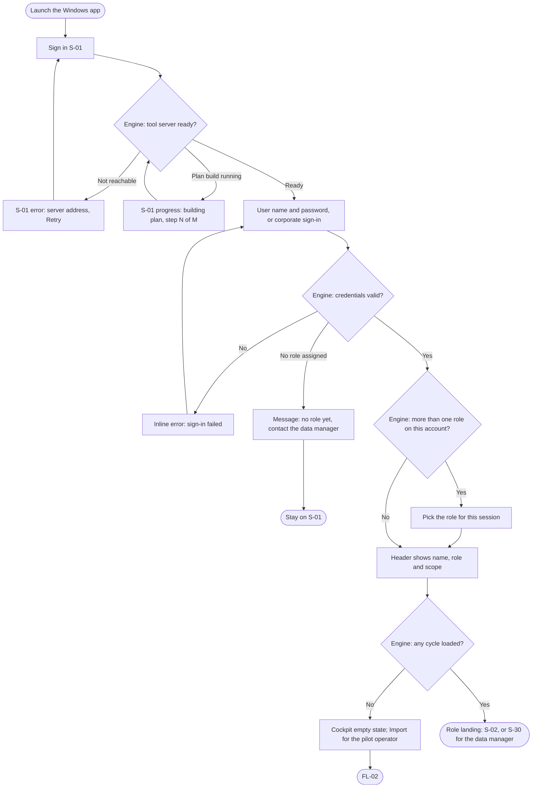

### FL-02 — Load pilot fixtures through channel 1 (DF-10, DF-07, PR-02, CP-02)

Role: Pilot operator. A planner who imports a single mask-layout file uses the same path, like today's copy and paste from Excel.

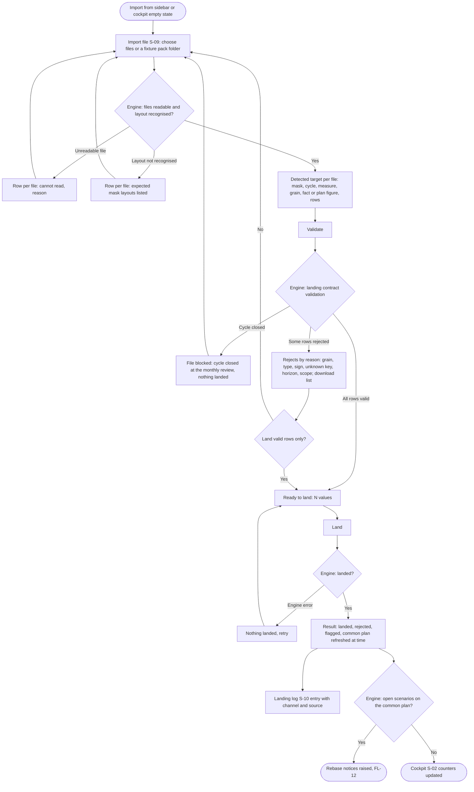

### FL-03 — Enter the sales plan in the Sales planning mask (DF-10, SC-02, CP-01, CP-02, CP-03, CP-08, SC-05)

Role: Sales planner. Any day of the month; there is no day window. The Order Intake forecast (external orders only) is a plan figure entered per planning model; an entry on a product-category row is accepted and spread by the engine (SC-02).

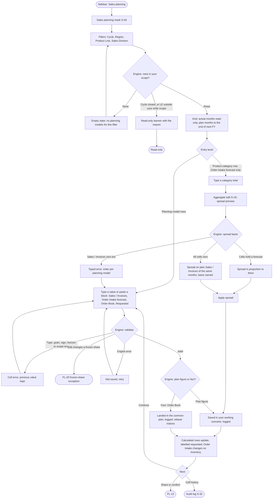

### FL-04 — Enter m−1 sales actuals and the opening inventory (DF-10, DF-07, DF-09, CP-02, PR-02, PR-05, UX-01)

Role: Sales planner. Actuals land when available (the 3rd working day, G5), not in a fixed window. Sales actuals are at LE × region × planning model. The Totals of Invoiced Units and Order Intake are typed (OQ-26).

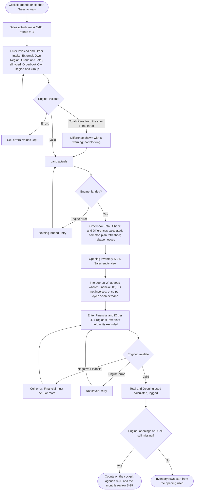

### FL-05 — Enter the operations plan and the Operations Orderbook (DF-10, NW-06, CP-01, CP-08, PR-02)

Role: Ops planner. Any day of the month. The Operations Orderbook is the plant's own sales orders (OQ-25); values loaded from the pilot fixture carry "provenance unverified" until U10.

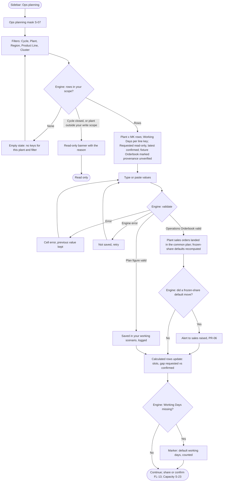

### FL-06 — Enter production actuals and FGNI, settle production alerts (DF-08, DF-09, DF-10, CP-02, NW-01, PR-05, UX-01)

Roles: Ops planner (Produced Units, FGNI); Sales planner or Ops planner (approval). The alert compares, per **bridge group × month**, the Produced Units (summed over plants) with the sales-implied production. Sales-implied production is Δ inventory plus External invoiced units, summed over every LE of the group. Region is summed by default, and its breakdown is shown.

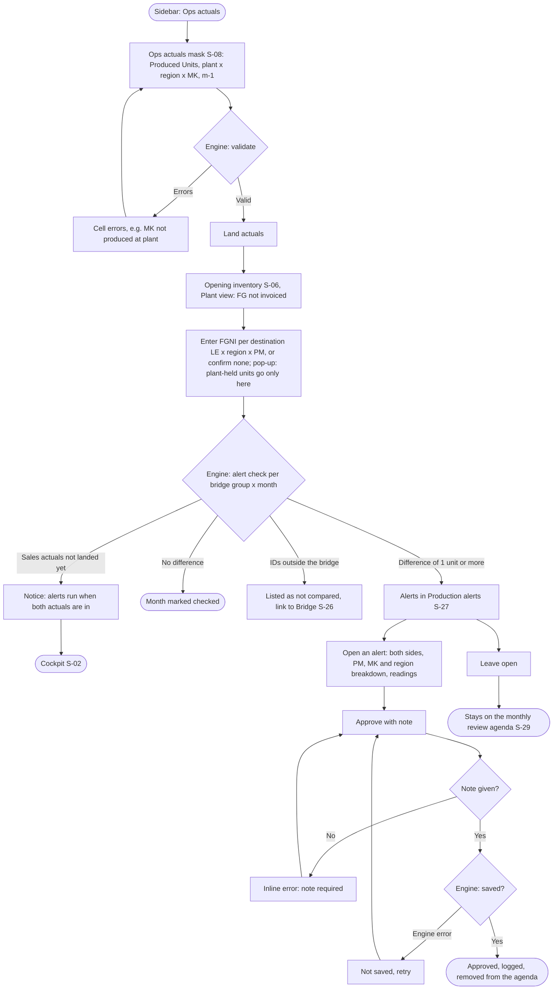

### FL-07 — Create a personal scenario (SC-01, SC-05, DF-03, QC-04, UX-03)

Roles: Sales planner, Ops planner. View-only roles never create scenarios.

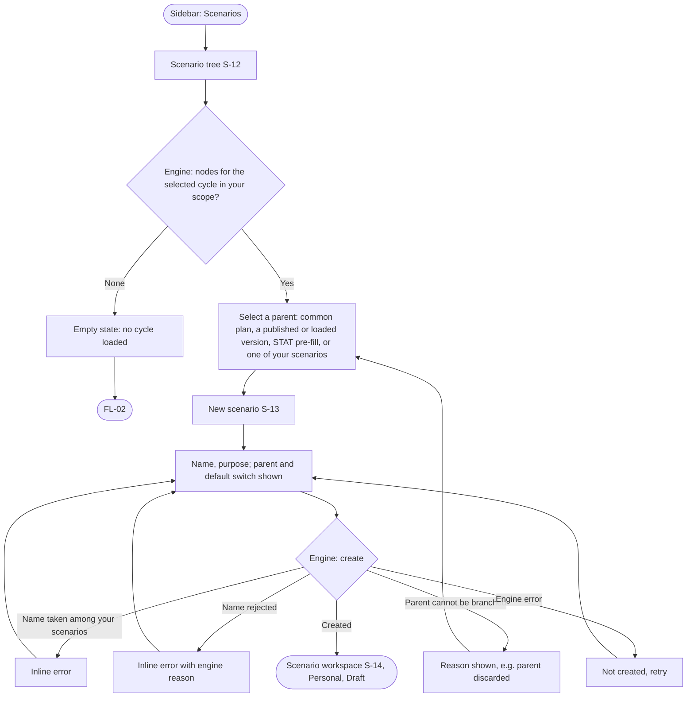

### FL-08 — Edit in a scenario and read the consequence (SC-01, SC-02, SC-03, CP-01, CP-02, CP-03, CP-06, CP-08, DF-02, NW-07, PR-06)

Roles: Sales planner, Ops planner.

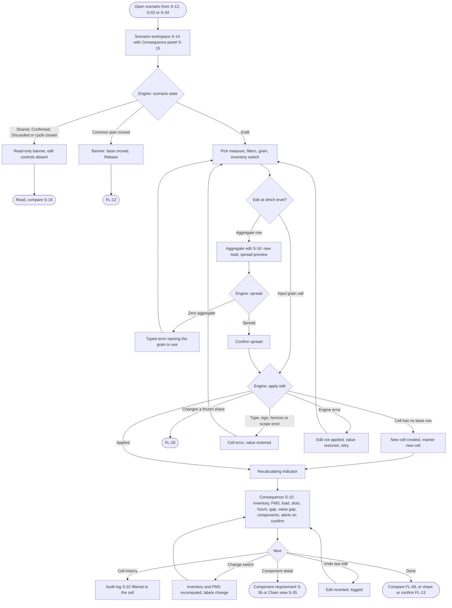

### FL-09 — Compare scenarios with the common plan and each other (SC-04, CP-02, CP-03, DF-02, UX-03)

Roles: Sales planner, Ops planner, Approver, view-only roles (within scope).

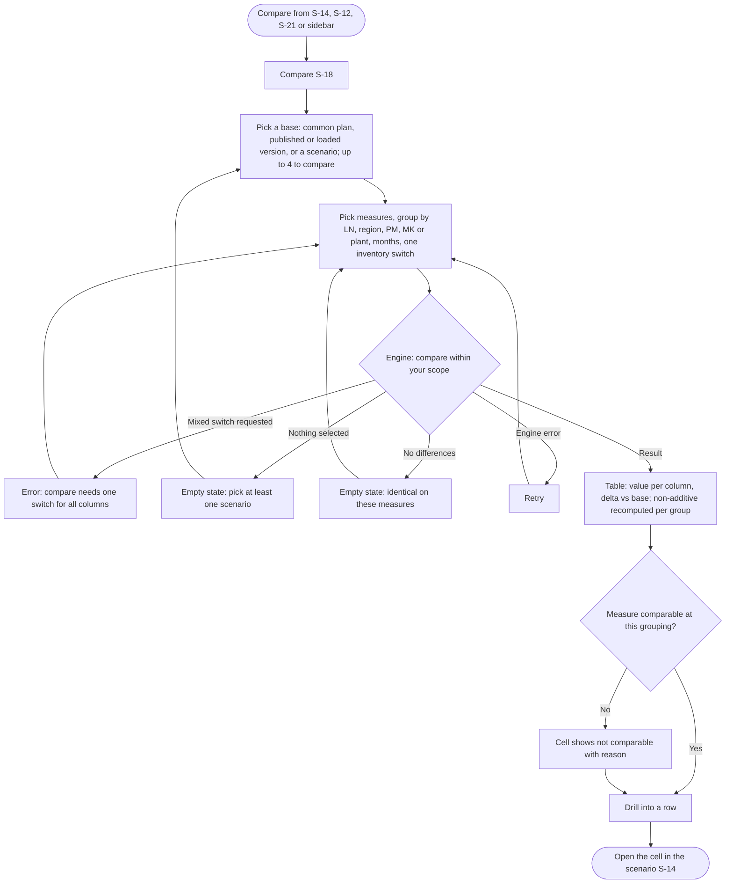

### FL-10 — Check capacity and the allocation proposal (NW-04, NW-05, NW-06, NW-07, CP-07, CP-01)

Role: Ops planner. The allocation proposal is a live measure, not a day-15 step (it replaces job 4000). For an MK with a routing group in its Planning BOM, the routing group sets the plant split (NW-04 is unified into NW-07).

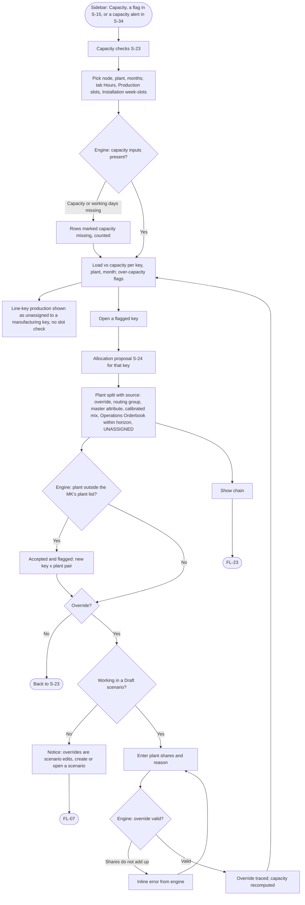

### FL-11 — Follow confirmations back to sales grain (NW-01, NW-02, NW-03, CP-02, PR-06)

Role: Ops planner; the Sales planner can also read it. A confirmation committed by ops moves the sales-side confirmed inventory and FMS at once.

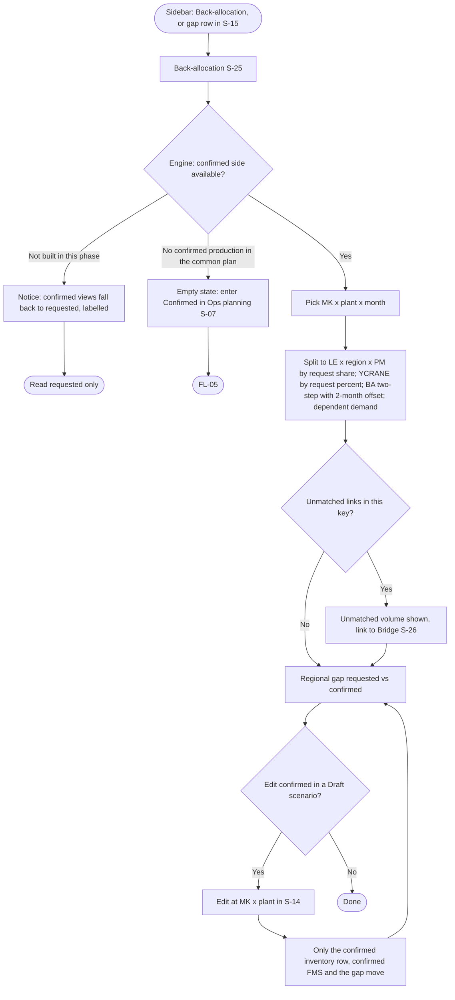

### FL-12 — Rebase a scenario after the common plan moved (SC-06, PR-02)

Roles: Sales planner, Ops planner, Approver.

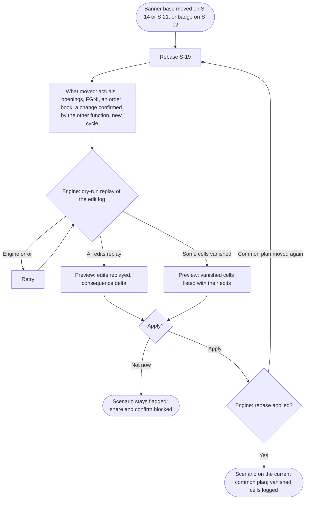

### FL-13 — Share for review and confirm into the common plan (SC-05, SC-06, SC-07, PR-06)

Roles: Sales planner or Ops planner (share; confirm own-role changes where the engine allows it [AD]); Approver (confirm or discard from review). Confirm commits the scenario's edits into the cycle's common plan. It does **not** name or publish a version; publishing happens once a month in FL-14.

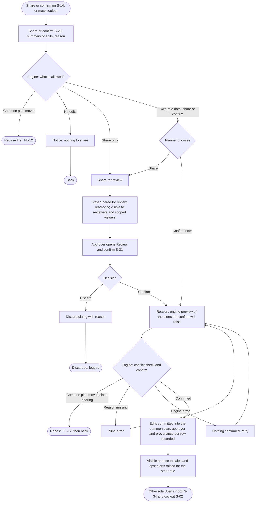

### FL-14 — Monthly review: decide, publish R and C, close the cycle (PR-01, PR-03, PR-04, PR-05, SC-07)

Role: Approver. This is the only dated event of the cycle. Its date is configurable.

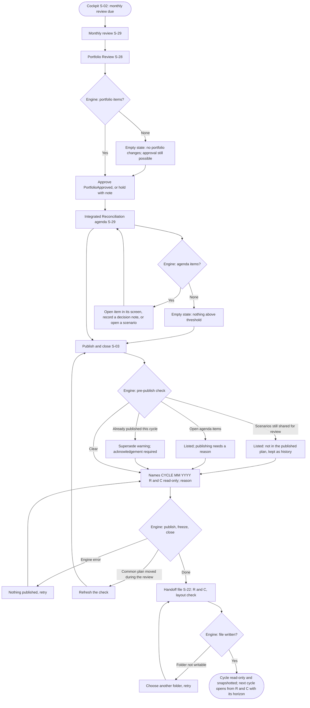

### FL-15 — Check input channels 2 and 3 and run a test-double landing (DF-10, PR-02)

Role: Pilot operator.

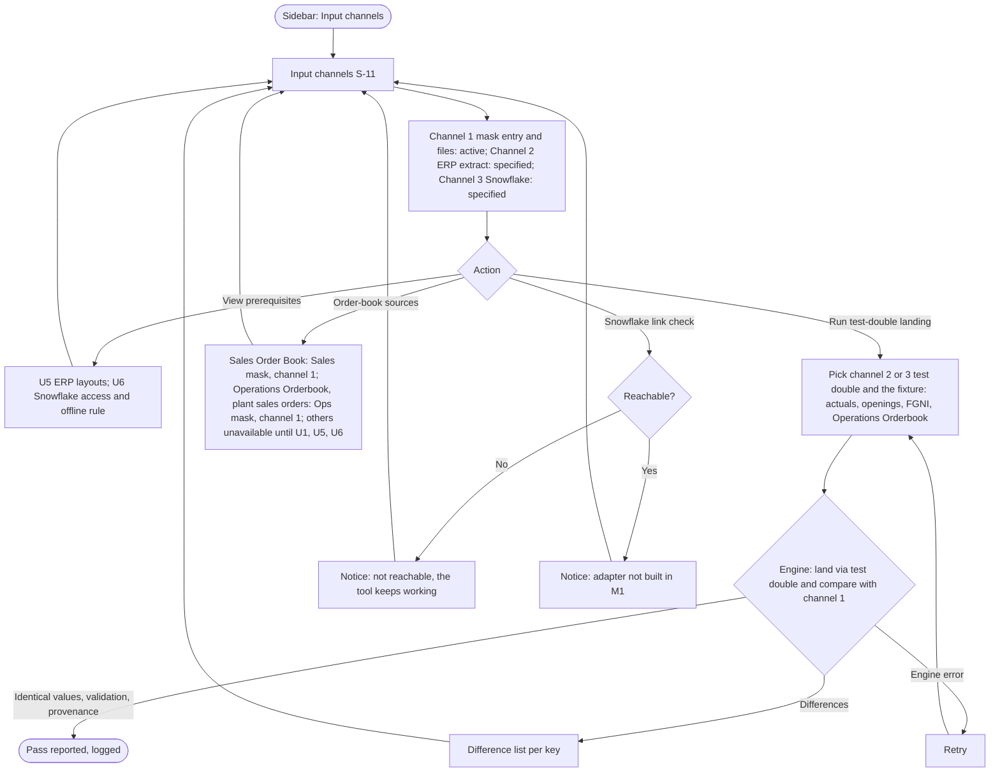

### FL-16 — Maintain master data and the bridge (DF-11, DF-04, NW-01, NW-06, NW-07, CP-07, CP-08, UX-03)

Role: Data manager edits; every other role reads (S-30r Users is hidden from them). This is the entry flow. The details are FL-16a (change a dated row), FL-16b (import a list) and FL-16c (give a user a role and a scope) in `SPEC-ibp-m1-master-data.md` §6, and FL-22 (Planning BOM) in this document.

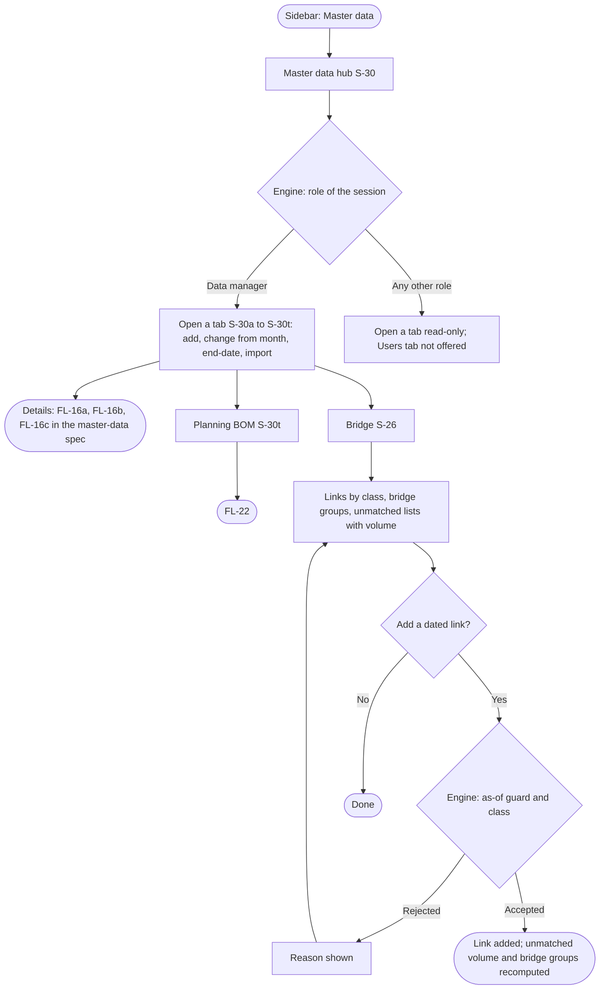

### FL-17 — Read the accuracy control report (QC-01, QC-02, QC-04, QC-05, QC-06, QC-07)

Roles: Approver; planners and view-only roles may read it. The report is off the critical path: its checks are reported, never a gate.

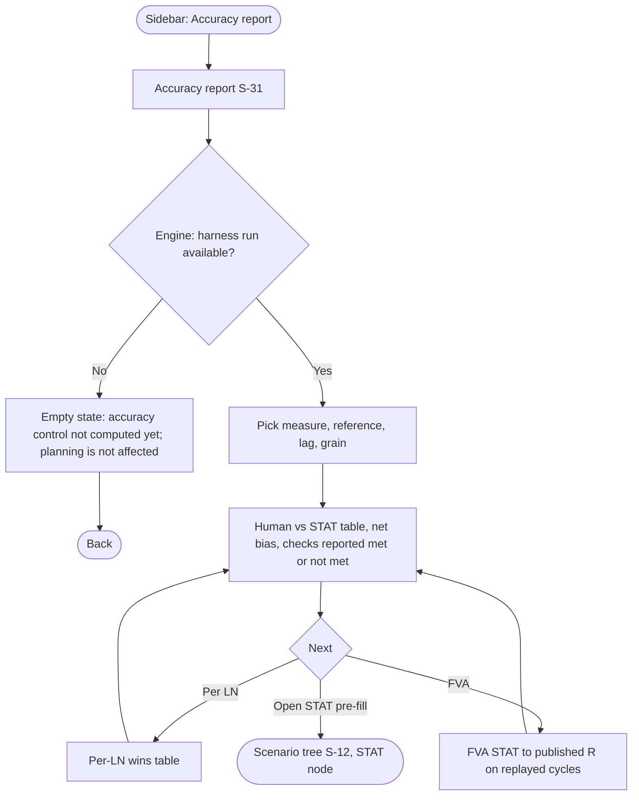

### FL-18 — Choose diagrams (UX-02)

Roles: all (usually the Pilot operator).

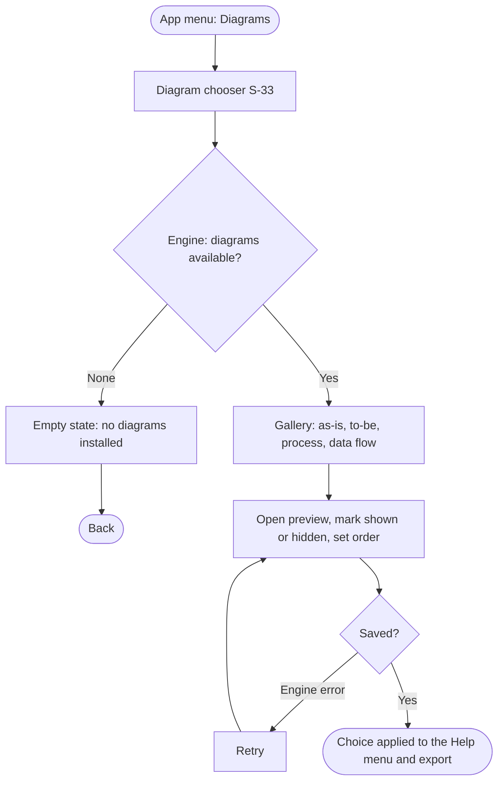

### FL-19 — Receive and act on a cross-function alert (PR-06, PR-05, UX-03)

Roles: Sales planner, Ops planner (act); Approver and view-only roles (read within scope). Sales receives alerts from ops for a shortfall, a changed confirmation, or a moved order-book default. Ops receives alerts from sales for new or changed requested load, frozen-zone exceptions and capacity breaches.

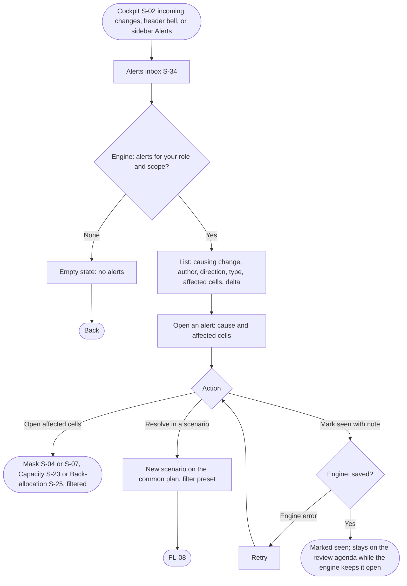

### FL-20 — Change a frozen share of Requested production (CP-08, SC-02, PR-05, PR-06)

Role: Sales planner (the owner of Requested, within write scope). It starts from S-04 or S-14.

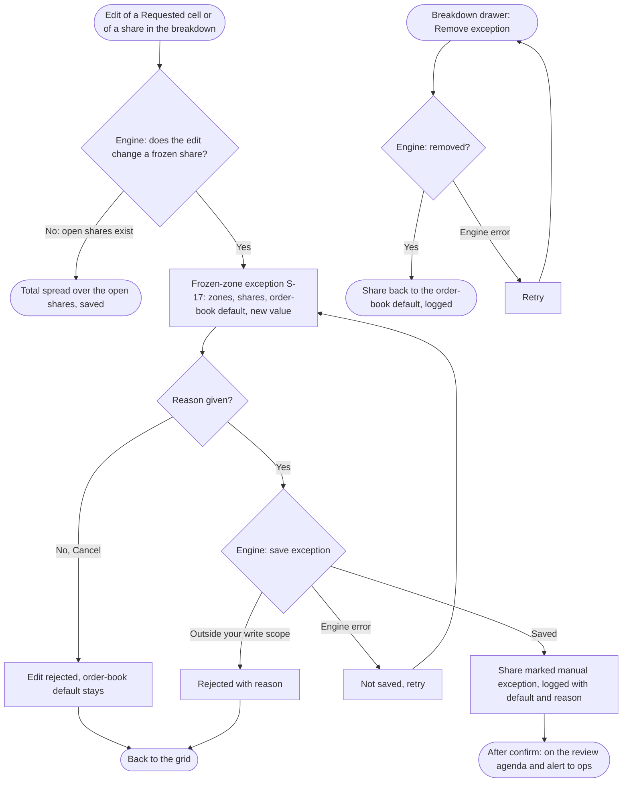

### FL-21 — Read the plan in a view-only role (UX-03, UX-04)

Roles: Manager, Regional Head, Corporate function.

```mermaid
flowchart TD
    A(["Signed in as a view-only role"]) --> B["Cockpit S-02 within your scope, no actions"]
    B --> C{"Pick"}
    C -- Plan --> D["Masks S-04 to S-08 read-only, rows in your scope"]
    C -- Scenarios --> E["Scenario tree S-12: common plan, published, loaded, shared for review in scope"]
    C -- Compare --> F["Compare S-18, sums and FMS on in-scope rows"]
    C -- "Alerts and agenda" --> G["S-34, S-27 and S-29 read-only in scope"]
    C -- "Chain and components" --> CC["Chain view S-35 and Component requirement S-36, in scope"]
    D --> H(["Cell history S-32 in scope"])
    E --> F
```

### FL-22 — Maintain the Planning BOM of an MK (NW-07, NW-04, DF-11, CP-07)

Role: Data manager edits; every other role reads. Every MK is configurable; an MK without a Planning BOM is allowed and listed. The file import follows the FL-16b pattern of the master-data spec; dated changes follow FL-16a.

```mermaid
flowchart TD
    A(["Hub S-30, or Open Planning BOM from S-24 or S-35"]) --> B["Planning BOM tab S-30t"]
    B --> C{"Engine: role of the session"}
    C -- "Any other role" --> C1["Read-only: MK list, groups, rates"] --> Z(["Show chain FL-23"])
    C -- "Data manager" --> D["Pick an MK and a rate scope: Global or a region; As of month"]
    D --> E{"Engine: MK has a Planning BOM?"}
    E -- No --> E1["Empty state: no Planning BOM, MK listed as without BOM"] --> F{"Create how?"}
    E -- Yes --> G["Groups and options in force for the month"]
    F -- "Import file" --> I["Import, FL-16b pattern: validate, rejects, land as one logged batch"] --> G
    F -- "Enter by hand" --> H
    G --> H["Add or change a group: routing or component; exclusive or optional attachment; condition on a routing option; options and rates; effective-from month"]
    H --> J{"Engine: validate on save"}
    J -- "Exclusive rates do not sum to 100 %" --> J1["Save rejected, sum shown, nothing saved"] --> H
    J -- "Second routing group on this MK" --> J2["Save rejected: one routing group per MK"] --> H
    J -- "Attach rate outside 0-100 %" --> J3["Field error"] --> H
    J -- "Override of a proposal without reason" --> J4["Reason required"] --> H
    J -- "Engine error" --> J6["Not saved, retry"] --> H
    J -- "Plant outside the MK's plant list" --> J5["Accepted and flagged: new key x plant pair"] --> K
    J -- Valid --> K["Saved as a dated row, history kept; requirement and chain recomputed"]
    K --> L{"Next"}
    L -- "Use proposal from history" --> M{"Engine: configuration history from U1?"}
    M -- No --> M1["Column reads: no history, rates only"] --> H
    M -- Yes --> M2["Accept the proposal, or override with a reason"] --> J
    L -- "Region rate set" --> R1["Region set replaces the whole group for that region"] --> H
    L -- "Show chain" --> N(["Chain view S-35 for this MK"])
    L -- Done --> O(["MK counted with a Planning BOM"])
```

### FL-23 — Read the chain of a planning model, key, plant or component (UX-04, NW-07, NW-01, NW-03, CP-07, CP-08)

Roles: all, read-only, within scope.

```mermaid
flowchart TD
    A(["Show chain from S-26, S-30t, S-24, S-36, S-15 or sidebar"]) --> B["Chain view S-35"]
    B --> C["Start from PM, MK, plant or component; key; month range; node; side requested or confirmed"]
    C --> D{"Engine: chain within your scope"}
    D -- "Key unknown or outside your scope" --> D1["Empty state with the reason"] --> C
    D -- "Engine error" --> D2["Retry"] --> C
    D -- Result --> E["Steps: PM, MK and bridge weights, plant and tier, semi-finished with offset, components, overrides; units, provenance, effective dates"]
    E --> F{"Engine: MK has a Planning BOM?"}
    F -- No --> F1["Component step: no Planning BOM, no requirement"]
    F -- Yes --> G["Components by rate: region group or global; conditional; ordered configuration or rates only"]
    F1 --> H{"Open a step"}
    G --> H
    H -- "Bridge link" --> H1(["Bridge S-26"])
    H -- "Plant split" --> H2(["Allocation proposal S-24"])
    H -- "Group or rate" --> H3(["Planning BOM S-30t, edit for the data manager"])
    H -- "Override or exception" --> H4(["Audit log S-32 entry"])
    H -- "Semi-finished key" --> H5["Chain of the semi-finished key"] --> E
```

### FL-24 — Read the component requirement (NW-07, UX-03)

Roles: Ops planner, Sales planner; others read within scope. M1 computes the requirement only: no component capacity and no supply constraint.

```mermaid
flowchart TD
    A(["Sidebar: Component requirement, or S-15 section"]) --> B["Component requirement S-36"]
    B --> C["Filters: node, side, component, plant, region, MK, months"]
    C --> D{"Engine: any MK with a Planning BOM?"}
    D -- None --> D1["Empty state: no Planning BOM yet; MKs without one listed in S-30t"] --> X(["Back"])
    D -- Some --> E["Table component x plant x region x month; MKs without a Planning BOM counted"]
    E --> F{"Engine: ordered configuration available?"}
    F -- No --> F1["Banner: rates only, U1 not connected"] --> G
    F -- Yes --> G["Ordered and remainder shown per row"]
    G --> H{"Next"}
    H -- "Sum regions" --> I["Component x plant x month"] --> G
    H -- "Show chain" --> J(["Chain view S-35 for the component"])
    H -- "What-if" --> K(["Edit Requested in a scenario, FL-08; S-15 shows the component delta"])
```

## Sitemap

Navigation now differs by role, because the server knows the role. The diagram shows the whole app. The table below it states which groups each role sees and where it can write. Dialogs and panels are shown with dotted links. M2 destinations are greyed placeholders and are not designed.

```mermaid
flowchart LR
    ROOT(["App start"]) --> S01["S-01 Sign in"]
    S01 --> S02["S-02 Planning cockpit"]

    subgraph ALR["Alerts"]
        S34["S-34 Alerts inbox"]
        S27["S-27 Production alerts"]
    end

    subgraph INP["Inputs"]
        S04["S-04 Sales planning mask"]
        S05["S-05 Sales actuals mask"]
        S06["S-06 Opening inventory"]
        S07["S-07 Ops planning mask"]
        S08["S-08 Ops actuals mask"]
        S09["S-09 Import file"]
        S10["S-10 Landing log"]
        S11["S-11 Input channels"]
        S05 --> S06
        S08 --> S06
        S09 --> S10
    end

    subgraph SCN["Scenarios"]
        S12["S-12 Scenario tree"]
        S13["S-13 New scenario"]
        S14["S-14 Scenario workspace"]
        S15["S-15 Consequence panel"]
        S16["S-16 Aggregate edit"]
        S17["S-17 Frozen-share exception"]
        S18["S-18 Compare"]
        S19["S-19 Rebase"]
        S20["S-20 Share or confirm"]
        S21["S-21 Review and confirm"]
        S12 -.-> S13 --> S14
        S14 --- S15
        S14 -.-> S16
        S14 -.-> S17
        S14 --> S18
        S14 -.-> S19
        S14 -.-> S20 --> S21
    end

    subgraph NET["Network and capacity"]
        S23["S-23 Capacity checks"]
        S24["S-24 Allocation proposal"]
        S25["S-25 Back-allocation"]
        S26["S-26 Bridge"]
        S35["S-35 Chain view"]
        S36["S-36 Component requirement"]
        S23 --> S24
        S25 --> S26
        S36 --> S35
        S26 -.-> S35
        S24 -.-> S35
    end

    subgraph REV["Monthly review"]
        S29["S-29 Monthly review agenda"]
        S28["S-28 Portfolio Review"]
        S03["S-03 Publish and close"]
        S22["S-22 Handoff file"]
        S29 --> S28
        S29 --> S03 --> S22
    end

    subgraph ADM["Data and quality"]
        S30["S-30 Master data hub, tabs S-30a to S-30t"]
        S30T["S-30t Planning BOM"]
        S31["S-31 Accuracy report"]
        S32["S-32 Audit log"]
        S33["S-33 Diagram chooser"]
        S30 --> S30T
    end

    S02 --> ALR
    S02 --> INP
    S02 --> SCN
    S02 --> REV
    S15 --> S23
    S15 --> S25
    S15 --> S36
    S04 -.-> S17
    S04 -.-> S16
    S14 -.-> S32
    S27 -.-> S26
    S30 --> S26
    S30T -.-> S35
    S35 -.-> S30T
    S34 -.-> S14

    W1["M2 Web app"]:::later
    W2["M2 Simultaneous multi-writer input"]:::later
    W3["M2 Real ERP and Snowflake adapters"]:::later
    W4["M2 In-place publish, dEPM retired"]:::later
    W5["M2+ Component capacity and supply"]:::later
    S01 -.-> W1
    S14 -.-> W2
    S11 -.-> W3
    S22 -.-> W4
    S36 -.-> W5

    classDef later stroke-dasharray: 5 5,opacity:0.5
```

Navigation by role (server-decided; the client renders what the server allows):

| Sidebar group | Sales planner | Ops planner | Approver | Pilot operator | Data manager | View-only (Manager, Regional Head, Corporate) |
|---|---|---|---|---|---|---|
| Cockpit S-02 | ✓ (sales emphasis) | ✓ (ops emphasis) | ✓ (review emphasis) | ✓ (landings emphasis) | ✓ | ✓ in scope, no actions |
| Alerts S-34, S-27 | act | act | read | read | read | read in scope |
| Inputs S-04, S-05, S-06 (Sales entity view) | write own LE(s) | read | read | read | read | read in scope |
| Inputs S-07, S-08, S-06 (Plant view) | read | write own plant(s) | read | read | read | read in scope |
| Import, Landing log, Input channels S-09 to S-11 | S-09 and S-10 for own data | S-09 and S-10 for own data | S-10 read | full | S-10 read | not shown |
| Scenarios S-12 to S-21 | own scenarios; share; confirm own-role | own scenarios; share; confirm own-role | review, confirm, discard | read; dry-run file | read | read common plan, published, shared in scope |
| Network and capacity S-23 to S-26, S-35, S-36 | read | write overrides in a scenario | read | read | S-26 edit links | read in scope |
| Monthly review S-29, S-28, S-03, S-22 | read agenda | read agenda | run the review, publish | dry-run file | read | read agenda in scope |
| Data and quality S-30 (incl. S-30t) to S-33 | read (no Users tab) | read (no Users tab) | read | read | edit all S-30 tabs, S-30t included | read (no Users tab) |

✓ means the group is shown with its normal actions.

Primary navigation:

- **Header (all screens):** app name and pilot badge on the left. In the centre: the cycle selector with the cycle state ("Cycle 09 2026 · Open — continuous planning", or "Closed · published 28 Sep") and the text "Monthly review 28 Sep". On the right:
  - connection status: "Connected to tool server", or "Single-PC mode — offline" as a normal state, or "Server unreachable — retrying" as an error;
  - alert bell with a count and a text label, opening S-34;
  - user name, role chip ("Ops planner") and scope chip ("Scope: Northfield (plant)");
  - app menu: Help, Diagrams, About, Sign out.
- **Left sidebar, collapsible, grouped:** Cockpit · Alerts · Inputs · Scenarios · Network and capacity (Capacity checks, Allocation, Back-allocation, Bridge, Chain view, Component requirement) · Monthly review · Data and quality. The server sends the items per role (table above). Items a role may only read open read-only; items a role may not reach are not sent.
- **Landing by role:** S-02 for every role except the Data manager, who lands on S-30. The cockpit content is ordered by the role.
- **Footer (all screens):** the pilot notice "Pilot — data are history fixtures; only the monthly handoff file leaves the tool", the engine status (idle / recalculating / last recalculation time), the build version.

## Screen inventory

Role abbreviations: SP Sales planner · OP Ops planner · AP Approver · PO Pilot operator · DM Data manager · VO view-only roles (Manager, Regional Head, Corporate function). "All" means every signed-in role. The Phase column gives the concept phase in which the capability exists, through the CLI first where that applies; the workbench UI for every screen comes in Phase 12.

| ID | Name | Purpose | Roles | Requirements | Flows | Entry points | Phase |
|---|---|---|---|---|---|---|---|
| S-01 | Sign in | Sign in against the tool server; build progress; role pick when the account holds several | All | UX-03, UX-02, SC-05 | FL-01 | App launch, Sign out | 12 |
| S-02 | Planning cockpit | Continuous-planning home: next monthly review and freeze, incoming confirmed changes from the other function, gap alerts, reviews waiting, agenda (missing openings, unreported FGNI, frozen-zone exceptions, UNASSIGNED frozen shares, plants without region, open production alerts, rejects, moved base), your work, recent landings; all within the role's scope | All | PR-01, PR-05, PR-06, SC-05, UX-03, PR-02, CP-02 | FL-01, FL-02, FL-14, FL-19, FL-21 | Landing, sidebar Cockpit | 9 |
| S-03 | Publish and close | Monthly-review decision: publish `CYCLE MM YYYY R` and `C` (names read-only, supersede warning), handoff file, freeze and close the cycle, open the next cycle | AP | SC-07, PR-01, PR-03, DF-03 | FL-14 | S-29 step 3 | 9 |
| S-04 | Sales planning mask | Enter Sales / Invoices, **Order Intake forecast** (external orders; at the data manager's level — product line, Product Class or planning model — spread by the engine), Order Book and Requested production at LE × region × PM × month over the rest of the current FY plus the next FY, with the current-FY actuals beside the plan; MK × plant breakdown of frozen shares; live inventory and FMS; "i" on every field | SP (VO, others read) | DF-10, SC-02, CP-01, CP-02, CP-03, CP-08, SC-05, UX-01 | FL-03, FL-20 | Sidebar, S-34 alert, S-02 | 5 (CLI), 7, 12 |
| S-05 | Sales actuals mask | Enter m−1 Invoiced and Order Intake by External / Own Region / Group / **Total (all four typed; Difference to the sum calculated and flagged)** and Orderbook Own Region / Group (External, Total and Check calculated) at LE × region × PM; land actuals | SP (VO, others read) | DF-10, DF-07, DF-09, PR-02, UX-01 | FL-04 | Sidebar, S-02 agenda | 5, 12 |
| S-06 | Opening inventory | Opening mask at LE × region × PM: Financial and IC (sales), Total = Financial + IC, FGNI per plant and destination (ops), Opening used = Total + FGNI; **info pop-up "What goes where" (Financial / IC / FGNI, nothing entered twice)**; missing openings and unreported plants; coarse channel 2-3 arrivals spread or mapped | SP (Sales entity view), OP (Plant view), VO read | CP-02, DF-10, SC-02, PR-05, UX-01 | FL-04, FL-06 | S-05 "Continue to opening", S-08 callout, sidebar, S-02 agenda | 5, 6, 12 |
| S-07 | Ops planning mask | Enter Confirmed production and Cluster average max capacity at plant × MK × month, Working Days at plant × line key × month, and the Operations Orderbook (**the assembly plant's own sales orders**; pilot-fixture values marked "provenance unverified" until U10); read the latest confirmed Requested production (with PM breakdown) and the sales Order Book; frozen zone marked; current-FY actuals beside the plan | OP (VO, others read) | DF-10, NW-06, CP-01, CP-08, PR-02, UX-01 | FL-05 | Sidebar, S-34 alert, S-02 | 5, 7, 12 |
| S-08 | Ops actuals mask | Enter Produced Units (m−1) at plant × region × MK; land actuals; pointer to FGNI | OP (VO, others read) | DF-10, DF-08, DF-07, UX-01 | FL-06 | Sidebar, S-02 agenda | 5, 12 |
| S-09 | Import file | Import mask-layout files or a fixture pack through channel 1; validation, rejects, landing | PO, SP, OP | DF-10, PR-02 | FL-02 | Sidebar, mask toolbar "Import", cockpit empty state | 5 (CLI), 12 |
| S-10 | Landing log | Every landing per channel: time, user, source, counts, rejects, flags, snapshot | PO, SP, OP, AP, DM | DF-07, DF-10, PR-02 | FL-02 | Sidebar, S-09 result, S-02 rejects card | 5, 12 |
| S-11 | Input channels | Status of channels 1-3, prerequisites U5 / U6, test-double landing, the two order-book sources | PO | DF-10, PR-02 | FL-15 | Sidebar | 9 |
| S-12 | Scenario tree | Common plan, published versions, loaded references, STAT pre-fill and scenarios with visibility level and state, parent pointers | SP, OP, AP, PO, DM; VO read in scope | SC-01, SC-05, SC-07, DF-03, QC-04, UX-03 | FL-07, FL-09, FL-12, FL-17, FL-21 | Sidebar, S-21 after confirm, S-31 | 5, 8, 9, 12 |
| S-13 | New scenario | Name a personal scenario on a chosen parent | SP, OP | SC-01, SC-05 | FL-07 | "New scenario" on S-12, S-14, S-34 | 5, 8 |
| S-14 | Scenario workspace | Edit grid at input grain (Order Intake forecast among the measures), inventory switch, frozen shares, new cells, read-only states | SP, OP | SC-01, SC-03, CP-02, CP-03, CP-06, CP-08, DF-02, DF-10 | FL-08, FL-10, FL-11, FL-20 | Open on S-12, drill from S-18, "Resolve in scenario" on S-34 | 5, 12 |
| S-15 | Consequence panel | Docked panel in S-14: inventory, FMS, load, slots, hours, gap, value gap, dependent demand, component requirement, alerts the confirm would raise | SP, OP | CP-01, CP-02, CP-03, CP-06, NW-02, NW-03, NW-07, PR-06 | FL-08 | Always visible in S-14; detach to window | 5, 6, 7, 9 |
| S-16 | Aggregate edit | Edit a total and preview the proportional spread (Requested over open shares only; Order Intake forecast from a product-category row, with the Sales / Invoices fallback); typed error on a zero aggregate | SP, OP | SC-02, CP-08, DF-10 | FL-03, FL-08 | Edit on an aggregate row in S-14; category row on S-04 | 5, 8 |
| S-17 | Frozen-share exception | Change a frozen MK × plant share of Requested: zones, order-book default, reason required, consequence stated | SP | CP-08, PR-05, PR-06 | FL-20 | Engine response to an edit on S-04 or S-14 | 7 |
| S-18 | Compare | Base (common plan, published, loaded, scenario) vs scenarios on every measure, by LN, region, PM, MK, plant, on one switch, within scope | SP, OP, AP, VO | SC-04, CP-02, CP-03, DF-02, UX-03 | FL-09, FL-13, FL-21 | Sidebar, S-14 toolbar, S-12, S-21 | 5 |
| S-19 | Rebase | What moved the common plan, replay preview, vanished cells, apply | SP, OP, AP | SC-06, PR-02 | FL-12 | Banner on S-14 / S-21, badge on S-12, blocked share or confirm | 8, 9 |
| S-20 | Share or confirm | Summary of edits and reason; share for review, or confirm own-role changes into the common plan when allowed | SP, OP | SC-05, SC-07, PR-06 | FL-13 | "Share or confirm" on S-14 and in the masks | 8 |
| S-21 | Review and confirm | Read-only review of a shared scenario; confirm into the common plan (approver recorded, alert preview) or discard | AP | SC-05, SC-07, SC-03, PR-06 | FL-13 | S-12 (Shared node), S-02 "Reviews waiting" | 8 |
| S-22 | Handoff file | The dEPM handoff file of a publish (R and C; P / A copies if configured) or a dry-run file; layout check | AP, PO, SP, OP | SC-07 | FL-14 | After publish on S-03; "Dry-run file" on S-14, S-03 | 5 (dry run), 9 |
| S-23 | Capacity checks | Hours, production slots and installation week-slots per key × plant × month | OP; others read | NW-06, CP-01 | FL-10 | Sidebar, capacity flag on S-15, capacity alert on S-34 | 7 |
| S-24 | Allocation proposal | Live plant split per key with source, CP-07 precedence (override, **routing group of the Planning BOM**, master attribute, calibrated mix, UNASSIGNED; Operations Orderbook within horizon); "new key × plant pair" flag; override with reason; UNASSIGNED volume | OP; others read | NW-05, NW-04, NW-07, CP-07 | FL-10, FL-23 | Key drill on S-23, sidebar, chain step on S-35 | 7 |
| S-25 | Back-allocation | Confirmed at MK × plant split to LE × region × PM; YCRANE, BA two-step, dependent demand; regional gap | OP, SP; others read | NW-02, NW-03, NW-01, CP-02 | FL-11 | Sidebar, gap row on S-15, shortfall alert on S-34 | 6 |
| S-26 | Bridge | PM ↔ MK links by class, bridge groups, dated edges, unmatched lists with volume; add dated link; "Show chain" for a link | DM edit; OP, others read | NW-01, DF-04, UX-04 | FL-06, FL-11, FL-16, FL-23 | Sidebar, S-25 / S-27 unmatched link, S-30 card, chain step on S-35 | 6 |
| S-27 | Production alerts | DF-09 per bridge group × month: Produced Units (Σ plants) vs Δ inventory + External invoiced (Σ LEs); region, PM and MK breakdown; approve with note | SP, OP act; others read | DF-09, DF-08, NW-01 | FL-06 | Sidebar Alerts, S-02 agenda, S-29 section | 6, 9 |
| S-28 | Portfolio Review | First part of the monthly review; gate `PortfolioApproved` | AP; others read | PR-04 | FL-14 | S-29 step 1 | 9 |
| S-29 | Monthly review agenda | Integrated Reconciliation agenda fed continuously (PR-05): cross-function alerts, gaps above threshold, accuracy gaps, production alerts, missing openings, unreported FGNI, frozen-zone exceptions, UNASSIGNED frozen shares, plants without region; steps to S-28 and S-03; review date | AP; others read in scope | PR-05, PR-01, PR-06, DF-09, CP-02, CP-08 | FL-06, FL-14 | S-02 review strip, sidebar | 9 |
| S-30 | Master data hub | Hub with 20 tabs S-30a … S-30t per `SPEC-ibp-m1-master-data.md` (S-30t Planning BOM wireframed here); seed report; data-quality checks | DM edit; all others read (no Users tab) | DF-11, DF-04, NW-06, NW-07, CP-07, CP-08, UX-03 | FL-16, FL-22 | Sidebar, landing for DM | 5, 8, 12 |
| S-30t | Planning BOM (tab of S-30) | **New.** Per MK: at most one routing group (option → plant), component groups (exclusive, rates sum to 100 %; optional attachments with own attach rate), conditions on a routing option, rates per MK × region with global fallback (a region set overrides a whole group), effective-dated rows, file import and manual edit, "proposed from history" column when U1 data exist, override traced; MKs without a Planning BOM listed | DM edit; all others read | NW-07, NW-04, DF-11, CP-07, UX-04 | FL-22, FL-16, FL-23 | S-30 tab list and card, "Open Planning BOM" on S-24 and S-35, S-36 "MKs without a Planning BOM" | 7 (file / CLI), 12 |
| S-31 | Accuracy report | Human vs STAT accuracy on universe U; checks reported, never a gate | AP, SP, OP, VO | QC-01, QC-02, QC-04, QC-05, QC-06, QC-07 | FL-17 | Sidebar, S-29 accuracy section | 10, 11 |
| S-32 | Audit log | Every sign-in, input, landing, edit, exception, share, confirm, publish, approval, override, alert note and master-data change (Planning BOM rows and rate overrides included), with user, time, values, reason, source | All (in scope) | SC-05, DF-10, DF-07, UX-03 | FL-08, FL-21, FL-23 | Sidebar, "History" on any cell, S-10 entry, override step on S-35 | 5, 8 |
| S-33 | Diagram chooser | Pick which diagrams the tool shows and exports | All | UX-02 | FL-18 | App menu "Diagrams" | 12 |
| S-34 | Alerts inbox | Cross-function alerts on confirm (PR-06) for the role: causing change, author, affected cells, delta; open cells, resolve in a scenario, mark seen with note | SP, OP act; AP, VO read in scope | PR-06, PR-05, UX-03, UX-01 | FL-19 | Header bell, S-02 incoming changes, sidebar Alerts | 9 |
| S-35 | Chain view | **New.** One read-only view for a selected PM (or MK, plant, component) and month range: PM → MK (bridge weights) → plant (CP-07 tier, routing option, ordered vs remainder) → semi-finished (2-month offset) → components (rates, region group or global, conditional, or real order configuration) → overrides; units, provenance and effective dates per step; each step links to its maintenance mask | All, read-only in scope | UX-04, NW-07, NW-01, NW-03, CP-07, CP-08, UX-03 | FL-23, FL-22, FL-24, FL-21 | Sidebar Network and capacity, "Show chain" on S-26, S-30t, S-24, S-36, S-15 | 7 (CLI print), 12 |
| S-36 | Component requirement | **New.** Units per component × plant × region × month (summable to component × plant × month), requested or confirmed side, ordered vs remainder, "rates only" until U1; MKs without a Planning BOM counted; requirement only, no capacity | OP, SP; others read in scope | NW-07, UX-03 | FL-24, FL-08 | Sidebar Network and capacity, component section on S-15 | 7, 12 |

### Requirement coverage

User-facing requirements and their screens:

| Requirement | Screens |
|---|---|
| CP-01 | S-04, S-07, S-15, S-23 |
| CP-02 | S-02, S-04, S-05, S-06, S-14, S-15, S-18, S-25, S-29 |
| CP-03 | S-04, S-14, S-15, S-18 |
| CP-06 | S-14, S-15 |
| CP-07 | S-24, S-30 (S-30d, S-30g, S-30t), S-35 |
| CP-08 | S-04, S-07, S-14, S-16, S-17, S-29, S-30 (S-30m), S-35 |
| SC-01 | S-12, S-13, S-14 |
| SC-02 | S-04 (Order Intake category entry), S-06, S-16 |
| SC-03 | S-14, S-21 |
| SC-04 | S-18 |
| SC-05 | S-01, S-02, S-04, S-12, S-13, S-20, S-21, S-32 |
| SC-06 | S-19 |
| SC-07 | S-03, S-12, S-20, S-21, S-22 |
| DF-02 | S-14, S-18 |
| DF-03 | S-03, S-12 |
| DF-04 | S-26, S-30 |
| DF-07 | S-05, S-08, S-10, S-32 |
| DF-08 | S-08, S-27 |
| DF-09 | S-05 (typed Total, Difference), S-27, S-29 |
| DF-10 | S-04 to S-11, S-14, S-16, S-32 |
| DF-11 | S-30 (hub and tabs S-30a … S-30t) |
| NW-01 | S-25, S-26, S-27, S-35 |
| NW-02 | S-15, S-25 |
| NW-03 | S-15, S-25, S-35 |
| NW-04 | S-24, S-30t (routing group) |
| NW-05 | S-24 |
| NW-06 | S-07, S-23, S-30 |
| NW-07 | S-30t, S-35, S-36, S-15, S-24 |
| PR-01 | S-02, S-03, S-29 |
| PR-02 | S-02, S-05, S-07, S-09, S-10, S-11, S-19 |
| PR-03 | S-03 |
| PR-04 | S-28 |
| PR-05 | S-02, S-29, S-34 |
| PR-06 | S-02, S-15, S-20, S-21, S-29, S-34 |
| QC-01, QC-02, QC-05, QC-06, QC-07 | S-31 |
| QC-04 | S-12, S-31 |
| UX-01 | all workbench screens S-02 to S-36; "i" texts on S-04 to S-08; the S-06 "What goes where" pop-up |
| UX-02 | S-01 (server and single-PC mode), S-33 |
| UX-03 | S-01, S-02, S-12, S-18, S-30 (S-30r), S-32, S-34, S-35, S-36, and the header scope chip on every screen |
| UX-04 | S-35 (linked from S-26, S-30t, S-24, S-36, S-15) |

**Not user-facing.** These requirements have no screen. They are listed so that the omission is visible.

| Requirement | Why there is no screen |
|---|---|
| CP-04 | Incremental = full recalculation, early cutoff and group recomputation are engine properties. The user sees only the result, in S-15. |
| CP-05 | Set-based build and latency targets are engine properties. S-01 shows build progress, and the footer shows recalculation time, but the target itself has no screen. |
| DF-01 | Two stores, one direction, is an architectural boundary. The user never chooses a store. |
| DF-05 | The load rules on the training / verification store run at load time. The CLI and the verification reports print their counts. |
| DF-06 | The seed history profile and the seed week-slot maxima are test assets. Their maintained values appear on S-30c and S-30l. |
| QC-03 | The immutable snapshot store is back-end. The user sees "snapshotted" on S-03 and S-10. |
| QC-08 | The KPI tables are output files read by Power BI, not a workbench screen. |
| QC-09 | The no-leakage rule in the harness is back-end. |
| SC-08 | Re-entrant transactions are back-end. |
| RG-01 | The regression suite is developer-facing. |

The slice-1 CLI (Phase 5, T9) is a developer and UAT surface, not a screen. Its commands cover FL-02, FL-04, FL-06 (FGNI entry), FL-07, FL-08, FL-09 and the dry run of FL-14. In Phase 7 it adds the Planning BOM file entry (FL-22 by file) and the chain print (FL-23).

## Wireframes

Conventions for every wireframe:

- **Viewport:** desktop (Windows app window). Minimum 1366 × 768, designed for 1920 × 1080.
- **Shell:** the header, sidebar and footer are the ones described under Primary navigation. Wireframes repeat them only where they differ.
- **Formats:** months appear as "Sep 2026". Units are integers with thousands separators. Capacity per day uses up to 4 decimals. Component requirement units and Planning BOM rates are the exception: the requirement is an unrounded expected value and shows 1 decimal (UX-Q-22); rates show 1 decimal with "%".
- **Numbers and labels:** every number comes from the engine, already filtered to the session's scope. Inventory and FMS figures always carry the label "(requested)" or "(confirmed)". "Confirmed view: requested fallback" appears wherever the confirmed side does not exist yet.
- **Running example:** Cycle 09 2026. m−1 = Aug 2026. Horizon: actuals Jan–Aug 2026 (8 months, read-only) | plan Sep 2026 – Dec 2027 (16 months = rest of FY 2026 + FY 2027). Next monthly review: 28 Sep 2026. Planning BOM example (constructed, U9): MK Y has a routing group "Colour" (red → Northfield 30 %, blue → Niagara 70 %) and a component group "Pump" (Pump 1 40 %, Pump 2 20 %, Pump 3 40 %).
- **Horizon band (S-04, S-07):** a thin band above the month headers has two labelled segments: "Actuals · Jan–Aug 2026 · read-only" and "Plan · Sep 2026 – Dec 2027 · 16 months". Each month header carries the text "Act" or "Plan" under the month. A vertical divider separates the two. Actual columns have a hatched background and a lock icon in the header. The hatching is a pattern, not just a colour.
- **"i" icon:** every input field, column header and row label of an input measure carries an "i" icon. Click, Enter or F1 on the focused cell opens a popover with the definition (see "Field definitions") and a source line. The popover closes with Escape. Calculated rows carry an "i" as well.
- **Visibility markers in grids:** a value typed in your working scenario and not yet confirmed shows a corner marker plus the tooltip "Yours — personal, not confirmed". A value in the common plan shows no marker. A row label ending in "· fact" lands in the common plan when saved; a row label ending in "· plan figure" lands in your working scenario.
- **Working-scenario chip (S-04, S-07):** under the page title, a chip reads "Plan figures go to: Working plan · <user name> (personal)". It holds a picker with your Draft scenarios and "New scenario…". If you have none, the engine creates "Working plan · <user name>" on your first plan-figure save and says so in a toast (UX-Q-15). Next to it: "Share or confirm… (12 edits)" → S-20.

### S-01 — Sign in
Roles: All   Requirements: UX-03, UX-02, SC-05   Viewport: desktop
Header: app name "IBP M1" and pilot badge left | — | connection status right ("Connected to tool server <host>" or "Single-PC mode — offline")
Sidebar (if any): none
Body:
1. Centred card, 480 px wide. Title "Sign in".
2. Server status line: icon plus text "Tool server ready · Cycle 09 2026 loaded · last build <date time>". While the plan builds: progress bar "Building plan — step 3 of 6: input-grain overlay", and the fields below are disabled.
3. Fields "User name" and "Password" (tool-local accounts), or a single button "Sign in with corporate account" when the server is set up for the corporate directory (U7). The server decides which is shown.
4. Primary button "Sign in" (right-aligned in the card). Secondary link "Change server…" (opens a field for the server address; in single-PC mode, it reads "Local server on this PC").
5. After sign-in, only if the account holds more than one role: radio group "Role for this session", listing the roles from the server, each with its scope ("Sales planner · Acmelift Europe GmbH"). Button "Continue". The role is a starting choice only: the header role chip is a menu that switches the active role without signing out (UX-Q-17); every read and write after the switch uses the new role's scopes and the audit log records the active role. The interface language is English only.
Footer: build version, pilot notice.
States: empty — server not found: "No tool server at <address>" with "Change server…" and "Retry"; loading — progress bar as above, "Sign in" disabled; error — "Sign-in failed. Check user name and password." (no hint which one was wrong); "No role is assigned to this account. Contact the data manager."; build failed: engine message (first line), "Retry"; success — opens the role's landing screen; the header shows name, role and scope.
Server decides: authentication, the roles and scopes of the account, the build progress, the loaded cycles, the landing screen.

### S-02 — Planning cockpit
Roles: All (content per role and scope)   Requirements: PR-01, PR-05, PR-06, SC-05, UX-03, PR-02, CP-02   Viewport: desktop
Header: shell; centre shows the cycle selector "Cycle 09 2026 · Open — continuous planning" (dropdown of loaded cycles; closed ones read "Closed · published <date>").
Sidebar (if any): shell sidebar, Cockpit active.
Body:
1. **Review strip** (full width, top):
   - left: "Next monthly review: Mon 28 Sep 2026 · in 6 days". Under it: "At the review, the common plan is frozen and published as CYCLE 09 2026 R and CYCLE 09 2026 C, and handed to dEPM.";
   - centre: horizon line "Horizon: actuals Jan–Aug 2026 · plan Sep 2026 – Dec 2027 (16 months)";
   - right: for the Approver, primary button "Open monthly review" → S-29; for other roles, link "See the review agenda" → S-29 (read-only).
   There are no day windows and no "Advance step" button.
2. **Incoming confirmed changes** (left column, two thirds wide). Title by role: "From Operations" (sales roles), "From Sales" (ops roles), "Across functions" (Approver, view-only).
   - A feed of PR-06 alerts routed to this role, newest first, 8 rows. Each row shows: time; author and function; what changed, as engine text (for example "Requested +40 · MK CIT-11-01-000 · Northfield · Nov 2026"); the effect on you (for example "Gap requested − confirmed now −40" or "Shortfall: confirmed 120 < requested 160"); a state badge (New / Seen, icon plus text); actions "Open" (→ S-34 detail) and "Resolve in scenario" (write roles only).
   - Footer link "All alerts (12 new)" → S-34.
3. **Gap alerts** (right column, one third, stacked cards). Each card has a count, a one-line label and a link:
   - "Requested vs confirmed gaps above threshold — 18 · 1,240 units · <value>" → S-29 section;
   - "Capacity breaches — 4" → S-23 filtered;
   - "Shortfall on confirmed inventory — 6" (sales roles) → S-25.
4. **Reviews waiting** (full width, below): table of scenarios Shared for review that the session may read. Columns: name, author, shared at, edits, main consequence (engine text). Row action: "Review" for the Approver (→ S-21); "Open read-only" for the others (→ S-14). Empty: "No scenarios waiting for review".
5. **Agenda** (grid of cards, 4 × 2; these items feed the monthly review). Each card shows a count, a label and a link:
   - "Missing openings — 214 cells" → S-06 filtered;
   - "Plants not reporting FG not invoiced — 3" → S-06 Plant view filtered;
   - "Frozen-zone exceptions (confirmed) — 7" → S-29 section;
   - "Requested with UNASSIGNED frozen share — 2" → S-29 section;
   - "Plants without region — 5" → S-30c;
   - "Open production alerts — 5" → S-27;
   - "Rejected rows in last landing — 37" → S-10;
   - "Your scenarios on a moved base — 3" → S-12 filtered.
   A card with count 0 shows "None" with a check icon.
6. **Your work** (write roles only; left two thirds): your scenarios with name, parent, visibility badge (Personal / Shared for review / Confirmed / Discarded, icon plus text), last edit, base-moved icon. Your working scenario carries the tag "working plan". Row click opens S-14.
7. **Recent landings** (right third; PO, SP, OP): the last 5 landings with time, channel, source file, landed / rejected counts. Link "All landings" → S-10.
Role order: the Sales planner sees section 2 "From Operations" first; the Ops planner sees "From Sales" first; the Approver sees the review strip and section 4 first; the Pilot operator sees section 7 promoted to the top right; view-only roles see sections 1-5 within scope, without actions, plus a line "Read-only · scope: <scope>".
Footer: shell footer.
States: empty — no cycle loaded: the review strip is hidden; message "No cycle data yet." For the Pilot operator, primary button "Import fixtures" → S-09; for other roles: "Ask the pilot operator to load the fixtures." loading — skeleton cards; error — banner "Couldn't read the cycle state" with "Retry"; cycle closed — strip reads "Cycle 09 2026 closed · published as R and C on <date> · read-only" with a link to the next cycle; success — as above.
Server decides: cycle state, review date, horizon, which alerts reach this role and scope, agenda counts in scope, which gaps are above threshold, which actions the role gets.

### S-03 — Publish and close (dialog, large)
Roles: Approver   Requirements: SC-07, PR-01, PR-03, DF-03   Viewport: desktop
Header: dialog title "Publish and close Cycle 09 2026" | — | close icon
Sidebar (if any): none (modal over S-29)
Body:
1. **Names** (read-only, from the engine), two rows with lock icons:
   - "Demand layer → CYCLE 09 2026 R"
   - "Supply layer → CYCLE 09 2026 C"
   Identity line in small text: "origin: published · sequence 1". Helper: "Names are derived from the cycle. They sit beside the loaded references of the same name; the tool keeps them apart by identity." Read-only line from the server configuration: "Handoff file also carries P and A as copies of R and C: yes / no".
2. **Supersede warning** (only when the engine reports an earlier publish of this cycle): "CYCLE 09 2026 R and C were published on <date> by <name> (sequence 1). Publishing again supersedes them. They stay read-only and kept, and the handoff file is re-issued as sequence 2." A required checkbox: "I want to publish again and supersede sequence 1".
3. **Pre-publish check** (engine list, grouped, each group with a warning icon and text):
   - scenarios still Shared for review: names. Note: "Not in the published plan; they stay readable as history";
   - open agenda items by section, with counts and a link back to S-29;
   - Portfolio Review gate state: "PortfolioApproved <date> by <name>" or "not approved".
4. **Consequence statement:** "Publishing freezes the common plan of Cycle 09 2026 into R and C, writes the dEPM handoff file, and closes the cycle: it becomes read-only and snapshotted, and every write to it is rejected. Cycle 10 2026 opens from R and C, with horizon Oct 2026 – Dec 2027 (15 months)."
5. Field "Reason" (required; its label is "Reason to publish with open items" when open items exist, otherwise "Decision note").
6. Buttons: "Cancel" (default focus) left; secondary "Dry-run file" (→ S-22, dry-run mode); primary destructive "Publish R and C and close the cycle" right. The primary button stays disabled until the reason is filled and, if shown, the supersede box is ticked.
Footer: none
States: empty — n/a; loading — "Checking the common plan…" spinner, then "Publishing…"; error — "Nothing published: <engine message>" with "Retry"; "The common plan changed during the review — refresh the check" with "Refresh"; success — the dialog closes and S-22 opens with the written file; S-02 shows the cycle as "Closed · published <date>" with a lock icon.
Server decides: the names, identity and sequence, the supersede, the pre-publish items, whether a reason is required, the next cycle and its horizon, the publish, the freeze, the snapshot.

### S-04 — Sales planning mask
Roles: Sales planner (write within own LE(s)); every other role read-only within scope   Requirements: DF-10, SC-02, CP-01, CP-02, CP-03, CP-08, SC-05, UX-01   Viewport: desktop
Header: shell. Under it: page title "Sales planning · Cycle 09 2026"; cycle state chip "Open" (or "Closed · read-only"); the working-scenario chip and "Share or confirm…" (see conventions).
Sidebar (if any): shell sidebar, Inputs > Sales planning active.
Body:
1. **Filter bar** (one row): Cycle; Region; Product Line; Sales Division (LE; LEs outside your write scope are listed with a lock icon and open read-only); **Plant** (multi-select, from the plants the planning models' MKs reach, plus "(unassigned plant)"); **Cluster** (the planning model's Assembly Cluster, plus "(no cluster)"); Planning model search; "Apply". Plant and cluster are also sort keys: "Sort by: Planning model | Plant | Cluster". Right side: segmented control **"Rows: Planning model | Order Intake level"** (default Planning model; the second label reads "Product line", "Product family" or "Planning model" as the data manager has set it for the product line, UX-Q-20), "Import file…" → S-09, "Export to Excel". Tail & Passenger Lifts never appear in any filter list or row.
2. **Horizon band** above the month headers (see conventions): 8 actual months, then 16 plan months.
3. **Grid** (main area), in the default "Planning model" row mode. Frozen key columns: LE, Region, Planning model (ID + caption). Rows are grouped by planning model. For each planning model:
   - input row "Sales / Invoices · plan figure" (i);
   - input row **"Order Intake forecast · plan figure" (i)**, with the sub-label "external orders";
   - input row "Order Book · fact" (i);
   - input row "Requested Production · plan figure" (i), with an expand caret per cell;
   - calculated row "Projected inventory (requested)" (i), read-only: grey background, lock icon, the text "calculated";
   - calculated row "FMS (requested)" (i), read-only.
   In the actual columns, every row is read-only and shows the actual the engine returns: Sales / Invoices shows Invoiced External; Order Intake forecast shows Order Intake External; Projected inventory shows the actual month-end inventory; Order Book, Requested and FMS show the engine's value or "—" where none exists.
4. **Order Intake level mode** (for the Order Intake forecast, entered at the level the data manager sets per product line: product line by default, product family = Product Class, or planning model; a change applies from the next cycle; values are always stored at LE × region × planning model):
   - Rows: LE, Region, the category at the set level (the member the engine returns, e.g. "Crane (E)" at product-line level), with a caret to show the planning models inside it. At planning-model level this mode equals the default mode and the control is disabled with the tooltip "Order Intake is entered per planning model for this product line".
   - Only the row "Order Intake forecast · plan figure" is editable here. The other measures show read-only category totals (FMS shows "—"; it is never summed).
   - Typing a value on a category row opens **S-16 Aggregate edit** with the spread preview. Info line above the grid: "A category total is spread over its planning models by the engine. The planning-model rows keep the result."
5. **Frozen zone on Requested (UX-05, three states per cell × month):**
   - **Open** — no share frozen: no marker. **Partially frozen** — snowflake icon and the text "k of n plants" (for example "1 of 2 plants"; n = plants with a non-zero share or a frozen default in that month). **Frozen** — every non-zero share frozen: snowflake icon and the text "frozen". Never colour alone.
   - A cell expands in the grid into **per-plant sub-rows**: plant, MK where the planning model links to several, share %, units, the frozen months of that plant, a lock-style icon per sub-row when frozen. The cell region's preferred plant is marked; its other allowed plants (NW-08) are listed at 0 % as alternatives; an "(unassigned plant)" sub-row has no zone. The sub-rows plus "(unassigned plant)" add up to the cell. Shares are unrounded; a rounded display rounds by largest remainder so totals add up.
   - A tooltip per plant gives its zone length, the month its zone ends, the default source ("order book" or "order book missing") and any exception. A **header band per plant** above the month columns shows where each plant's zone ends. With a plant filter the cell shows only that plant's share and zone state.
   - Under a plant or cluster filter, Sales / Invoices, Order Intake forecast and actuals are read-only (the engine splits only Requested by plant); Requested sub-rows stay editable per CP-08.
   - Expanding the caret also opens the **share breakdown drawer** (bottom, collapsible). Title: "Requested production · <LE> · <region> · <PM> · Oct 2026 = 160". Table rows, one per MK × plant share: MK (ID + caption); plant; zone status ("Frozen until Nov 2026 · 22 working days at Northfield" or "Open"); share units; source (icon + text: "order book · 3 orders · latest dates 12–19 Oct", "planner", "manual exception — <reason>", "UNASSIGNED plant — no frozen default", "order book missing — last default kept", "twin re-split — order book", "twin override").
   - An editable field per share, open shares directly; editing a frozen share opens S-17. A row with a manual exception has the action "Remove exception" (FL-20).
   - Total check line: "Shares 160 = cell 160".
   - Note: "Editing the cell total spreads the change over the open shares only."
   - **Plant view and twin plants (UX-05, NW-08):** each cell is shown under every plant its split reaches (routing group, sourcing rule, twin re-split, then ITEM × PLANT shares), the region's other allowed plants as 0 % alternatives. When an order-book landing re-splits a cell between twin plants (e.g. Northfield ↔ Niagara; ordered units placed on the plant named by the order line, taken off the twin's share, cell total unchanged), the affected sub-rows show a **traced change** badge "twin re-split · +n at Northfield · −n at Niagara · <landing time>" with the previous values in the tooltip and the entry in History (S-32); inside a frozen zone the frozen share follows CP-08. A planner with write scope can **move a share to the twin plant** with the sub-row action "Move to <twin plant>…" (units field); in a personal scenario it is an ordinary traced CP-07 override, flagged "outside sourcing rule" if the target is not an allowed plant.
   - **Value gap (CP-09, DF-14):** a calculated row "Value gap · local currency" and "Value gap · EUR" (read-only, "calculated"; from Phase 6, before that only the units gap) = (Requested − Confirmed back-allocated) × price. The price comes from the data manager's price table (per planning model or Product Class) in the LE's local currency; EUR uses the month's FX rate. A cell without price or FX rate is blank with a warning icon and the text "no price" or "no FX rate", counted on the PR-05 agenda. Values in different currencies are never summed: totals across LEs are in EUR only.
6. **Totals row** at the bottom per measure for the filter (read-only). FMS shows per division and at the total level "Division —", recomputed by the engine. The totals row never sums FMS.
7. **Cell interactions:** type and Enter to save; paste a block from Excel; right-click "History…" → S-32 filtered to the cell. A saved cell briefly shows a check icon; calculated rows refresh in place, with a small "recalculating" spinner in the column header. Plan-figure cells you changed carry the "Yours — personal" marker until confirmed. Order Intake forecast cells filled by a category spread carry the marker "spread" (icon + text) with the tooltip "Spread from <category> total <value> on <basis>".
8. **Paste result strip** (after a paste): "Pasted 120 cells · 118 saved · 2 rejected" with "Show rejects", which marks the rejected cells with error icons and tooltips.
9. Month-1 inventory cells without an opening show "opening missing" and a link to S-06.
Footer: shell footer.
States: empty — "No planning models for this filter" with "Clear filters"; loading — skeleton grid; error — cell-level error icon with the engine message, previous value restored (for example "Outside the plan horizon", "Sales Division outside your write scope", "Value must be a whole number"); category spread refused — the S-16 typed error "No Order Intake forecast and no plan Sales / Invoices in this category for <month>. Enter it per planning model."; read-only — banner with the server's reason: "Cycle closed at the monthly review — read-only", "View-only role — read-only", or "This LE is outside your write scope"; success — values saved, calculated rows updated.
Server decides: the rows in scope, the horizon and which months are actuals, the Order Intake level rows (product line / Product Class) and their members, validation (type, grain, sign, horizon, write scope), plan figure vs fact routing, the working scenario, the Order Intake level and spread and its basis, the plant/cluster shares and the sourcing-rule alternatives, twin re-splits, value gap with price and FX, frozen zones per MK × plant, the shares and their defaults, exception detection, projected inventory, FMS, the cycle lock.

### S-05 — Sales actuals mask
Roles: Sales planner (write within own LE(s)); others read within scope   Requirements: DF-10, DF-07, DF-09, PR-02, UX-01   Viewport: desktop
Header: shell; page title "Sales actuals · Aug 2026 (m−1) · Cycle 09 2026"
Sidebar (if any): shell sidebar, Inputs > Sales actuals active.
Body:
1. **Filter bar:** Region, Sales Division (LE), Product Line (filter only: it narrows the planning-model list), Planning model search. The month is fixed to m−1 and shown as text.
2. **Info line** above the grid: "Actuals are entered per legal entity × region × planning model. Only External invoices reduce stock; Own Region and Group are intra-group. Type the Total as your source shows it — the mask does not calculate it, and flags it when it differs from External + Own Region + Group. The opening inventory has its own mask — see Opening inventory."
3. **Grid.** Frozen key columns: LE, Region, Planning model (ID + caption). Rows are grouped by LE, with a read-only subtotal per LE. Column groups use two-level headers, and every column header carries an "i":
   - "Invoiced Units": External (input) · Own Region (input) · Group (input) · **Total (input)** · **Difference (calculated, lock icon)**;
   - "Order Intake": External (input) · Own Region (input) · Group (input) · **Total (input)** · **Difference (calculated)**;
   - "Orderbook (end of m−1)": External (read-only, "from Sales planning") · Own Region (input) · Group (input) · Total (calculated) · Check (calculated).
   Editable cells are white; calculated cells are grey with a lock icon and the word "calculated" in the header.
4. **Difference column behaviour:** Difference = Total − (External + Own Region + Group), returned by the engine. A zero shows "0". A non-zero value shows a warning icon, the value, and the tooltip "Typed Total differs from the sum of the three categories by <difference>". It is a warning only: it does not block the landing. A status chip above the grid counts them: "Totals differing from the sum: 4 · Show".
5. **Check column behaviour:** when Check differs from Orderbook External, the cell shows a warning icon and the tooltip "Check ≠ External order book: <difference>". It is a warning only and does not block the landing.
6. **Action bar** (bottom right of the body): secondary "Save draft values"; primary "Land actuals" (replaces dEPM's "Import actuals"); secondary link "Continue to opening inventory" → S-06.
7. **After landing:** result strip "Landed 4,960 values · 4 Totals differ from their sum · snapshot <time> · common plan refreshed · 3 open scenarios flagged for rebase · production alerts re-run", with links to S-10, S-12 and S-27.
Footer: shell footer.
States: empty — "No planning models for this filter"; loading — skeleton grid; error — cell errors with messages (for example "Planning model not assigned to this region", "Invoiced units must be 0 or more"); landing error "Nothing landed — <engine message>" with "Retry"; read-only — banner with the server's reason; success — result strip as above.
Server decides: which LE × region × PM rows exist (Region Model Assignment), the Differences and their flags, Orderbook External, Total and Check, validation, the snapshot, the affected scenarios, the alert re-run.

### S-06 — Opening inventory
Roles: Sales planner (Sales entity view, own LE(s)); Ops planner (Plant view, own plant(s)); others read within scope   Requirements: CP-02, DF-10, SC-02, PR-05, UX-01   Viewport: desktop
Header: shell; page title "Opening inventory · end of Aug 2026 (m−1) · Cycle 09 2026"; right of the title, a secondary button with an info icon **"What goes where? Financial · IC · FG not invoiced"** that opens the info pop-up below.
Sidebar (if any): shell sidebar, Inputs > Opening inventory active.
Body:
1. **Status bar** (top), one filter chip per group: "Openings present 9,412 · missing 214 · negative fixture 12 · spread 0 · mapped 0 · plants not reporting FG not invoiced 3".
2. **View tabs:** "Sales entity view — Financial and IC" (default for sales roles) | "Plant view — FG not invoiced" (default for ops roles).
3. **Sales entity view grid.** Frozen key columns: LE, Region, Planning model. Then (every header with "i"):
   - "Financial" (input, 0 or more);
   - "IC" (input, any sign), with the header sub-label "excl. units held in a plant";
   - "Total = Financial + IC" (calculated);
   - "FG not invoiced (from plants)" (calculated sum, with a link icon that opens the plant rows for this cell);
   - "Opening used = Total + FG not invoiced" (calculated, bold);
   - "Provenance" (icon + text: entered / file / spread / mapped / fixture / negative fixture / missing);
   - "Channel"; "Last change".
   Rows without a Total show "opening missing" with a warning icon.
4. **Plant view grid.** Rows are grouped by plant. Each plant header row shows its reporting status for Aug 2026: "Reported" or "Not reported — counts as 0", with a warning icon. Under it, one row per destination LE × region × planning model. Columns: "FG not invoiced" (input, 0 or more, "i"), "Provenance" (entered / mapped from plant × MK / fixture), "Last change". Buttons per plant: "Add destination row…" (pickers for LE, region and planning model, limited by master data) and "Report none for Aug 2026" (records 0 and clears the not-reported flag).
5. **Coarse arrivals panel** (collapsible, below the grid). Title: "Arrivals coarser than LE × region × PM (channels 2-3)". Table: source, channel, grain, units, basis used (as engine text: "Plan Sales / Invoices Sep–Nov 2026" or "Fallback: Requested production Sep–Nov 2026"; for FGNI at plant × MK: "mapped through the bridge by request share"), cells reached, status. Rejected rows show "No spread basis — counted as missing". In the pilot the panel reads: "No coarse arrivals. Channel 1 lands at planning model."
6. **Cell overwrite:** any spread or mapped cell can be edited; its provenance becomes "entered (overwrote spread)". Note under the grid: "Spread and mapped values are fixed when they land; later plan edits do not re-spread."
7. Right-click on a row: "History…" → S-32. Toolbar: "Export missing list", "Import file…" → S-09.
8. **Info pop-up "What goes where"** (non-modal dialog, 720 px wide, over the grid; focus moves into it and Escape closes it). It opens automatically on the user's first visit to S-06 in each cycle (UX-Q-21, decided), and on demand from the header button and from the link "What goes where?" at the bottom of the "i" popovers of Financial, IC and both FG not invoiced columns. Content, top to bottom:
   - Title "Opening inventory — what goes in each field". Lead line: "Each finished unit is counted once: in Financial, or in FG not invoiced. IC only corrects your own stock."
   - Three columns side by side, each with a heading, "Who enters it", "Put here", "Never put here":
     - **Financial** — Sales planner of the legal entity, Sales entity view. Put here: sellable finished units in your entity's financial stock at the end of m−1, 0 or more. Never put here: units still physically held in an assembly plant.
     - **IC** — Sales planner, Sales entity view. Put here: the intercompany correction of your own stock, any sign; units you will invoice to a group company count negative. Never put here: units an assembly plant still holds for you — the plant reports them as FG not invoiced.
     - **FG not invoiced** — Ops planner of the plant, Plant view. Put here: finished units your plant produced and has not yet invoiced to the sales entity that will sell them, per destination LE × region × planning model, 0 or more; "Report none" if there are none. Never put here: units already invoiced to the sales entity.
   - Formula line: "Opening used = Financial + IC + FG not invoiced. Projected inventory and FMS start from it."
   - Worked example box: "Northfield holds 5 finished cranes for Acmelift Europe, not yet invoiced. → Northfield's ops planner enters 5 as FG not invoiced for Acmelift Europe · EMEA · <PM>. → Acmelift Europe enters them neither in Financial nor in IC."
   - Footer of the pop-up: primary button "Got it" (no "don't show again" box: it reopens by itself once in the next cycle).
Footer: shell footer.
States: empty — "No openings for this filter"; loading — skeleton; error — cell errors ("Financial must be 0 or more", "FG not invoiced must be 0 or more", "Destination not valid for this plant"); read-only — banner with the server's reason (the pop-up stays available); success — status bar counts update, and the inventory rows on S-04 and S-14 start from the opening used.
Server decides: Total, the FGNI sum and Opening used, sign rules and the negative-fixture flag, the missing and not-reported counts, spread and mapping bases and their results, provenance, which view the role may write, the pop-up text (from the measure definitions, S-30q) and whether it opens automatically for this user.

### S-07 — Ops planning mask
Roles: Ops planner (write within own plant(s)); others read within scope   Requirements: DF-10, NW-06, CP-01, CP-08, PR-02, UX-01   Viewport: desktop
Header: shell. Under it: page title "Operations planning · Cycle 09 2026"; cycle state chip; the working-scenario chip and "Share or confirm…".
Sidebar (if any): shell sidebar, Inputs > Ops planning active.
Body:
1. **Filter bar:** Cycle; Plant (plants outside your write scope open read-only); Region; Product Line; Cluster; Manufacturing key search; "Apply". Right: "Import file…", "Export to Excel".
2. **Banner** (when relevant): "Sales confirmed 3 Requested changes for your plants since <time>." with the link "See alerts" → S-34.
3. **Horizon band** as on S-04. In actual columns, "Confirmed Production Units" shows the Produced Units actual; other rows show the engine's actual or "—".
4. **Grid,** grouped Plant → line key → manufacturing key. Cluster rows are grouping headers, not keys. Frozen key columns: Plant, Line key, MK (ID + caption).
   - Per plant × line key: input row "Working Days · plan figure" (i).
   - Per plant × MK: input row "Confirmed Production Units · plan figure" (i); input row "Cluster average max capacity per day · plan figure" (i); input row **"Operations Orderbook — plant sales orders · fact" (i)**.
   - Per plant × MK, read-only rows: "Requested production — latest confirmed" (i), with an expand caret that shows the LE × region × PM breakdown and the line "confirmed <date> by <user>"; "Sales Order Book (read-only)" (i).
   - Per plant × MK, calculated rows: "Production slots available", "Production slots used", "Gap requested − confirmed" (grey, lock icon).
5. **Operations Orderbook provenance.** Cells landed from the pilot fixture (the ops cube) carry the marker icon plus text "provenance unverified", with the tooltip "Pilot fixture from the ops cube OrderBook_units. Whether it holds the plants' own sales orders or a copy of the sales order book is not verified yet (U10)." A chip above the grid counts them: "Operations Orderbook: 1,840 cells provenance unverified". Values typed by the ops planner carry no such marker. The marker disappears when the server stops returning it.
6. **Frozen zone.** On the Requested row of each MK × plant, the months inside that pair's zone carry a snowflake in the cell and the header note "frozen until Nov 2026 · 22 working days". In those months the cell's source reads "order book". A month that holds a manual exception shows "manual exception" with a link to its reason (opens the S-32 entry). The zone is never a lock on ops inputs.
7. **Markers:** a Working Days cell filled by the engine shows the icon and text "default (plant's most frequent value)". A line-key row "(E)" shows "rollup — not editable".
8. **Callout** at the top of the grid for ops planners: "Units produced and not yet invoiced? Report them in Opening inventory > Plant view." → S-06.
9. Cell interactions as on S-04 (Enter, paste, History).
Footer: shell footer.
States: empty — "No manufacturing keys for this plant and filter"; loading — skeleton; error — cell errors ("Plant outside your write scope", "Working Days must be between 0 and 31", "MK not produced at this plant"); read-only — banner with the server's reason; success — calculated rows update; after an Operations Orderbook save, the strip "Landed in the common plan · frozen-share defaults recomputed · 2 alerts sent to sales".
Server decides: rows in scope, the horizon, validation, plan figure vs fact routing, the latest confirmed Requested and its breakdown, frozen zones per MK × plant and their defaults, default working days, slot availability and use, gap, the alerts an Orderbook landing raises, the "provenance unverified" flag.

### S-08 — Ops actuals mask
Roles: Ops planner (write within own plant(s)); others read within scope   Requirements: DF-10, DF-08, DF-07, UX-01   Viewport: desktop
Header: shell; page title "Operations actuals · Produced Units · Aug 2026 (m−1)"
Sidebar (if any): shell sidebar, Inputs > Ops actuals active.
Body:
1. **Filter bar:** Plant, Region, Product Line (filter only: it narrows the key list), Manufacturing key search. The month is fixed to m−1 and shown as text.
2. **Grid,** rows plant × region × manufacturing key. Frozen key columns: Plant, Region, Manufacturing key (ID + caption). One editable column, "Produced Units" (i). Rows are grouped by plant, with a read-only subtotal per plant. Info line: "Produced Units are the production actual of record, entered per manufacturing key — not per product line."
3. **Callout** to the right of the grid: "Plants do not report financial inventory. Report the units you produced and have not yet invoiced to a sales entity in Opening inventory > Plant view." Button "Report FG not invoiced" → S-06 Plant view, filtered to your plants.
4. **Action bar:** "Save draft values", primary "Land actuals".
5. **Result strip** after landing: "Landed 1,284 values · production alerts checked per bridge group: 5 raised · 2 groups not compared", with links → S-27 and → S-26. If sales actuals are missing: "Alerts run when sales actuals for Aug 2026 are landed."
Footer: shell footer.
States: empty — "No manufacturing keys for this filter"; loading — skeleton; error — cell errors (for example "Manufacturing key not produced at this plant") / "Nothing landed" with Retry; read-only — banner with the server's reason; success — result strip.
Server decides: which plant × region × key rows exist, validation, the alert evaluation per bridge group and its outcome.

### S-09 — Import file
Roles: Pilot operator; Sales planner and Ops planner for their own data   Requirements: DF-10, PR-02   Viewport: desktop
Header: shell; page title "Import — channel 1 (mask-layout files)"
Sidebar (if any): shell sidebar, Inputs > Import file active.
Body:
1. Step indicator: 1 Choose · 2 Validate · 3 Land.
2. Step 1: drop zone "Drop files or a fixture pack folder here", with buttons "Choose files…" and "Choose folder…". A table of the chosen files: file name, size, detected mask (Sales planning / Sales actuals / Opening inventory — Financial and IC / Opening inventory — FG not invoiced / Ops planning / Operations Orderbook / Ops actuals), cycle, measures, "fact" or "plan figure", rows, status icon. Unrecognised files show "Layout not recognised — expected one of: …". Primary "Validate".
3. Step 2: per-file validation result: valid rows, and rejected rows by reason (grain, type, sign, unknown key, horizon, write scope, cycle closed, frozen zone) with counts; flagged rows (negative fixture) with counts; "Download reject list (CSV)". While the frozen-zone hook is a stub, a note reads "Frozen-zone check: stub (empty zone list)". If rejects exist, choose "Land valid rows only" or "Back".
4. Step 3: summary "Ready to land 128,440 values into Cycle 09 2026: facts → common plan; plan figures → <working scenario>". Primary "Land". After landing, a result panel shows landed / rejected / flagged counts, the landing time, "common plan refreshed", "N open scenarios flagged for rebase", and the links "Open landing log" (S-10) and "Back to cockpit".
Footer: shell footer.
States: empty — no file chosen: drop zone only, Validate disabled; loading — progress per file "Validating 3 of 9"; error — unreadable file row; whole landing failed: "Nothing landed — <engine message>", Retry; blocked — "Cycle closed at the monthly review. Nothing landed."; success — result panel.
Server decides: layout recognition, target detection, fact vs plan-figure routing, every validation, rejects and flags, the landing, the scenarios affected.

### S-10 — Landing log
Roles: Pilot operator, planners, Approver, Data manager   Requirements: DF-07, DF-10, PR-02   Viewport: desktop
Header: shell; page title "Landing log"
Sidebar (if any): shell sidebar, Inputs > Landing log active.
Body:
1. Filter bar: cycle, channel (1 mask entry / 1 file / 2 ERP test double / 3 Snowflake test double), mask, user, date range.
2. Table: time, user, channel, source (file name or object), extraction time, mask, measures, landed, rejected, flagged, target (common plan / scenario name), snapshot ID, "common plan refreshed" icon. Row click expands: rejects by reason with a download link, and the list of scenarios flagged for rebase.
3. Snapshot column link "View snapshot" opens a read-only grid of the values as landed.
Footer: shell footer.
States: empty — "Nothing landed yet" with "Import" → S-09 (roles that may import); loading — skeleton rows; error — "Couldn't read the log", Retry; success — table.
Server decides: all content, filtered to the session's scope.

### S-11 — Input channels
Roles: Pilot operator   Requirements: DF-10, PR-02   Viewport: desktop
Header: shell; page title "Input channels"
Sidebar (if any): shell sidebar, Inputs > Input channels active.
Body:
1. Three channel cards side by side, each with name, status badge (icon + text), description and actions:
   - Channel 1 "Mask entry and mask-layout files": badge "Active"; last landing time; link "Landing log".
   - Channel 2 "ERP system extractions": badge "Specified — not connected"; prerequisite box "Waiting for U5: which systems, measures (actuals, openings, FG not invoiced, Operations Orderbook, produced units), layout, grain, keys, frequency, owner"; button "Run test-double landing…".
   - Channel 3 "Snowflake link": badge "Specified — not connected"; prerequisite box "Waiting for U6: objects, grain, keys, refresh, owner, access from a Windows tool that must also work offline"; reachability line "Not reachable — the tool keeps working" or "Reachable — adapter not built in M1"; buttons "Check link", "Run test-double landing…".
2. Section "Order-book sources" below the cards, two read-only lines:
   - "Sales Order Book: Sales planning mask (channel 1), as of m−1 end. Mid-month feed with order-line configuration (channel 2 or 3): available when U1 is set up."
   - "Operations Orderbook — the assembly plants' sales orders: Ops planning mask (channel 1); pilot fixture provenance unverified until U10. Channels 2-3: when U5 / U6 deliver."
3. Test-double dialog (from the card buttons): choose the fixture to compare (dropdown of landed channel-1 fixtures: actuals, openings, FG not invoiced, Operations Orderbook), then "Run". Result: "Identical: values, validation, log, provenance" with a check icon, or a differences table (key, measure, channel 1 value, test-double value).
Footer: shell footer.
States: empty — none (three cards always shown); loading — "Running test double…"; error — engine error with Retry; success — result as above.
Server decides: channel status, reachability, the test-double landing and the comparison, the active order-book sources.

### S-12 — Scenario tree
Roles: SP, OP, AP, PO, DM; view-only roles read within scope   Requirements: SC-01, SC-05, SC-07, DF-03, QC-04, UX-03   Viewport: desktop
Header: shell; page title "Scenarios · Cycle 09 2026"
Sidebar (if any): shell sidebar, Scenarios > Scenario tree active.
Body:
1. **Left pane (40%): the tree.**
   - Top root: "Common plan · Cycle 09 2026" with the badge "Confirmed — shared by sales and ops" and the text "live". Its edits come only through confirm.
   - Root group "Published versions": for example "CYCLE 08 2026 R" and "CYCLE 08 2026 C", each with a lock icon, "read-only", "published <date> · sequence 1"; superseded ones appear in grey with "superseded by sequence 2".
   - Root group "Loaded references": for example "CYCLE 09 2026 P (loaded)", with the alias "SOP_2026_09_DEMAND_P" in grey, a lock icon and "read-only". A loaded and a published version may share one name; each line shows its origin.
   - The STAT pre-fill node (badge "STAT", read-only), present only once the accuracy track has produced it.
   - Scenarios nested by parent pointer, each with a **visibility badge** (icon + text: "Personal — only you", "Shared for review", "Confirmed", "Discarded"), a base-moved icon when flagged, and the last change time. The session sees its own personal scenarios and the shared ones the server lets it read; other users' personal scenarios never appear.
2. **Tree toolbar:** filter by visibility level, "Show discarded" toggle, search by name.
3. **Right pane (60%): detail of the selected node:** name, parent, visibility level, created by / at, edit count, inventory switch default, base status, history of state changes (share, confirm with approver name, discard; for published versions: publish, supersede). Actions by state:
   - Personal Draft (yours): "Open", "New child scenario", "Compare", "Share or confirm…", "Discard";
   - Shared for review: "Review" for the Approver (→ S-21); "Open read-only" and "Compare" for others;
   - Confirmed: "Open read-only", "Compare"; the line "Committed into the common plan <date> by <approver>";
   - Common plan, published, loaded: "Open read-only", "New child scenario" (write roles), "Compare";
   - Discarded: "Open read-only".
4. Primary button above the tree: "New scenario" (write roles; enabled when a node is selected) → S-13.
Footer: shell footer.
States: empty — no cycle loaded: "No cycle loaded"; no personal scenarios: right-pane hint "Select the common plan and create your first scenario"; loading — skeleton tree; error — "Couldn't load scenarios", Retry; success — tree.
Server decides: the nodes visible to the session, visibility levels, which actions each node allows for this role, base-moved flags, identities, aliases and sequences.

### S-13 — New scenario (dialog)
Roles: Sales planner, Ops planner   Requirements: SC-01, SC-05   Viewport: desktop
Header: dialog title "New scenario" | — | close icon
Sidebar (if any): none
Body:
1. Read-only line "Parent: Common plan · Cycle 09 2026" (or the chosen version or scenario) with a "Change" link that returns to the tree.
2. Field "Name" (required). Helper: "Personal: only you see it until you share it. It never reaches Power BI."
3. Field "Purpose" (multi-line, optional, logged).
4. Read-only line "Inventory switch default: requested (sales role)" or "confirmed (ops role)".
5. Buttons: "Cancel", primary "Create and open".
Footer: none
States: empty — n/a; loading — "Creating…"; error — inline name errors from the engine ("You already have a scenario with this name", or the engine's reason for a rejected name), parent error ("This parent cannot be branched: <reason>"), engine error with Retry; success — S-14 opens on the new scenario, Personal, Draft.
Server decides: name validity, whether the parent can be branched, the default switch by role.

### S-14 — Scenario workspace
Roles: Sales planner, Ops planner (edit their own Draft); others open read-only where allowed   Requirements: SC-01, SC-03, CP-02, CP-03, CP-06, CP-08, DF-02, DF-10   Viewport: desktop
Header: shell. Under it, a scenario bar:
- left: scenario name, visibility badge and parent link;
- centre: base status, "On the current common plan" or the warning "Common plan moved: Operations confirmed changes 6 Oct 14:02 — Rebase" → S-19;
- right: buttons "Compare" (→ S-18), "Dry-run file" (→ S-22), "Share or confirm…" (→ S-20), and an overflow menu with "Discard" and "New child scenario".
Sidebar (if any): shell sidebar collapsed to icons by default, to give the grid space.
Body: two panes. The grid takes about 65% of the width and the consequence panel S-15 is docked on the right at about 35%, with a draggable divider and a "Detach" option.
1. **Grid toolbar:**
   - measure picker: Sales / Invoices, Order Intake forecast, Order Book, Requested production, Confirmed production, Opening inventory;
   - grain picker: Sales LE × region × PM × month; Ops plant × MK × month;
   - filters: LN, LE, Region, Product line, PM, Plant, MK, months;
   - aggregate level selector for aggregate rows: PM, LN, region, category;
   - **inventory switch,** a segmented control "Production in inventory: Requested | Confirmed". When relevant, the note "Confirmed view: requested fallback (confirmed side not built yet)" sits under it;
   - "Undo last edit".
2. **Grid:** rows at the chosen grain, frozen key columns (LN, LE, Region, PM, or Plant, MK), one column per horizon month; actual months are read-only, with the horizon band as on S-04.
   - An edited cell shows an edit marker (corner triangle, tooltip "edited: was 120").
   - A new cell without a base row shows the marker "new cell".
   - Requested cells with frozen shares show the snowflake and "frozen share"; the caret opens the share breakdown drawer, as on S-04.
   - Rows with region "—" stay "—"; the grid never fills a region in.
   - Aggregate rows (bold) show their total; editing one opens S-16.
   - A footer row shows totals.
3. **Edit behaviour:** type and Enter applies the edit. The cell shows a small spinner, then the consequence panel updates. Right-click menu: "History…" (S-32), "Revert this cell", "Open in Compare".
4. **Edit summary drawer** (collapsible, bottom): count of edits; a list with cell key, old → new, reason if any (exceptions included), time; "Export edit list".
Footer: shell footer; the engine status shows "Recalculated in 1.4 s".
States:
- empty — no rows for the filter: "No rows for this filter. To add a value where no base row exists, use 'Add cell'", plus an "Add cell" button that opens key pickers;
- loading — skeleton grid and panel skeleton;
- error — edit not applied: value restored, with an error icon and the engine message; engine error banner with Retry;
- read-only — banner by state: "Shared for review — read-only", "Confirmed into the common plan — read-only", "Discarded — read-only", "Cycle closed — read-only", "View-only role — read-only"; edit controls absent;
- base moved — warning banner with Rebase;
- success — edit applied and consequence shown.
Server decides: rows at each grain within scope, whether an edit is accepted, new-cell creation, frozen shares and exception detection, region handling, the aggregate spread (via S-16), the switch default and fallback, totals.

### S-15 — Consequence panel
Roles: Sales planner, Ops planner   Requirements: CP-01, CP-02, CP-03, CP-06, NW-02, NW-03, NW-07, PR-06   Viewport: desktop
Header: panel title "Consequence of your edits" | scope line "for selection: LE Acmelift Europe · EMEA · PM X" | buttons "Detach", "Collapse"
Sidebar (if any): none (docked in S-14)
Body: stacked collapsible sections. Each shows the scenario value, the common-plan value and the delta for the months in view (small table, 6 months visible, horizontal scroll), with a "Show all" link.
1. "Inventory (requested)" or "(confirmed)" — the label follows the switch. Rows: opening used, − Sales / Invoices (external), + production, = end of month. Shows the "opening missing" marker when absent.
2. "FMS" — per division and at the total level "Division —", labelled requested / confirmed; "not covered" cells flagged; footnote "FMS is calculated, never entered; totals recompute the formula".
3. "Requested load by manufacturing key × plant × region" — top 10 changed keys, with the link "All keys".
4. "Gap requested vs confirmed (MK × plant)" — top changes; region shown only after back-allocation, otherwise "region: summed"; link → S-25.
5. "Capacity" — counts of keys over capacity in hours, production slots and installation week-slots, with deltas; link → S-23. Before Phase 7: "Capacity checks not available yet".
6. "Value gap" — currency amount delta.
7. "Dependent demand" — semi-finished keys moved by the edit (BA kits, installations), with the 2-month offset noted.
8. **"Component requirement"** — top 10 changed components × plant (units, 1 decimal, delta), the label "rates only" while no ordered configuration exists, and the line "<n> edited MKs have no Planning BOM — no component requirement". Links "All components" → S-36 and "Show chain" → S-35 for the selection. Before the Planning BOM exists (Phase 7, last wave): "Component requirement not available yet".
9. "On confirm" — the engine's preview of the alerts a confirm would raise for the other role: count by type (for example "Ops: 3 changed requested loads · 1 frozen-zone exception"), with the line "Sent only when the change is confirmed."
Footer: last recalculation time and duration.
States: empty — no edits yet: "Edit a value to see its consequence. Common-plan values are shown."; loading — section skeletons with "Recalculating…"; error — "Consequence not available: <engine message>", Retry; success — sections as above.
Server decides: every value and delta, the top-10 selection, over-capacity verdicts, back-allocation availability, the component requirement and the MKs without a Planning BOM, the alert preview.

### S-16 — Aggregate edit (dialog)
Roles: Sales planner, Ops planner   Requirements: SC-02, CP-08, DF-10   Viewport: desktop
Header: dialog title "Edit total — Requested production · PM X · all regions · Oct 2026" (or "Edit total — Order Intake forecast · Crane (E) · Acmelift Europe · EMEA · Oct 2026") | — | close icon
Sidebar (if any): none
Body:
1. Current total (read-only) and the field "New total" (number, required).
2. Line "Spread in proportion to this scenario's current values. For Requested production, only open MK × plant shares take the change; frozen shares keep their order-book default." For the Order Intake forecast, the line reads: "Spread over the planning models of this category in proportion to their current Order Intake forecast. If they are all 0, the engine spreads on their plan Sales / Invoices of the same month."
3. Preview table (after "Preview"): target cells at input grain with current value, share %, new value, and a "frozen — not changed" marker where it applies; total check line. For the Order Intake forecast, a basis line above the table states the basis the engine used: "Basis: current Order Intake forecast" or "Basis: plan Sales / Invoices Oct 2026 (all forecasts were 0)".
4. Error box when rejected: "Cannot spread a zero total. Edit at <grain named by the engine> instead." with the button "Go to that grain". If every target share is frozen: "All shares are frozen. Change a frozen share as an exception instead." with the button "Open the breakdown". For the Order Intake forecast with no basis: "No Order Intake forecast and no plan Sales / Invoices in this category for Oct 2026. Enter it per planning model." with the button "Show planning models".
5. Buttons: "Cancel", "Preview", primary "Apply spread" (enabled after a successful preview).
Footer: none
States: empty — n/a; loading — "Computing spread…"; error — the typed errors above; engine error with Retry; success — the dialog closes, the cells show the edit marker (or "spread" in S-04), the consequence updates.
Server decides: shares, open vs frozen targets, the spread basis and its fallback, the zero-aggregate rejection and the grain to use.

### S-17 — Frozen-share exception (dialog)
Roles: Sales planner (Requested owner, within write scope)   Requirements: CP-08, PR-05, PR-06   Viewport: desktop
Header: dialog title "Change a frozen share — exception" | — | close icon
Sidebar (if any): none
Body:
1. **Engine statement:** "Requested production for Acmelift Europe GmbH · EMEA · PM X · Oct 2026 has frozen shares. Inside the frozen zone, each frozen MK × plant share follows the Operations Orderbook, placed by the orders' latest dates."
2. **Shares table** (all shares of the cell; the changed one highlighted with a border and the text "changing"). Columns:
   - MK (ID + caption);
   - plant;
   - zone: "Frozen until Nov 2026 · 22 working days at Northfield" or "Open";
   - order-book default: units, order count, latest dates, with the link "Orders…" that opens the order list read-only;
   - current value;
   - new value (editable only on the changing row).
   Total line: "Cell total 160 → 175".
3. **Consequence statement:** "This is a manual exception. It is logged with the order-book default and your reason. It stays in force through later order-book landings until you remove it. Once it is confirmed into the common plan, it appears on the monthly review agenda and raises an alert to Operations."
4. Field "Reason" (required, multi-line).
5. Buttons: "Cancel — keep the order-book default" (default focus) left; primary "Save exception" right.
Footer: none
States: empty — n/a (opens only when an edit changes a frozen share); loading — "Saving…"; error — "Reason required" inline; "This planning model is outside your write scope"; engine error with Retry; success — the share shows "manual exception" with an edit marker, and the cell keeps its snowflake.
Server decides: the zone of each MK × plant pair (own length, own plant Working Days), the share split by request share, the order-book defaults, whether the edit changes a frozen share, whether this user may except, the logging. If the zone list is empty (U4 not delivered), no share is frozen and this dialog never appears.

### S-18 — Compare
Roles: Sales planner, Ops planner, Approver, view-only roles (within scope)   Requirements: SC-04, CP-02, CP-03, DF-02, UX-03   Viewport: desktop
Header: shell; page title "Compare"
Sidebar (if any): shell sidebar, Scenarios > Compare active.
Body:
1. **Selection bar,** left to right:
   - "Base" dropdown: common plan, a published or loaded version, or a scenario;
   - "Compare with" multi-select: up to 4 scenarios or versions the session may read, shown as removable chips;
   - measures multi-select: every measure, non-additive ones included;
   - "Group by": LN, Region, PM, MK, Plant, up to 2 levels;
   - month range within the horizon;
   - inventory switch: one value for all columns;
   - "Compare" button.
2. **Result table:** group rows (expandable); for each measure, columns per scenario with value and delta vs base (absolute and %). Non-additive measures (FMS, coverage, utilisation, max slots) are recomputed per group on in-scope sums; where the engine cannot, the cell shows "not comparable" with an info icon whose tooltip gives the reason. Column headers carry the switch label for inventory and FMS. View-only sessions see a line "Within your scope: <scope>".
3. Row action: "Open in scenario" → S-14 filtered to that row.
4. Export: "Export table (CSV)".
Footer: shell footer.
States: empty — nothing selected: "Pick a base and at least one scenario"; identical: "No differences on these measures and groups"; loading — skeleton table; error — "Compare needs one inventory switch for all columns" (inline under the switch); engine error with Retry; success — table.
Server decides: all values, deltas, group recomputation within scope, comparability and its reason, rejection of mixed switches.

### S-19 — Rebase (dialog, large)
Roles: Sales planner, Ops planner, Approver   Requirements: SC-06, PR-02   Viewport: desktop
Header: dialog title "Rebase <scenario name>" | — | close icon
Sidebar (if any): none
Body:
1. "What moved" box: the engine's event list, for example "Aug 2026 Sales actuals landed · channel 1 file · 3 Oct 09:12 · user R.", "Operations confirmed 14 changes · scenario 'Northfield Q4' · 6 Oct 14:02 · approver M.", or "Operations Orderbook landed · frozen-share defaults moved on 22 cells".
2. Replay preview: counts "Edits replayed 42 · vanished cells 3 · exceptions kept 2"; a table of vanished cells (key, your edit, why it vanished); a short consequence delta summary (inventory, gap) between the old and the new common plan with your edits.
3. Note: "Until you rebase, this scenario cannot be shared or confirmed."
4. Buttons: "Not now", primary "Apply rebase".
Footer: none
States: empty — base not moved: "This scenario is on the current common plan"; loading — "Replaying edits…"; error — "The common plan moved again during the preview" with "Refresh preview"; engine error with Retry; success — the dialog closes, the banner clears, and the vanished cells are recorded in the audit log.
Server decides: what moved, the replay, vanished cells, kept exceptions, the conflict state, the apply.

### S-20 — Share or confirm (dialog)
Roles: Sales planner, Ops planner   Requirements: SC-05, SC-07, PR-06   Viewport: desktop
Header: dialog title "Share or confirm <scenario name>" | — | close icon
Sidebar (if any): none
Body:
1. Summary from the engine: the number of edits by measure, exceptions count, main consequences (inventory, gap, capacity flags count) and "On confirm: <n> alerts to <other role>".
2. Radio group "What do you want to do?":
   - "Share for review" (always offered when sharing is allowed). Helper: "The scenario becomes read-only. Approvers can confirm or discard it. View-only roles can read it within their scope."
   - "Confirm into the common plan now" (shown only when the engine allows it, because all edits are your own role's data [AD]). Helper: "Your changes enter the common plan at once and become visible to sales and ops. The other role receives <n> alerts."
3. Field "Reason / message" (required).
4. Buttons: "Cancel", and the primary button, whose label follows the radio choice: "Share" or "Confirm now".
Footer: none
States: empty — no edits: "Nothing to share. Make an edit first." with the primary button disabled; loading — "Sharing…" / "Confirming…"; error — "The common plan moved: rebase first" with a button to S-19; engine error with Retry; success — the visibility badge changes to "Shared for review" (S-14 turns read-only), or to "Confirmed" with the toast "Confirmed into the common plan · 3 alerts sent to Operations".
Server decides: whether sharing and self-confirm are allowed, the summary, the alert preview, the conflict check, the confirm.

### S-21 — Review and confirm
Roles: Approver   Requirements: SC-05, SC-07, SC-03, PR-06   Viewport: desktop
Header: shell; page title "Review · <scenario name> · Shared for review"
Sidebar (if any): shell sidebar.
Body:
1. Summary card (top): author and function, shared at, reason from the planner, parent, edit count, exceptions count, base status.
2. Tabs: "Edits" (read-only edit list with old → new, reasons, new-cell and exception markers) · "Consequence" (S-15 content, read-only) · "Compare with the common plan" (embedded S-18 preset to common plan vs this scenario) · "History" (S-32 filtered to this scenario).
3. Decision panel (right column, sticky):
   - statement: "Confirming commits these edits into the common plan of Cycle 09 2026. Sales and ops see them at once. Nothing is published until the monthly review.";
   - "Alerts this confirm will raise": engine list by receiving role and type (for example "Ops planner Northfield: 3 changed requested loads, 1 frozen-zone exception");
   - read-only line "Approver: <signed-in user name>". The approver is the signed-in user and is recorded;
   - field "Reason" (required);
   - primary "Confirm into the common plan"; destructive link "Discard…" (opens a dialog with a reason field and "Discard" / "Cancel").
Footer: shell footer.
States: empty — no scenario in review: "Nothing is waiting for review"; loading — skeleton; error — inline "Reason required"; "The common plan moved since sharing — rebase before confirming" with a button to S-19 (see UX-Q-3); engine error "Nothing confirmed", Retry; success — the toast "Confirmed · alerts sent"; the tree shows the scenario as Confirmed, and the common plan carries per-row provenance.
Server decides: the conflict state, the alert preview and routing, the confirm (merge, per-row provenance, approver record), the discard.

### S-22 — Handoff file
Roles: Approver (published file); Pilot operator, planners (dry run)   Requirements: SC-07   Viewport: desktop
Header: shell (or a dialog over S-03 / S-14 for the dry run); title "dEPM handoff file" with the mode badge "Published" or "Dry run — not for dEPM"
Sidebar (if any): shell sidebar.
Body:
1. File box: output folder (with "Change folder…"), file name (from the engine; see UX-Q-9), rows, measures, months in the horizon (for example "16 plan months"), versions "CYCLE 09 2026 R" and "CYCLE 09 2026 C" with their sequence (plus "P, A as copies" when configured), or "dry run of <scenario or common plan>", published by, written at.
2. Layout check line: "Layout check: passed (extract fact layout)" with a check icon, or a list of failures.
3. Preview table: first 50 rows in the extract fact layout (read-only), with a column picker.
4. Actions: "Open folder", "Copy path"; for a dry run: "Write dry-run file".
5. Note: "dEPM import of this file is not verified in M1 (U2)."
Footer: shell footer.
States: empty — no file yet: "Publish at the monthly review or write a dry-run file"; loading — "Writing file…"; error — "Folder not writable" with "Choose another folder"; layout-check failure list; success — file box filled.
Server decides: file name, content, version labels and sequence, month count, layout check, dry-run vs published mode.

### S-23 — Capacity checks
Roles: Ops planner; others read within scope   Requirements: NW-06, CP-01   Viewport: desktop
Header: shell; page title "Capacity checks", with a node selector (common plan or a scenario) and the switch label
Sidebar (if any): shell sidebar, Network and capacity > Capacity checks active.
Body:
1. Filter bar: plant, product line, manufacturing key search, months, "Only over capacity" toggle.
2. Tabs, each an independent check: "Hours" · "Production slots" · "Installation week-slots (CIT keys)".
3. Hours tab: table key × plant × month: Average Assembly Hours × units = load hours, hour capacity, utilisation %, status (OK / Over, icon + text).
4. Production slots tab: table key × plant × month: units, capacity = cluster avg max per day × working days, utilisation, status. Line-key rows "(E)" are not listed as capacity. A separate box "Unassigned to a manufacturing key: 1,204 units (line-key production) — no slot check" links to the list.
5. Installation week-slots tab: CIT keys only; station, weeks occupied (1-8), week-slot maximum (Westvale 30, others 8, from master data), use per week, status.
6. Markers: "capacity missing" and "default working days" counted in a banner above the table.
7. Row action: "Allocation…" → S-24 for that key.
Footer: shell footer.
States: empty — capacity not available yet (before Phase 7): "Capacity checks are not available in this build"; no rows: "No keys for this filter"; loading — skeleton; error — Retry; success — tables.
Server decides: every load, capacity, verdict, rollup treatment, default and missing counts.

### S-24 — Allocation proposal
Roles: Ops planner; others read within scope   Requirements: NW-05, NW-04, NW-07, CP-07   Viewport: desktop
Header: shell; page title "Allocation proposal · Cycle 09 2026 (live)"; node selector (overrides only in a Draft scenario)
Sidebar (if any): shell sidebar, Network and capacity > Allocation active.
Body:
1. Filter bar: manufacturing key, product line, region, months; toggles "Only UNASSIGNED" and "Only new key × plant pairs".
2. Table per key × month: demand units, the proposed split per plant (plant name and units), the source per share (icon + text, in the engine's precedence: "Override", "Routing group — ordered configuration", "Routing group — rate", "Product master", "Calibrated mix", "UNASSIGNED"; inside the order-book horizon "Operations Orderbook within horizon" or "Sales Order Book within horizon"), UNASSIGNED units with a warning icon. A plant outside the key's plant list shows the flag "new key × plant pair — accepted, flagged" (icon + text).
3. Side panel for the selected key: the plants that produce it, the order-book horizon date, history mix shares, and the override form: shares per plant (number fields), reason (required), "Apply override". In the common plan or read-only nodes the form is replaced by "Overrides are scenario edits — open a Draft scenario". Link "Show chain" → S-35 for the key and month.
4. **Routing box** (replaces the 9.7 NAM routing note; NW-04 is unified into the Planning BOM). For a key whose Planning BOM has a routing group: "Routing group 'Colour' (Planning BOM): red → Northfield 30 %, blue → Niagara 70 % · global · from Sep 2026". Under it: "Ordered units by their real configuration: none — rates only (no configured order feed, U1)" or "Ordered 40 · remainder 60 by rates". Link "Open Planning BOM" → S-30t (edit for the data manager, read for others). For a key without a routing group: "No routing group — plant from the product master, calibrated mix or override."
Footer: shell footer.
States: empty — "No demand for this filter"; loading — skeleton; error — override errors from the engine ("Shares must cover the demand"); engine error Retry; success — the override is shown with source "Override", and capacity is recomputed.
Server decides: the proposal, the precedence tier per share, sources, the routing split (ordered then remainder), UNASSIGNED volume, the new-pair flag, override validity.

### S-25 — Back-allocation
Roles: Ops planner, Sales planner; others read within scope   Requirements: NW-02, NW-03, NW-01, CP-02   Viewport: desktop
Header: shell; page title "Confirmations back to sales grain"; node selector
Sidebar (if any): shell sidebar, Network and capacity > Back-allocation active.
Body:
1. Left list: manufacturing key × plant × month with confirmed units, requested units, gap; search and filters (plant, product line, month).
2. Right detail for the selected row:
   - split table: LE × region × PM, request share %, confirmed units allocated (largest remainder), requested units, regional gap;
   - badges per link class: "YCRANE — split by request %", "-BA two-step Northfield → Niagara, 2-month offset", "-BR variant";
   - dependent demand box: semi-finished keys derived (BA kits, installations) with plant and offset;
   - unmatched box: "Unmatched links: 2 · 340 units" with a link → S-26.
3. Note line on the inventory effect: "When ops confirms, these units move the confirmed inventory and FMS of these sales cells at once."
Footer: shell footer.
States: empty — no confirmed production in the common plan: "Enter Confirmed production in Ops planning" → S-07; not available yet (before Phase 6): "Confirmed side not built yet — confirmed views use requested, labelled"; loading — skeleton; error — Retry; success — as above.
Server decides: the split, link classes, offsets, dependent demand, unmatched volume, regional gap.

### S-26 — Bridge
Roles: Data manager (add links); Ops planner and others read   Requirements: NW-01, DF-04, UX-04   Viewport: desktop
Header: shell; page title "PM ↔ manufacturing key bridge · as of <date>"
Sidebar (if any): shell sidebar, Network and capacity > Bridge active.
Body:
1. Summary counts by class (cardinality 1:1, N:1, 1:N; semantics plant-suffixed, -BA, -BR, semi-finished, demand-only, supply-only), each a filter chip; plus "Bridge groups: <n> · largest group <size>".
2. Table of links: planning model (ID, caption), manufacturing key (ID, caption), plant, class pair, bridge group ID, valid from / to, volume. Row action "Show chain" → S-35 for that planning model and key.
3. Tab "Bridge groups": group ID, PMs, MKs, plants, volume; used by the production alert, the FGNI mapping and the frozen-zone shares.
4. Tab "Unmatched": demand-only and supply-only IDs with volume, sorted by volume. When opened from S-27, the tab is filtered to the IDs left out of the alert comparison.
5. Action "Add dated link…" (data manager only): form with planning model, key, plant, valid from, valid to, reason; "Save".
Footer: shell footer.
States: empty — "No links for this filter"; loading — skeleton; error — "Rejected: overlaps an existing dated link" / "Unknown element ID"; success — link added, counts and groups updated.
Server decides: classes, bridge groups, as-of guard, validity, unmatched lists and volume.

### S-27 — Production alerts
Roles: Sales planner, Ops planner (approve); others read within scope   Requirements: DF-09, DF-08, NW-01   Viewport: desktop
Header: shell; page title "Production alerts (actuals)"
Sidebar (if any): shell sidebar, Alerts > Production alerts active.
Body:
1. Filter: month, bridge group, planning model, manufacturing key, plant, region (breakdown filter), state (Open / Approved).
2. Grain line above the table (engine text): "Produced Units (plant × region × MK) are summed over plants. Sales-implied production = Δ inventory + External invoiced units, summed over every legal entity of the group. Own Region and Group invoices stay inside the group and net out. Comparison per bridge group × month; region summed, breakdown shown."
3. Table, one row per bridge group × month. Columns: month; bridge group (ID, and "<n> PMs · <m> MKs"); class (1:1, N:1, 1:N, icon + text); Produced Units; sales-implied production; delta; state.
4. "Not compared" box below the table: one-side-only IDs and semi-finished keys without PM, with units, and the link "Open in Bridge" → S-26 (filtered).
5. **Detail panel** for the selected alert:
   - ops side: Produced Units per plant × region × MK; each row links to its S-08 cell;
   - sales side: per LE × region × PM, Δ inventory and External invoiced; each row links to its S-05 or S-06 cell;
   - region breakdown table (both sides per region), marked "information — alert is on the region sum";
   - three readings of Δ inventory side by side: "Financial + IC + FG not invoiced" (marked default), "Financial + IC", "Financial only";
   - the bridge links used, with their dated validity;
   - field "Note" (required) and primary button "Approve" (write roles);
   - previous approvals: user, time, values, delta, note.
Footer: shell footer.
States: empty — "No production alerts" or "Alerts run when both sales and ops actuals for <month> are landed"; loading — skeleton; error — "Note required"; engine error Retry; success — state "Approved", removed from the agenda.
Server decides: bridge groups, the comparison, the threshold (≥ 1 unit), the default reading, the region breakdown, unmatched volume, the approval record.

### S-28 — Portfolio Review
Roles: Approver; others read   Requirements: PR-04   Viewport: desktop
Header: shell; page title "Monthly review · 1 Portfolio Review · Cycle 09 2026"; gate chip "PortfolioApproved: not yet" or "Approved <date> by <name>"
Sidebar (if any): shell sidebar, Monthly review > Portfolio Review active.
Body:
1. Step indicator: 1 Portfolio Review (current) · 2 Integrated Reconciliation · 3 Decide and publish.
2. Items for review, returned by the engine (see UX-Q-5): a table with item, planning model, change (for example SOP/EOP dates or Region Model Assignment, from S-30e / S-30f), changed by / at, and a note field per item.
3. Decision bar: field "Note", buttons "Hold" (secondary) and primary "Approve portfolio (PortfolioApproved)"; link "Next: Integrated Reconciliation" → S-29.
Footer: shell footer.
States: empty — "No portfolio changes this cycle" (approval still possible); loading — skeleton; error — Retry; success — the gate chip shows approved with name and time.
Server decides: the items in scope, the gate state.

### S-29 — Monthly review agenda
Roles: Approver; others read within scope   Requirements: PR-05, PR-01, PR-06, DF-09, CP-02, CP-08   Viewport: desktop
Header: shell; page title "Monthly review · Cycle 09 2026 · 28 Sep 2026"; for the Approver, the link "Change review date…" (UX-Q-18)
Sidebar (if any): shell sidebar, Monthly review > Agenda active.
Body:
1. Step indicator: 1 Portfolio Review (→ S-28, with the gate state) · 2 Integrated Reconciliation (current) · 3 Decide and publish (→ S-03).
2. Threshold line (read-only, from the engine): "Gaps shown at ≥ <units> units or ≥ <value> value" (see UX-Q-4). Note: "The agenda is fed continuously during the month."
3. Agenda sections, each a collapsible table with an item count:
   - "Cross-function alerts open": type, direction, causing change, author, affected cells; link → S-34;
   - "Gaps requested vs confirmed": key, plant, month, units, value; links → S-25 / S-23;
   - "Accuracy gaps": from the accuracy control, link → S-31; "not computed" when absent;
   - "Open production alerts": bridge group, month, delta; link → S-27;
   - "Missing openings": LE, region, PM, reason (not landed / no spread basis); link → S-06;
   - "Plants not reporting FG not invoiced": plant, month; link → S-06 Plant view;
   - "Frozen-zone exceptions": cell, MK × plant, default → exception value, reason, author, confirmed at; link → S-04 breakdown;
   - "Requested with UNASSIGNED frozen share": cell, MK, month; link → S-24;
   - "Plants without region": plant; link → S-30c.
4. Per item: a decision-note field and the state "Open / Noted" (Approver); action "Open a scenario" (write roles) to resolve it.
5. Bottom bar (Approver): "Back to Portfolio Review", primary "Decide and publish…" → S-03.
Footer: shell footer.
States: empty — "Nothing above threshold. Agenda empty."; loading — skeleton; error — Retry; success — sections.
Server decides: agenda items within scope, thresholds, gap values, all lists, the review date.

### S-30 — Master data hub
Roles: Data manager (edit); Global supply planner and Ops planner edit only the parts the master-data spec gives them; every other role read   Requirements: DF-11, DF-12, DF-13, DF-14, NW-06, NW-07, NW-08, CP-07, CP-08, UX-03   Viewport: desktop

**S-30 is specified in `docs/spec/SPEC-ibp-m1-master-data.md`, which wins on any difference** (§8 screen inventory, §9 maintenance layouts, §9.0 common tab frame, §6 flows FL-16a/b/c). This UX spec does not list the tabs or their IDs. It only fixes what the UX needs from the hub:

- one hub screen, a card grid plus a secondary tab list, with the common tab frame of the master-data spec;
- the tabs cover the item master (ITEM, ITEM × PLANT, ITEM × REGION), regional sourcing rules, twin plants, the price table, FX rates, the calendar, and the Planning BOM (tab S-30t, detailed below);
- the Bridge card opens S-26; the Planning BOM card opens S-30t;
- only the roles the master-data spec names write; the Users tab is not sent to other roles.

Header, sidebar, body, states and server decisions: as in the master-data spec (§9.0). Redraw: hub overview only.

### S-30t — Planning BOM (tab of the master-data hub)
> **Authoritative layout:** `SPEC-ibp-m1-master-data.md` §9 S-30t (fields, views incl. the Components view, filters, rates matrix, validation, offset per option). The mockup `S-30t.excalidraw` follows it. Where this section differs (pane split, group cards, filter chips, offset per group), the master-data spec wins; this section adds the interaction notes (rate-scope selector, override reason, save bar). Decided (UX-Q-25): the master-data spec wins.

Roles: Data manager (edit any MK); Ops planner (edit rates of MKs produced at its plants, UX-Q-24); every other role read   Requirements: NW-07, NW-04, DF-11, CP-07, UX-04   Viewport: desktop
Header: shell | "Master data › Planning BOM" | "As of" month selector (default: current plan month), "History" (→ S-32 filtered to Planning BOM events). Under the title, a status chip row: "MKs with a Planning BOM: 12 · without: 1,353 · Show without" and the banner "Rates only — no configured order feed (U1). Ordered configurations and proposals from history appear when it is connected." (shown while the server reports no U1 data).
Sidebar (if any): shell sidebar (Data and quality > Master data active); the hub's secondary tab list with "Planning BOM" active.
Body: two panes.
1. **Left pane (30%): MK list.**
   - Search by MK ID or caption; filter chips "With Planning BOM", "Without Planning BOM", "With routing group", "With region rate sets", "With open proposals" (only when U1 data exist), "Flagged: new key × plant pair".
   - One row per MK: ID + caption; product line; a badge (icon + text) "No Planning BOM" or "1 routing · 3 component groups"; a flag icon when a check is open.
   - Footer of the list: "Export list", and "Import file…" (data manager) — the FL-16b import for many MKs at once.
2. **Right pane (70%): the selected MK.**
   - **MK header:** ID + caption, product line, producing plants (from S-30g), links "Show chain" → S-35 (preset to this MK) and "Open in Manufacturing keys" → S-30g.
   - **Rate scope selector** (segmented control plus dropdown): "Global (fallback for every region)" | "Region: <region>". Under it, an info line: "A region rate set replaces the whole group for that region. Regions without one use the global group." When a region is selected, each group card shows a badge: "Region set — overrides global" or "Uses global".
   - **Routing group** (card, at most one). Title "Routing group · <name>" with the note "Splits this MK's load across plants. Overrides the product master plant." Table columns: option (name, e.g. "red"); plant (picker from plants, or "-BA two-step via <plant>"); rate %; also a component (checkbox, "declared as a component"); proposed from history (column shown only when U1 data exist: proposed %, window "last 12 months", button "Accept"); source (icon + text: manual / proposal accepted / override of proposal); effective from (month). Sum line "Σ 100.0 %" with a check icon, or a warning icon and "Σ 95.0 % — must be 100 %". When a routing group exists, the button "Add routing group" is absent and a note reads "One routing group per MK".
   - **Component groups** (stacked cards). Each card:
     - Title and type: "Component group · Pump · Exclusive (one per unit)" or "Optional attachment · <component>";
     - Condition: "Applies to: all load of this MK at every plant" or "Applies to: units routed by option 'red' only" (picker of routing options);
     - Offset: "Component month = production month + <n> months" (default 0);
     - Exclusive: table component (ID + caption, picker from the component dimension, "New component…" for the data manager), rate %, proposed from history (when available), source, effective from; sum line as above;
     - Optional attachment: one field "Attach rate %" (0-100), proposed, source, effective from;
     - Card actions: "Change from month…" (FL-16a pattern: new dated row, history kept), "End-date group…", "History".
   - Buttons under the cards (data manager): "Add routing group" (when none), "Add component group", "Add optional attachment"; for a region scope: "Create region rate set from global…" and "Remove region rate set".
   - **Override reason:** when a rate differs from an accepted or open proposal, the row shows a required field "Reason for override" before Save.
   - **Save bar** (sticky, bottom of the right pane): "Effective from: <month>" picker; "Discard changes"; primary "Save". The bar counts unsaved rows.
3. **Empty MK state** (no Planning BOM): message "No Planning BOM for MK <ID>. The engine plans this MK without a component requirement, and the plant comes from the product master, calibrated mix or override." Buttons (data manager): primary "Create Planning BOM", secondary "Import file…". Readers see the message only.
Footer: common tab frame of the master-data spec (last change, change count, "Audit log").
States: empty — no MK has a Planning BOM: left pane lists all MKs with "No Planning BOM", right pane shows "Select an MK to create its Planning BOM" (data manager) or "No Planning BOM loaded yet" (readers); loading — skeleton list and cards; error — save rejected with the engine reason shown on the card: "Rates of group 'Pump' add up to 95.0 %. An exclusive group must add up to 100 %. Nothing saved."; "This MK already has a routing group."; "Attach rate must be between 0 and 100 %."; "Reason required to override the proposal."; engine error with Retry, input kept; warning (saved) — "Plant Cerritos is not in this MK's plant list — accepted and flagged as a new key × plant pair"; read-only — banner "Master data — read only for your role"; success — toast "Saved from Oct 2026 · component requirement and chain recomputed", the MK badge updates.
Server decides: the MK list and counts, whether a Planning BOM exists, the groups and options in force for the selected month and scope, the fallback to the global group, every validation (sum to 100 %, one routing group, attach range, override reason), the new-pair flag, the proposals and their window, the effective dating and history, who may write.

### S-31 — Accuracy report
Roles: Approver, Sales planner, Ops planner, view-only roles   Requirements: QC-01, QC-02, QC-04, QC-05, QC-06, QC-07   Viewport: desktop
Header: shell; page title "Accuracy control (reported, not a gate)"
Sidebar (if any): shell sidebar, Data and quality > Accuracy report active.
Body:
1. Universe line: "Universe U: closed targets, lags 1-12, cycles from 2022-01, mapped scope; missing actual = 0" (engine text) and the harness run date.
2. Selectors:
   - measure: Sales / Invoices · Requested production · Ops Confirmed production;
   - reference: sales actual / ops actual;
   - grain: LN × PM · plant × MK · company;
   - lag: 1-12, default 3;
   - metric mode: keep scored · PAL;
   - route, for ops: STAT_OPS_DIRECT · STAT_OPS_NET.
3. Headline cards: WMAPE human vs STAT and net bias human vs STAT, at the selected lag.
4. Table by lag 1-12: human WMAPE, STAT WMAPE, net bias each, Bias % K4/K6, FVA. Reported checks at lags 3-6, each with a status in text: "keep WMAPE below human: met / not met"; "|net bias| ≤ 10 % and below human: met / not met".
5. Tabs: "Per legal name" (wins table, sign-test result) · "FVA STAT → published R (replayed cycles; P from loaded history)".
6. Link "Open STAT pre-fill scenario" → S-12.
Footer: shell footer; note "Accuracy uses DWH history only. It never blocks planning or closing M1."
States: empty — "Accuracy control not computed yet. Planning is not affected."; loading — skeleton; error — "Harness output unreadable", Retry; success — as above.
Server decides: every metric, the universe, check outcomes, scope filtering.

### S-32 — Audit log
Roles: All (rows within scope)   Requirements: SC-05, DF-10, DF-07, UX-03   Viewport: desktop
Header: shell; page title "Audit log" (or "History of <cell key>" when opened from a cell)
Sidebar (if any): shell sidebar, Data and quality > Audit log active.
Body:
1. Filter bar: event type (sign-in, input, landing, edit, spread, frozen-share exception, override, share, confirm, discard, rebase, publish, supersede, alert note, production-alert approval, cycle close, master data, Planning BOM rate or override), node (common plan, version, scenario), user, cell key, date range.
2. Table: time, user, role, event, node, key, value, previous value (or default value for exceptions, proposed value for rate overrides), channel, source, reason / note, approver (for confirms and publishes).
3. Export "CSV".
Footer: shell footer.
States: empty — "No events for this filter"; loading — skeleton; error — Retry; success — table.
Server decides: all content, filtered to the session's scope; other users' personal scenario edits are never shown.

### S-33 — Diagram chooser
Roles: All   Requirements: UX-02   Viewport: desktop
Header: shell; page title "Diagrams"
Sidebar (if any): shell sidebar.
Body:
1. Gallery grid of diagram cards (thumbnail, title, short description): As-is architecture · To-be architecture · Process (continuous cycle) · Data flow (and any others installed).
2. Per card: "Preview" (opens a full-size viewer with zoom), toggle "Show in Help", drag handle to reorder.
3. Primary "Save choice"; secondary "Export selected (PNG / SVG)".
Footer: shell footer.
States: empty — "No diagrams installed"; loading — thumbnails loading; error — "Couldn't save choice", Retry; success — "Saved" toast.
Server decides: available diagrams.

### S-34 — Alerts inbox
Roles: Sales planner, Ops planner (act); Approver and view-only roles (read within scope)   Requirements: PR-06, PR-05, UX-03, UX-01   Viewport: desktop
Header: shell; page title "Alerts"; counter "12 new · 30 open"
Sidebar (if any): shell sidebar, Alerts > Alerts inbox active.
Body:
1. Tabs: "Cross-function (on confirm)" (current) · "Production alerts (actuals)" (→ S-27).
2. Filter bar: direction (From Sales / From Operations), type (new or changed requested load · shortfall · changed confirmation · capacity breach · frozen-zone exception · order-book default moved), state (New / Seen), plant, LE, region, month, author.
3. List (left, 45%): one row per alert, newest first. Each row shows a state badge (New / Seen, icon + text), type icon plus text, the causing change in one line (engine text, for example "Requested +40 · PM X → MK CIT-11-01-000 · Northfield · Nov 2026"), author and function, confirmed at, and delta.
4. Detail (right, 55%) for the selected alert:
   - the causing change: scenario name, author, approver, confirmed at, reason given at confirm;
   - affected cells table: key, month, before, after, delta (for example the gap at MK × plant, or the confirmed inventory and FMS at LE × region × PM);
   - actions (write roles only): "Open affected cells" (→ S-04, S-07, S-23 or S-25 filtered); "Resolve in a scenario" (→ S-13 with the common plan as parent and the filter preset); "Mark seen" with an optional note field;
   - history: seen by, notes.
Footer: shell footer.
States: empty — "No alerts for your role and scope"; loading — skeleton list; error — "Couldn't load alerts", Retry; note not saved — "Not saved: engine error", Retry; success — the badge changes to "Seen", the note is logged.
Server decides: which alerts exist, their routing by data ownership and scope, the threshold (≥ 1 unit, configurable), the affected cells, the state, and when an alert stops being open (UX-Q-16).

### S-35 — Chain view (new)
Roles: All, read-only, rows within scope   Requirements: UX-04, NW-07, NW-01, NW-03, CP-07, CP-08, UX-03   Viewport: desktop
Header: shell; page title "Chain view"; node selector (common plan, a published or loaded version, or a scenario the session may read) and a segmented control "Side: Requested | Confirmed" (default by role, as the inventory switch). On the confirmed side, a note: "Confirmed has no region: global group rates are used."
Sidebar (if any): shell sidebar, Network and capacity > Chain view active.
Body:
1. **Selection bar** (one row): segmented control "Start from: Planning model | Manufacturing key | Plant | Component"; key search (ID or caption; for a planning model also LE and region pickers, default "all in your scope"); month range (default: the next 3 plan months, within the horizon); "Show". Right: "Export chain (CSV)".
2. **Step ribbon** (full width, under the bar): six labelled boxes left to right, joined by arrows, each with a count and a units total for the range: "Planning model" → "Manufacturing key (bridge)" → "Plant (allocation)" → "Semi-finished (dependent demand)" → "Components (Planning BOM)" → "Overrides". Clicking a box scrolls the tree to that step. A box with nothing to show reads "none" (for example "Components — no Planning BOM").
3. **Chain tree table** (main area, about 65% wide), expandable rows, indented by step. Columns:
   - Step (icon + text);
   - Key (element ID + caption);
   - Factor (bridge weight %, routing rate %, component rate %, attach rate %, or "ordered");
   - Units (for the selected month, or summed over the range; toggle "Month / Range" in the column header; components to 1 decimal);
   - Rule or tier (engine text: "bridge 1:1", "YCRANE N:1 by request %", "CP-07 tier: routing group", "tier: product master", "tier: calibrated mix", "tier: override", "frozen share — order book", "-BA two-step, 2-month offset", "region group EMEA", "global group", "conditional on option 'red'", "rates only", "ordered configuration");
   - Provenance (icon + text: master data, order book, planner, override, manual exception, fixture);
   - Effective (valid from – to of the link or rate row used);
   - Open (link to the maintenance or source screen).
   Example rows for PM X · Acmelift Europe · EMEA · Oct 2026, Requested side:
   - Planning model PM X — Requested 100 — planner — Open → S-04;
     - MK Y — weight 100 % — 100 — bridge 1:1 — valid from Jan 2026 — Open → S-26;
       - Plant Northfield — routing "red" 30 % — 30.0 — tier: routing group; rates only (ordered 0, remainder 100) — global group — from Sep 2026 — Open → S-24;
         - Components at Northfield — group "Pump", exclusive: Pump 1 40 % = 12.0 · Pump 2 20 % = 6.0 · Pump 3 40 % = 12.0 — region group EMEA (overrides global) — from Sep 2026 — Open → S-30t;
         - Component "Red kit" — conditional on option "red" — 30.0 — Open → S-30t;
       - Plant Niagara — routing "blue" 70 % — 70.0 — tier: routing group — Open → S-24;
         - Semi-finished <key> at Ganderkesee — Aug 2026 (2-month offset) — 70 — -BA two-step — Open → S-25;
         - Components at Niagara — group "Pump": 28.0 · 14.0 · 28.0;
     - Overrides — "Rate override: Pump 2 20 % (proposed 25 %) · <user> · <date> · reason" — Open → S-32; "Frozen-zone exception: none"; "Planner plant override: none".
4. **Step detail panel** (right, about 35%) for the selected row: the step's figures per month of the range (small table), the full rule text from the engine, ordered vs remainder split when ordered units exist, the flag "ordered exceeds requested" when the engine sets it, the flag "new key × plant pair" when present, and the maintenance link as a button ("Open Planning BOM", "Open in Bridge", "Open allocation", "Open audit entry"). For the data manager the Planning BOM button reads "Edit Planning BOM"; for others "View Planning BOM".
5. Footer line of the tree: "Read-only. Computed by the engine for this selection; nothing here is stored as a table." and "Units at each step equal the engine values on S-04, S-24, S-25 and S-36."
Footer: shell footer.
States: empty — nothing selected: "Pick a starting key and months"; key unknown or outside scope: "No chain for <key> in your scope"; MK without a Planning BOM: the components step reads "No Planning BOM for MK <ID> — no component requirement" with a link to S-30t; component start with no MK using it: "No manufacturing key uses this component in <months>"; loading — skeleton tree, "Building chain…"; error — "Chain not available: <engine message>", Retry; success — tree and ribbon.
Server decides: every step, weight, tier, rate, region-or-global choice, condition, ordered vs remainder split, offset, override, unit figure, provenance and effective date; the scope filter; which maintenance screen each step links to and whether the session may edit there.

### S-36 — Component requirement (new)
Roles: Ops planner, Sales planner; Approver and view-only roles read within scope   Requirements: NW-07, UX-03   Viewport: desktop
Header: shell; page title "Component requirement"; node selector (common plan, version or scenario) and the segmented control "Side: Requested | Confirmed".
Sidebar (if any): shell sidebar, Network and capacity > Component requirement active.
Body:
1. **Banner row** (engine texts, icon + text): "Requirement only — no component capacity or supply check in M1." · "Rates only — no configured order feed (U1)" (while true) · "MKs without a Planning BOM: 1,353 — not in this requirement · Show" (→ S-30t filtered "Without Planning BOM").
2. **Filter bar:** component search, component group, plant, region, manufacturing key, product line, month range; toggle "Sum regions" (component × plant × month); "Apply". Right: "Export (CSV)".
3. **Grid:** frozen key columns Component (ID + caption), Plant, Region (or "all regions" when summed; "—" on the confirmed side, which has no region); one column per plan month in the range; units to 1 decimal (expected values, not rounded). Sub-rows on expand: "ordered configuration" and "remainder by rate" when ordered units exist; per MK contributing, with its units and the rate used.
4. **Totals row** per month for the filter, exact sums of the shown values.
5. Row actions: "Show chain" → S-35 started from the component (and plant); "Open Planning BOM" → S-30t for the contributing MK.
Footer: shell footer.
States: empty — no MK has a Planning BOM: "No component requirement yet. No manufacturing key has a Planning BOM." with "Open Planning BOM" (→ S-30t; edit for the data manager); no rows for the filter: "No component requirement for this filter"; not available yet (before Phase 7, last wave): "Component requirement is not available in this build"; loading — skeleton grid; error — Retry; success — grid.
Server decides: every requirement figure, the rates and fallbacks used, ordered vs remainder, the confirmed-side treatment, the MKs without a Planning BOM, scope filtering.

### Field definitions ("i" texts)

These are the texts behind the "i" icons on S-04 to S-08 (UX-01). The UX designer wrote them from the vault's S&OP documentation. Each text ends with its source, which the popover shows as a small "Source:" line. The source tags mean:

- `[DM]` — vault `concepts/snop-demand-measures.md` (from the Demand Planning Principles).
- `[UM]` — vault `sources/snop/infor-user-manual.md`, which summarises the INFOR User Manual, `Raw/snop/01_INFOR_DATA_MANAGEMENT/INFOR_User Manual.docx`. Field-level wording is quoted from the run digest `digests/planner-inputs.md` §1-§3, which extracted that manual.
- `[FMS]` — vault `notes/fms-how-depm-computes-it.md`.
- `[IC-MAP]` — vault `concepts/snop-intercompany-mapping.md`.
- `[OPS]` — vault `concepts/operations-facts.md`.
- `[SLOT]` — vault `concepts/snop-slot-planning.md`.
- `[CYCLE]` — vault `concepts/snop-planning-cycle.md`.
- `[concept X]` — no vault note defines the field, because the field is new in M1. The text follows the named concept requirement.

The texts state the decisions of concept rev 9.8 / 9.8.2: OQ-24 (IC excludes plant-held units; FGNI separate), OQ-25 (the Operations Orderbook is the assembly plants' sales orders), OQ-26 (Totals of Invoiced Units and Order Intake are typed) and OQ-27 (the Order Intake forecast counts external orders only). UX-Q-19 is closed.

**S-04 Sales planning mask**

| Field | "i" text | Source |
|---|---|---|
| Sales / Invoices | Units invoiced to external customers in the month — the month the revenue is recognised. A unit counts as sold when it is invoiced, not when it is ordered; it may come from stock or from new production. Enter only sales that leave the ACMELIFT perimeter (no intercompany sales). A unit is a finished, sellable product identified by its model; accessory kits are not units. Only these external invoices reduce the projected inventory. | [DM]; [UM]; [IC-MAP] |
| Order Intake forecast | The new firm orders you expect to receive in the month from customers outside the ACMELIFT group — external orders only, counted in the month the order is received. A plan figure, entered per planning model over the same horizon as Sales / Invoices. You may also type it on a product-category row: the engine spreads it over the planning models of the category (in proportion to their current forecast, or to their plan Sales / Invoices if all are 0). It does not change projected inventory or FMS; it is shown, compared and published with the plan. In past months, this row shows the Order Intake External actual. | [DM] (Order Entry); [concept DF-10, SC-02, OQ-27] |
| Order Book | Firm sales orders registered in the ERP, by model, in the month of the last confirmed delivery date (aligned to the planned invoice month). Enter them as of the last day of the previous month. Only orders registered in the ERP are firm. Order types: Stock order (for ACMELIFT stock, no end customer yet), Wholesale order (a General Importer stocking up, no end customer yet), Retail / customer contract order (end customer known). A fact: it goes straight into the common plan. | [DM]; [UM] |
| Requested Production | The official request to Manufacturing: how many units of this model must be finished (ex-works) in each month. Shipping and customs are not included. Inside the frozen zone (about the product lead time), the frozen manufacturing-key × plant shares follow the Operations Orderbook by its latest dates; change a frozen share only as an exception with a reason. Outside the zone, enter it as today. | [DM]; [concept CP-08] |
| Projected inventory (calculated) | Sellable finished goods at month end. Not entered: previous month-end inventory − Sales / Invoices + production. The label says which production is used, requested or confirmed. Month 1 starts from the opening used (Total + FG not invoiced). | [DM]; [UM]; [concept CP-02] |
| FMS — Forward Months of Supply (calculated) | How many months of future Sales / Invoices the month-end inventory covers without further production. Counted from the next month until cumulative sales reach the inventory, with a fraction in the crossing month; 0 when inventory is 0 or less. Totals and divisions "—" recompute the same formula on summed inventory and sales — never summed or averaged. There is no single target value. "Not covered" means the stock lasts past the end of the horizon. | [FMS]; [DM]; [UM] |

**S-05 Sales actuals mask** (month m−1, LE × region × planning model)

| Field | "i" text | Source |
|---|---|---|
| Invoiced Units — External | Units invoiced in m−1 to customers outside the ACMELIFT group (third parties). This is the sales actual of S&OP: the only invoiced figure that reduces stock and enters the production alert. | [DM]; [IC-MAP]; [UM] |
| Invoiced Units — Own Region | Units invoiced in m−1 to ACMELIFT group companies of your own region. Intra-group: they move stock between group entities and do not reduce group stock. *(Category meaning to be confirmed, UX-Q-13.)* | [UM]; [IC-MAP] |
| Invoiced Units — Group | Units invoiced in m−1 to ACMELIFT group companies outside your region. Intra-group, like Own Region. *(UX-Q-13.)* | [UM]; [IC-MAP] |
| Invoiced Units — Total | Type the total invoiced units of m−1 as your source shows it. The mask does not calculate it; if it differs from External + Own Region + Group, the Difference column flags it. Shown and carried by imports; never used to reduce stock or in the production alert, because intra-group invoices would count twice. | [IC-MAP]; [concept DF-10, DF-09, OQ-26] |
| Invoiced Units — Difference (calculated) | Total − (External + Own Region + Group). A value other than 0 is a warning, not an error: check the categories or the Total. It does not block the landing. | [concept DF-10] |
| Order Intake — External | New firm orders received in m−1 from customers outside the ACMELIFT group. | [DM] (Order Entry); [UM] |
| Order Intake — Own Region | New orders received in m−1 from group companies of your own region. *(UX-Q-13.)* | [UM] |
| Order Intake — Group | New orders received in m−1 from group companies outside your region. *(UX-Q-13.)* | [UM] |
| Order Intake — Total | Type the total order intake of m−1 as your source shows it. Not calculated; a difference to External + Own Region + Group is flagged in the Difference column. Display and import only. | [concept DF-10, OQ-26] |
| Order Intake — Difference (calculated) | Total − (External + Own Region + Group). A warning only; it does not block the landing. | [concept DF-10] |
| Orderbook — External (read-only) | Taken from the Order Book you entered in the Sales planning mask (end of m−1). Not typed here. | [UM] |
| Orderbook — Own Region | Firm orders on hand at the end of m−1 from group companies of your own region, registered in the ERP. | [UM]; [DM] |
| Orderbook — Group | Firm orders on hand at the end of m−1 from group companies outside your region, registered in the ERP. | [UM]; [DM] |
| Orderbook — Total (calculated) | External + Own Region + Group. *(Assumed to be the manual's fifth column, UX-Q-14.)* | [UM] |
| Check (calculated) | External order book at the beginning of the month + order intake − invoiced units. Compare it with the External order book; a difference points to a typing or ERP gap. | [UM] |

**S-06 Opening inventory** (end of m−1)

| Field | "i" text | Source |
|---|---|---|
| Financial | Units of sellable finished goods in your entity's financial stock at the end of m−1, for this model. Enter 0 or more. Do not include units still physically held in an assembly plant: the plant reports those as FG not invoiced. See "What goes where?". | [UM] (Inventory, Financial); [concept CP-02, OQ-24 closed] |
| IC | Intercompany correction of your own stock, any sign. Units in your own financial stock that are to be invoiced to a group company count negative. Units an assembly plant still holds for you are never entered here: the plant enters them as FG not invoiced, so they are counted once. See "What goes where?". | [UM] (IC definition); [IC-MAP]; [concept CP-02, OQ-24 closed] |
| Total = Financial + IC (calculated) | Financial + IC. This is the figure an opening import carries. | [concept CP-02] |
| FG not invoiced (Plant view) | Finished units held in your assembly plant at the end of m−1, produced and not yet invoiced to the sales entity that will sell them. Enter per destination legal entity, region and planning model; 0 or more. Plants do not report financial inventory, so without this figure these units are lost between entities. These units are entered only here — the sales entity does not enter them in Financial or IC. If there are none, use "Report none". | [UM] (Ops Input Actuals note: "Plants are not reporting their financial inventory… inform the sales entity of all the units produced and not invoiced"); [concept CP-02, OQ-24 closed] |
| FG not invoiced (from plants, calculated) | The sum of the FG-not-invoiced rows that all plants reported for this cell. | [concept CP-02] |
| Opening used (calculated) | Total + FG not invoiced. The projected inventory and FMS start from this value. | [concept CP-02]; [DM] |

The pop-up "What goes where" (S-06 body item 8) uses the same rule in one view; its text is kept with these definitions in the measures tab S-30q.

**S-07 Ops planning mask**

| Field | "i" text | Source |
|---|---|---|
| Confirmed Production Units | Number of units the plant expects to produce in the month for this manufacturing key: the plant's commitment against the request. In past months, this row shows the produced units. | [UM]; [OPS] |
| Working Days | The plant's production working days in the month for this line. Check them and change them where needed. When a value is missing, the engine uses the plant's most frequent value and marks it "default". The frozen zone is counted in these days. | [UM]; [OPS]; [concept NW-06, CP-08] |
| Cluster average max capacity per day | The average maximum number of units per day this cluster can produce, without any constraint. Slot capacity = this value × working days; utilisation compares units per day against it. | [UM]; [SLOT] |
| Operations Orderbook | The sales orders of your assembly plant: open order lines the plant holds for units it will build, for this manufacturing key, in the month of each order's latest updated date (with the ordering legal entity, region and planning model where known). Inside the frozen zone they set the frozen share of Requested production, so a late order moves by itself. A fact: it goes straight into the common plan. Values marked "provenance unverified" come from the pilot fixture, whose origin is still being checked. | [concept DF-10, CP-08, OQ-25 closed, U10] |
| Requested production — latest confirmed (read-only) | Sales' official request to Manufacturing, as last confirmed into the common plan; never a draft or a shared scenario. Expand to see the planning models behind it. | [DM]; [UM] ("from the Sales Cycle Requested"); [concept DF-10] |
| Sales Order Book (read-only) | The sales order book entered in the Sales planning mask, shown for reference. | [UM]; [DM] |
| Production slots available / used, Gap requested − confirmed (calculated) | Slots: positions on the line, after spreading each key's throughput weeks over the months. Gap: what sales requested minus what the plant confirmed, per key and plant. | [SLOT]; [OPS] |

**S-08 Ops actuals mask**

| Field | "i" text | Source |
|---|---|---|
| Produced Units | Units the plant actually finished in m−1 for this manufacturing key and region. This is the production actual of record. Plants do not report financial inventory, so report the units you have not yet invoiced to a sales entity in Opening inventory > Plant view. | [UM]; [OPS]; [concept DF-08] |

## UI principles

- **Navigation pattern.** A fixed header holds the cycle selector with the cycle state, the next review date, the alert bell and the user's role and scope. A collapsible left sidebar is grouped by area, and the cockpit is home. The server decides which items a role gets; the client never offers an action the role cannot perform. Panels dock (the consequence panel, the share breakdown drawer) and can be detached into a second window for two-monitor work. Dialogs handle short decisions: new scenario, aggregate edit, frozen-share exception, share or confirm, rebase, publish and close. "Show chain" is offered wherever a key, link, plant split or component appears (S-15, S-24, S-26, S-30t, S-36) and always opens the same read-only view, S-35.
- **Visibility and access are always on screen.** The header scope chip, the visibility badges (Personal / Shared for review / Confirmed / Discarded), the "plan figure / fact" row suffixes and the "Yours — personal" cell marker tell the user, without asking, who can see a value. A read-only banner always states the server's reason (cycle closed, view-only role, outside write scope, shared state).
- **Density.** Density is high, like the dEPM masks and Excel: compact grid rows (about 24 px), frozen key columns, horizon columns with horizontal scroll, and keyboard-first editing. Secondary information goes into tooltips, the "i" popovers and expandable rows rather than extra columns.
- **Horizon.** The masks always show the closed months of the current FY as actuals on the left, and the plan to the end of the next FY on the right. The band and the "Act / Plan" header text show where the boundary is; the number of plan months is stated (24 in January, 13 in December).
- **Engine-truth display.** Every computed figure, spread, share, default, verdict, validation, bridge group, alert, publish name, Planning BOM fallback and chain step is shown as the engine returns it. When the engine refuses an edit, the previous value comes back and the reason is shown on the cell. While a recalculation runs, the screen shows "recalculating" and never guesses a consequence. A typed figure that disagrees with a calculated one (the S-05 Totals) is kept as typed and flagged, never corrected by the screen.
- **Labels that prevent misreading.** Every inventory and FMS figure carries "(requested)" or "(confirmed)". Published and loaded versions carry a lock icon, "read-only", their origin and their sequence. Provenance markers (spread, mapped, new cell, override, order book, manual exception, default working days, opening missing, negative fixture, provenance unverified, rates only, proposed from history, edited) combine an icon with text. Every Planning BOM rate says whether it is a region group or the global group.
- **Destructive and irreversible actions.** Discard, confirm, frozen-share exceptions, and publish and close need a dialog or panel that states the consequence in plain words and asks for a reason. The safe option has default focus. Publishing over an earlier publish of the same cycle needs an explicit acknowledgement. A Planning BOM change is dated: the save bar states the effective-from month before Save.
- **Accessibility baseline.**
  - WCAG 2.2 AA contrast.
  - Status is never shown by colour alone; actual columns use a pattern plus a lock icon plus the text "Act".
  - Every field has a visible label, and every input field has an "i" reachable by keyboard (F1 on the focused cell or field). Errors are announced and linked to their field or cell.
  - Grids work fully from the keyboard: arrow keys to move, Enter to edit, Escape to cancel, Ctrl+C / Ctrl+V for blocks, Ctrl+Z to undo the last edit, Alt+Down to open a cell's share breakdown. The chain tree uses the tree pattern: Right / Left to expand and collapse, Enter to open the step detail.
  - Dialogs and the S-06 pop-up keep focus inside them, and Escape closes them.
  - The focus outline is always visible.
- **Responsive behaviour.** Windows desktop only. The layout works from 1366 × 768. Below 1600 px wide, the consequence panel collapses to a tab on the right edge, the chain view's step detail panel collapses under the tree, and the sidebar collapses to icons in the scenario workspace and the masks.
- **Connection.** Multi-reader mode needs the corporate network; the header shows "Connected to tool server". Single-PC mode is offline by design and shows "Single-PC mode — offline" as a normal state. If the server is unreachable, the header says so, edits are refused with the input kept, and the app retries. The Snowflake channel check is the only feature that needs outside network.
- **Formats.**
  - Months as "Sep 2026".
  - Units as integers with thousands separators; component requirement units to 1 decimal.
  - Capacity per day to 4 decimals; percentages and rates to 1 decimal.
  - Dates and times in local time, 24-hour clock.
  - Wherever a key is identified, its element ID is shown next to the caption. Captions are labels; IDs are identity.
- **Microcopy tone.** Neutral and precise, for professional planners. Use the ACMELIFT terms planners already know: Sales / Invoices, Order Intake, Order Book, Requested production, Confirmed production, cluster, manufacturing key, External / Own Region / Group. Say "Planning BOM" — never "condensed BOM". Use "common plan", "confirm" and "publish" consistently: confirm commits a change; publish freezes the month as R and C. Do not use P/R/A/C as working stages or day windows. Say what happened, then what to do next. Name the grain in every grain error and the scope in every scope error.

## Open questions

All UX-Q-1..25 are decided; the answers are in `docs/RISPOSTE-aperte.md` (section B) and the concept rev 9.9.3 has no open questions. Every row is kept so that IDs stay stable.

| # | Decision | Applied in |
|---|---|---|
| UX-Q-1 | Decided: English only. | S-01, all copy and "i" texts. |
| UX-Q-2 | Closed by UX-03: the approver is the signed-in user. | — |
| UX-Q-3 | Decided: rebase from S-21 (logged replay of the edits). | FL-12, FL-13, S-19, S-21. |
| UX-Q-4 | Decided: thresholds are read-only on S-29 and S-34. | S-29, S-34. |
| UX-Q-5 | Decided: Portfolio Review covers SOP/EOP and the Region Model Assignment of the cycle, plus new models to create and put in the plan. | S-28. |
| UX-Q-6 | Decided: no, a planner cannot withdraw a shared scenario to Draft. | S-12, S-21. |
| UX-Q-7 | Decided: value gap in the LE's local currency, converted to EUR with monthly FX rates kept by the data manager (CP-09, DF-14). | S-04, S-15, S-02, S-29. |
| UX-Q-8 | Decided: S-33 offers the four current diagrams only. | S-33. |
| UX-Q-9 | Decided: default folder and naming accepted as proposed on S-22. | S-22. |
| UX-Q-10 | Closed by concept SC-07: a re-publish supersedes the earlier one. | S-03. |
| UX-Q-11 | Closed by concept DF-09: alert per bridge group × month. | S-27. |
| UX-Q-12 | Closed by concept: S-06 is the opening mask. | S-06. |
| UX-Q-13 | Decided: yes. Own Region = group companies of the same region; Group = other regions. | S-05, S-27. |
| UX-Q-14 | Decided: yes, the fifth Orderbook column is the calculated Total. | S-05. |
| UX-Q-15 | Decided: automatic creation of "Working plan · <user>" on the first plan-figure save. | S-04, S-07, FL-03, FL-05. |
| UX-Q-16 | Decided: "Mark seen" only; the engine closes the alert. | S-34, S-02, S-29. |
| UX-Q-17 | Decided: role switch without signing out. | S-01, header role chip. |
| UX-Q-18 | Decided: the Approver changes the monthly review date on S-29. | S-29, S-02. |
| UX-Q-19 | Closed by concept rev 9.8 / 9.8.2. | — |
| UX-Q-20 | Decided: the data manager chooses the level per product line: product line (default), product family (= Product Class) or planning model. | S-04, S-16, SC-02. |
| UX-Q-21 | Decided: the S-06 pop-up opens once per cycle (first visit in each cycle), then on demand. | S-06 item 8, FL-04. |
| UX-Q-22 | Decided: component requirement shown with 1 decimal. | S-36, S-35, S-15. |
| UX-Q-23 | Decided: yes, S-30t with the same field names in both specs. | S-30, S-30t, FL-22. |
| UX-Q-24 | Decided: Planning BOM rates are edited by the data manager and Operations (the ops planner, for MKs at its plants). | S-30t, FL-22. |
| UX-Q-25 | Decided: yes, the master-data spec wins on S-30t. | S-30t. |

## Redraw list (rev 9.7, done)

Screens whose wireframe changed for rev 9.7 and that were redrawn by the wireframer:

- **Redraw (layout changed):** S-01, S-02, S-03, S-04, S-05, S-06, S-07, S-08, S-12, S-14, S-17, S-20, S-21, S-27, S-28, S-29, S-30 (hub overview only; tabs per the master-data spec).
- **New:** S-34 Alerts inbox.
- **Text and label changes only (redraw optional):** S-09, S-10, S-11, S-13, S-15 (new "On confirm" section), S-16, S-18, S-19, S-22, S-24, S-25, S-26 (bridge groups tab), S-31, S-32.
- **Unchanged:** S-23, S-33.
- **Removed:** none. S-03 changed purpose from "Close cycle" to "Publish and close". S-17 changed from "Frozen-zone reason" to "Frozen-share exception". S-20 changed from "Share for review" to "Share or confirm". All IDs are stable.

## Redraw list (rev 9.8.2)

Excalidraw mockups to create or redraw for this revision. All other screen IDs keep their rev 9.7 mockup.

- **New mockup (3):**
  - **S-30t** Planning BOM tab — MK list left; routing group card, component group cards (exclusive with Σ line, optional attachment), Global / Region rate scope, "proposed from history" column, dated save bar; plus the empty-MK state.
  - **S-35** Chain view — selection bar, step ribbon, chain tree table with the PB6 example, step detail panel.
  - **S-36** Component requirement — banner row, filter bar, component × plant × region × month grid with ordered / remainder sub-rows.
- **Redraw (layout changed, 6):**
  - **S-04** — new row "Order Intake forecast · plan figure"; "Rows: Planning model | Product category" control; one frame in product-category mode.
  - **S-05** — Invoiced and Order Intake Totals as input columns; new Difference columns with warning state; "Totals differing" chip.
  - **S-06** — "What goes where?" header button and IC sub-label; one extra frame for the open pop-up (three columns, formula, worked example).
  - **S-07** — Operations Orderbook row relabelled "plant sales orders"; "provenance unverified" cell marker and counter chip.
  - **S-24** — source labels in CP-07 precedence; "new key × plant pair" flag; routing box replaced by the Planning BOM routing group; "Show chain" link.
  - **S-30** — hub overview with the Planning BOM card and the S-30t entry in the tab list.
- **Text and label changes only (no redraw needed):** S-11 (order-book source lines), S-14 (measure picker adds Order Intake forecast), S-15 (new section 8 "Component requirement"), S-16 (Order Intake title, basis line and error), S-26 ("Show chain" row action), S-32 (event type and proposed value).
- **Unchanged:** S-01, S-02, S-03, S-08, S-09, S-10, S-12, S-13, S-17, S-18, S-19, S-20, S-21, S-22, S-23, S-25, S-27, S-28, S-29, S-31, S-33, S-34.
- **Removed or renumbered:** none. All existing IDs are stable; new IDs are S-30t, S-35, S-36.

## Redraw list (rev 9.9.3)

Screens whose wireframe text changed for concept rev 9.9.3. All IDs are stable; no screen is added or removed.

- **Redraw (layout changed):**
  - **S-04** — filter bar gains Plant and Cluster with sort; "Rows: Planning model | Order Intake level"; frozen zone in three states (open / "k of n plants" / frozen) with per-plant sub-rows, 0 % alternatives and a per-plant zone-end header band; twin re-split badge and "Move to <twin plant>" action; value gap rows in local currency and EUR with "no price" / "no FX rate" blanks.
  - **S-30** — hub body reduced to a pointer to `SPEC-ibp-m1-master-data.md` (no tab list).
- **Text and label changes only (redraw optional):**
  - **S-01** — role chip switches the active role without sign-out; English only.
  - **S-06** — pop-up opens once per cycle; the "don't open again" box is removed.
  - **S-30t** — Ops planner may edit rates for MKs at its plants; master-data spec wins.
  - **S-34, S-16** — wording follows UX-Q-16 (engine closes alerts) and the Order Intake level setting.
  - **S-15, S-02, S-29** — value gap labelled in EUR (local currency on S-04).
- **Unchanged:** all other screens.
